<div align="center">

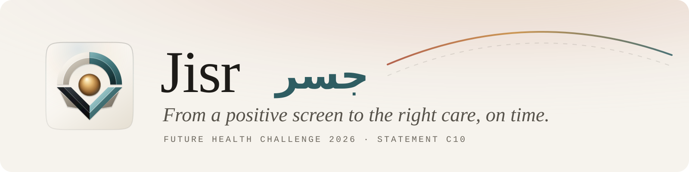

<br/>

**Screen → Safety check → Right step → Owned hand-off → Measured follow-up**

A stepped-care navigation platform that turns a positive anxiety or depression screen into a measured
hand-off to the right level of care: a fixed safety check before any AI, a rules-based step a clinician
confirms, a referral with an owner and a clock, and re-checks that show whether the person got better.

<br/>

[](https://hack2skill.com/event/futurehealthchallenge/)
[](#overview)
[](#privacy-and-safety)

[](https://nextjs.org/)
[](https://react.dev/)
[](https://www.typescriptlang.org/)
[](https://tailwindcss.com/)
[](https://fastapi.tiangolo.com/)
[](https://www.python.org/)
[](https://www.sqlalchemy.org/)
[](https://ai.google.dev/)

**[Live prototype](https://jisr.duckdns.org)** (Judge Mode passcode `jisr-demo`) · **[Demo video](https://youtu.be/_RJpj3JKOMw)** · **[Repository](https://github.com/mridulbansal4/Jisr)**

</div>

---

> **Deterministic engines decide, a clinician confirms, and the AI only drafts wording.**
> The crisis check runs before any AI on every answer and every typed message. No AI output can
> set a score, choose a care step or clear a crisis, and every AI sentence must point to a known fact.

> **Note on figures.** Every image in this README is a real screenshot of the running prototype
> ([`docs/assets/screens/`](docs/assets/screens)). All personas, providers and numbers are synthetic.
> Nothing here is real patient data.

---

## Table of contents

- [Overview](#overview) · [Why this is different](#why-this-is-different) · [The money shot](#the-money-shot)
- [Product walkthrough](#product-walkthrough) · [Interactive demo](#interactive-demo)
- [System architecture](#system-architecture) · [Repository structure](#repository-structure) · [The care pipeline](#the-care-pipeline)
- [Decision layer](#decision-layer) · [Algorithms](#algorithms) · [Privacy and safety](#privacy-and-safety)
- [Visual gallery](#visual-gallery) · [Technology stack](#technology-stack)
- [Installation](#installation) · [Running](#running) · [API contract](#api-contract)
- [Feature matrix](#feature-matrix) · [Performance](#performance) · [Design system](#ui-design-philosophy-and-design-system)
- [Data flow](#data-flow) · [State management](#state-management) · [Roadmap](#roadmap)
- [Team](#team) · [Acknowledgements](#acknowledgements) · [Citation](#citation) · [License](#license)

---

## Overview

Abu Dhabi screens more adults for anxiety and depression every year, and a population study found that
about one in six adults sampled scored moderate to severe on the PHQ-9 (`16.3%`). The Future Health
Digital Innovation Challenge statement C10 names the problem that follows: *"a continuing conversion gap
between a positive screen and timely specialist follow-up."* People who screen positive often do not
know where to go, whether their insurance covers it, or whether their employer will find out, so they wait.

Jisr (Arabic for "bridge") follows each person from a positive check-in to the right support, and
measures whether they got there:

- **Screen** with the validated PHQ-9 and GAD-7, or import an existing IFHAS result.
- **Check safety first** with fixed rules on every answer and message, in five written forms.
- **Match the least intensive safe step**, L0 (guided self-help) to L4 (specialist), and show why.
- **Own the hand-off**: a consented referral with a named owner, SLA clocks and automatic escalation.
- **Measure**: re-check every 14 days with reliable change scores, and report all seven C10 outcomes.

Built and validated over the week from 13 November 2026, on synthetic data, for a 90-day pilot.

---

## Why this is different

| | Typical screening app or chatbot | **Jisr** |
|---|---|---|
| Crisis handling | keyword warning, or left to the model | **fixed rules before any AI**, fail-closed, human acknowledgement within `15 min` |
| Who decides the care step | the model, or nobody | **versioned rules** suggest, **a clinician confirms** every step |
| Role of AI | answers and advises | **drafts wording only**, behind a claim checker with a template fallback |
| After the screen | a result and a phone number | **owned referral**, `48 h` clinic acceptance, re-matching, booking |
| Follow-up | none | re-check every `14 days`, **reliable change** drives step-up or step-down suggestions |
| Employer and insurer access | unclear | **no such login exists**; the person controls six revocable consent switches |
| Fairness | not measured | conversion by age, sex, nationality, language and region, **groups under 10 hidden** |
| Multilingual crisis detection | English only | English, Gulf Arabic, Arabizi, Urdu and Roman Urdu |

---

## The money shot

The single most important result: the crisis check is deterministic, fast, and caught every crisis
phrase in our benchmark, across five written forms, without one false alarm.

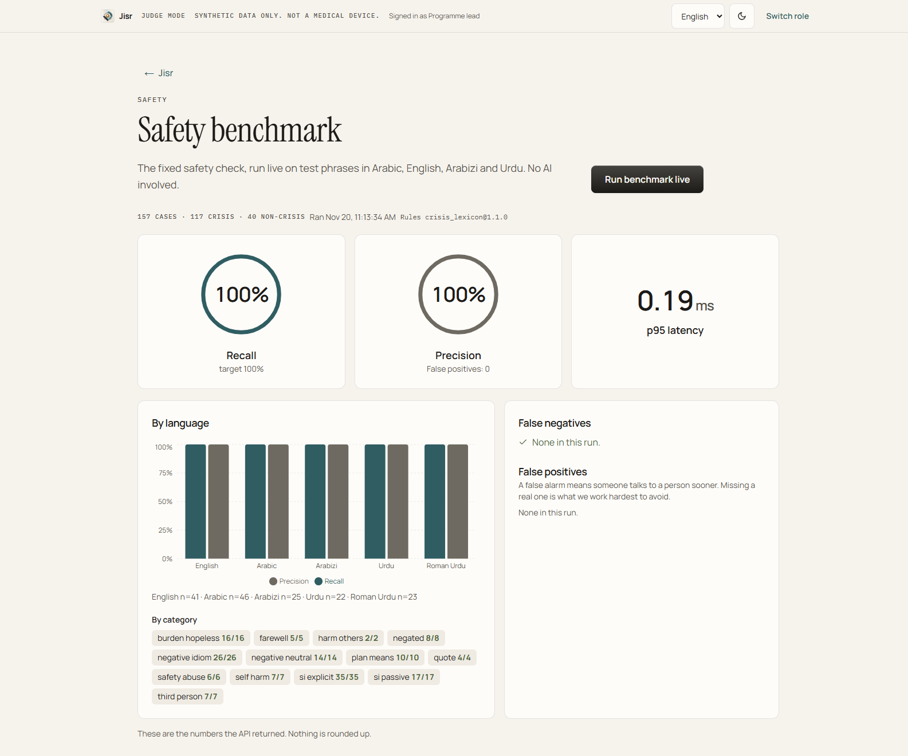

> **`157` cases · recall `117 / 117` · false alarms `0 / 40` · recall 95% lower bound `96.8%` ·
> p95 latency `0.091 ms` per message.** Team-written synthetic set (`crisis_lexicon@1.1.0`), not
> clinically validated. Source: [`EVAL.md`](EVAL.md).

**Why it matters.** A missed crisis phrase is the one error a mental-health product cannot make. Because
the check is rules, not a model, it runs in well under a millisecond, gives the same answer every time,
and can be audited line by line by a clinical lead.

---

## Product walkthrough

The prototype has three apps on one platform: the person app, the care console and the programme
dashboard, plus Judge Mode for reviewers. Every page is a real route under
[`apps/web/src/app/[locale]/`](apps/web/src/app/%5Blocale%5D), in English and Arabic (right-to-left).
Content is always labelled as **Observed**, **Calculated** or **AI-drafted**.

### 1 - Landing `/en`

The public front page: the problem in plain words, sourced numbers (`16.3%`, `1,930` trained family
physicians), the five-step flow and the safety principles.

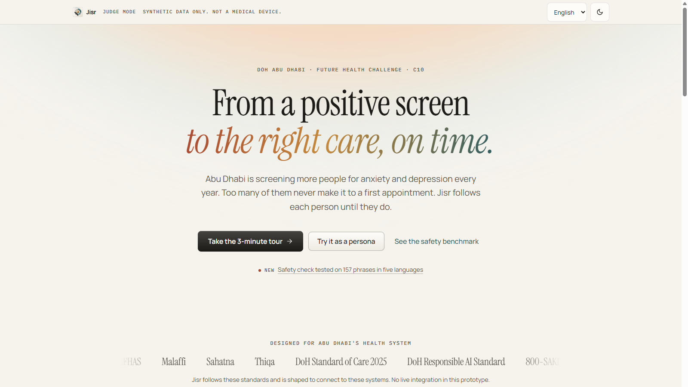

- **Implementation:** [`JudgeLanding.tsx`](apps/web/src/components/JudgeLanding.tsx), copy in
  [`messages/en.json`](apps/web/messages/en.json) and [`messages/ar.json`](apps/web/messages/ar.json).
- **Interaction:** switch English and Arabic from the top bar; the whole layout flips to right-to-left.

### 2 - Judge Mode `/en#personas`

Five synthetic people, one passcode. Each card signs the reviewer in with demo data, and "Reset demo"
returns everyone to the same starting state.

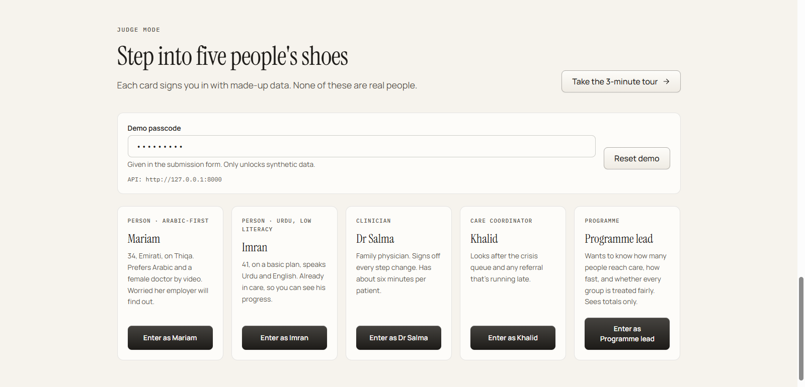

- **Implementation:** [`JudgeLanding.tsx`](apps/web/src/components/JudgeLanding.tsx) calls
  `POST /v1/auth/demo-login` and `POST /v1/demo/reset` through [`api.ts`](apps/web/src/lib/api.ts).
- **Interaction:** enter as Mariam, Imran, Khalid, Dr Salma or the Programme lead. A six-stop guided
  tour lives at `/en/tour`.

### 3 - Check-in `/en/me/screen`

The validated PHQ-9 and GAD-7, one question at a time, with large tap targets and an "I need help now"
button that is always visible.

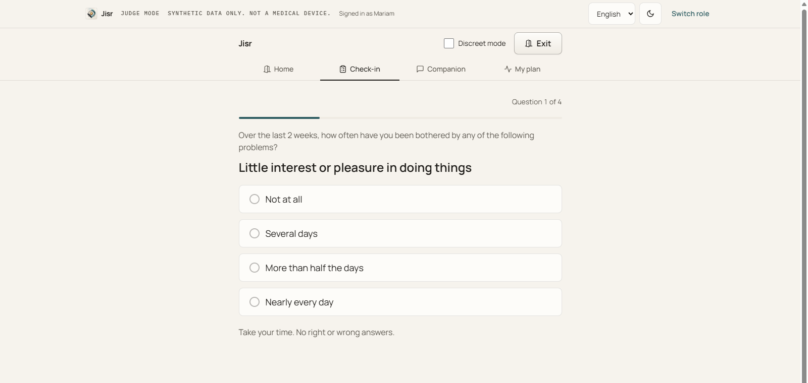

- **Implementation:** [`ScreeningFlow.tsx`](apps/web/src/components/person/ScreeningFlow.tsx); answers
  go to `POST /v1/screenings/{sid}/answers`, item text from
  [`instruments.v1.json`](packages/rules/instruments.v1.json).
- **Interaction:** every answer is checked by the crisis gate as it arrives, not only at the end.

### 4 - Result `/en/me/result`

Scores with their bands (here PHQ-9 `11 of 27` and GAD-7 `13 of 21`, both moderate), a standard
"what this means / what it doesn't mean" explanation, and an optional AI-drafted plain-language note.

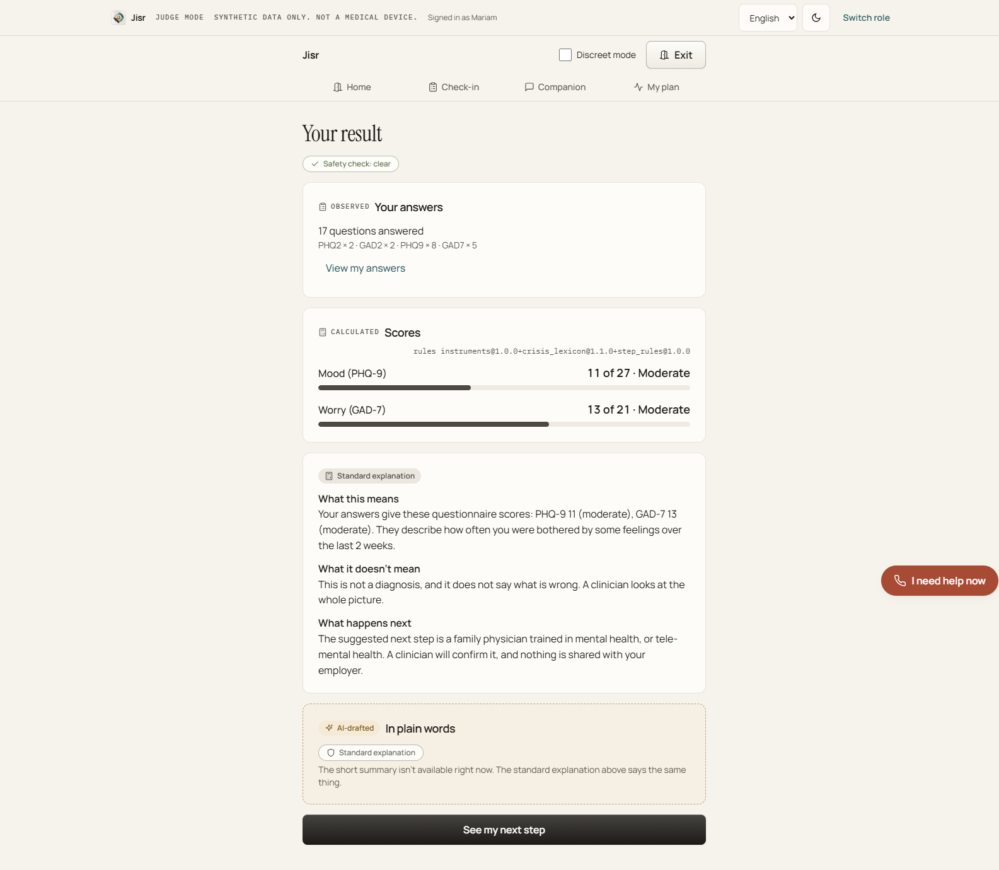

- **Implementation:** [`ResultView.tsx`](apps/web/src/components/person/ResultView.tsx); scoring in
  [`scoring.py`](services/api/app/engines/scoring.py); the AI note via `POST /v1/explain`.
- **Interaction:** the rules version used (`instruments@1.0.0+crisis_lexicon@1.1.0+step_rules@1.0.0`)
  is printed on the card, so any result can be traced to the exact rule set.

### 5 - Next step `/en/me/step`

The rules suggest the lightest safe step and show every factor with its weight and rule ID: severity,
language, clinician gender, how you meet, insurance network and availability.

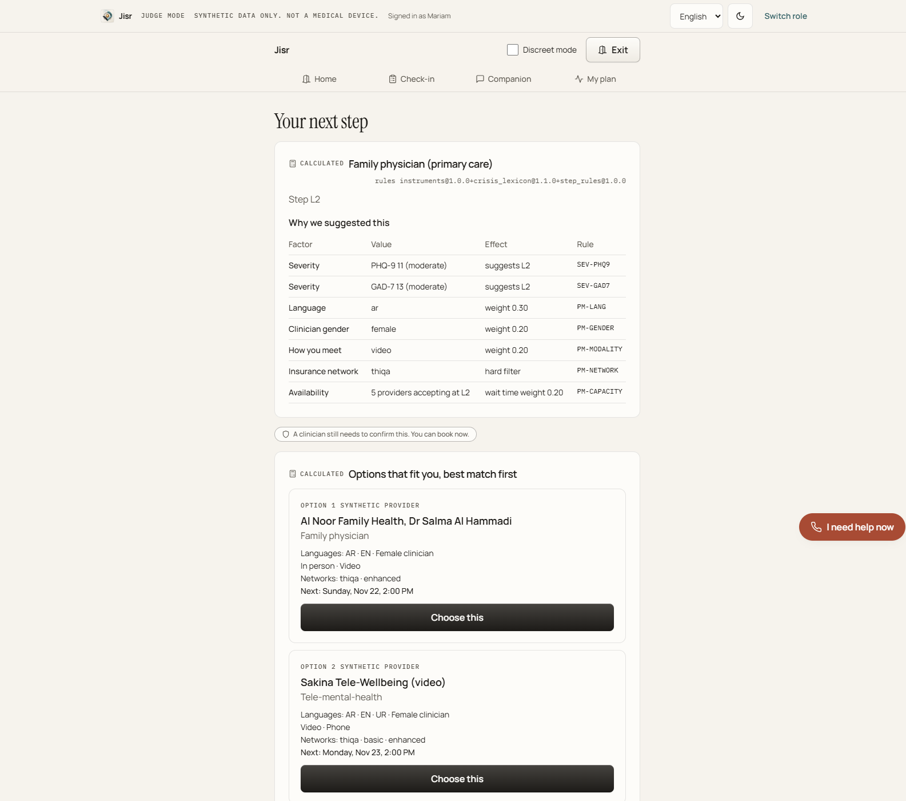

- **Implementation:** [`StepView.tsx`](apps/web/src/components/person/StepView.tsx);
  [`step_matcher.py`](services/api/app/engines/step_matcher.py) reads
  [`step_rules.v1.json`](packages/rules/step_rules.v1.json).
- **Interaction:** pick one of the ranked synthetic providers; a banner states that a clinician still
  confirms the step.

### 6 - Consent and booking `/en/me/book`

Six switches, each working immediately and revocable later. Booking takes three taps: choose the
provider, allow sharing with that clinician, send.

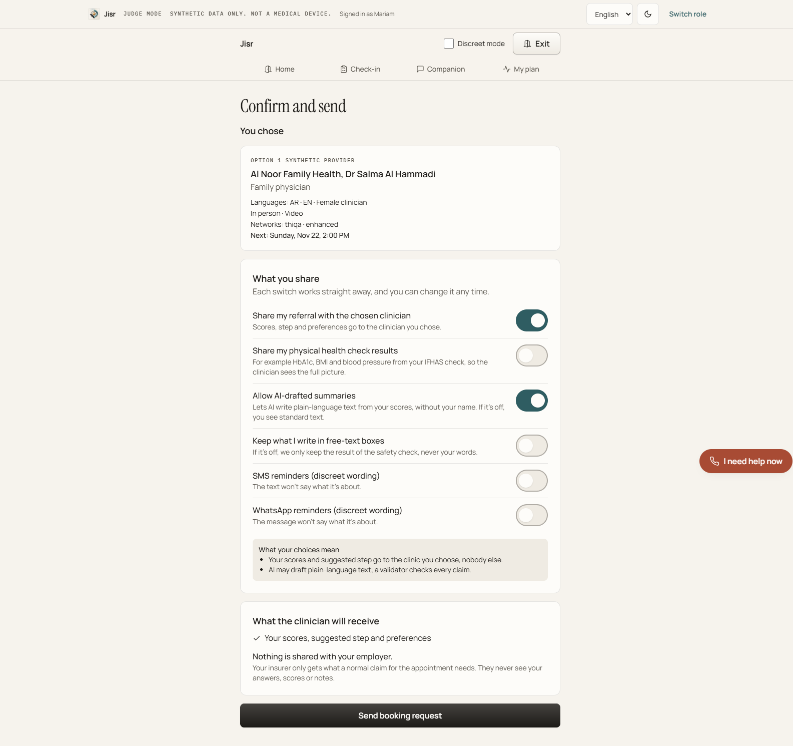

- **Implementation:** [`BookView.tsx`](apps/web/src/components/person/BookView.tsx); `PUT /v1/consents`
  and `POST /v1/episodes/{eid}/referrals`.
- **Interaction:** without the referral switch the request cannot be sent; the page states plainly that
  nothing is shared with the employer.

### 7 - My plan `/en/me/plan`

Where things stand, the next deadline, and an observed timeline of everything that has happened.

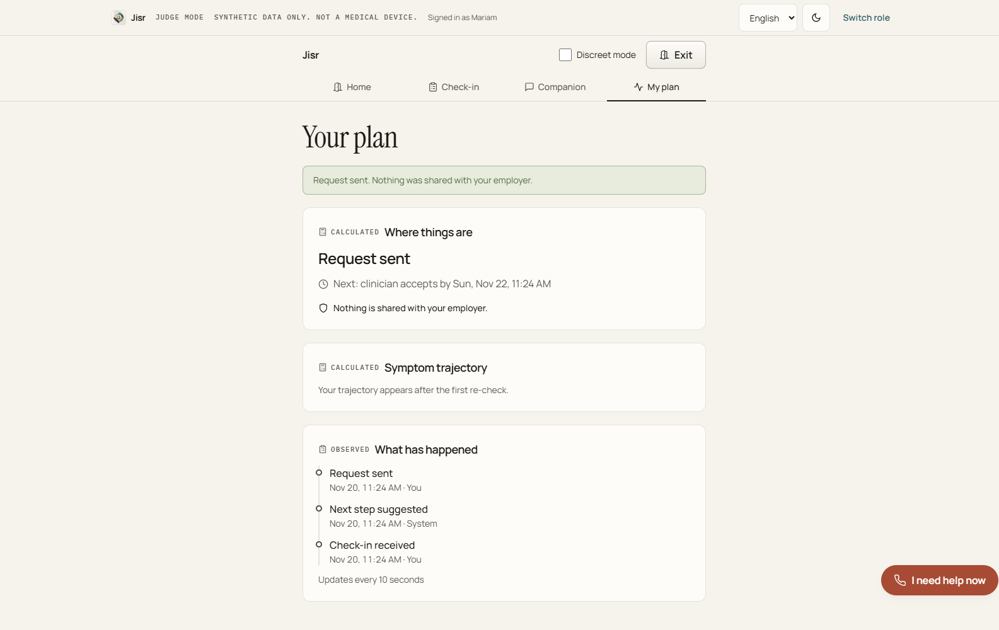

- **Implementation:** [`PlanView.tsx`](apps/web/src/components/person/PlanView.tsx),
  [`Timeline.tsx`](apps/web/src/components/Timeline.tsx); events from the append-only
  [`ledger.py`](services/api/app/ledger.py).
- **Interaction:** the page refreshes every 10 seconds as the clinic and coordinator act.

### 8 - Symptom trajectory `/en/me/plan` (Imran)

Re-check scores over time against the caseness lines, so the person and the clinician can see whether
things are actually improving.

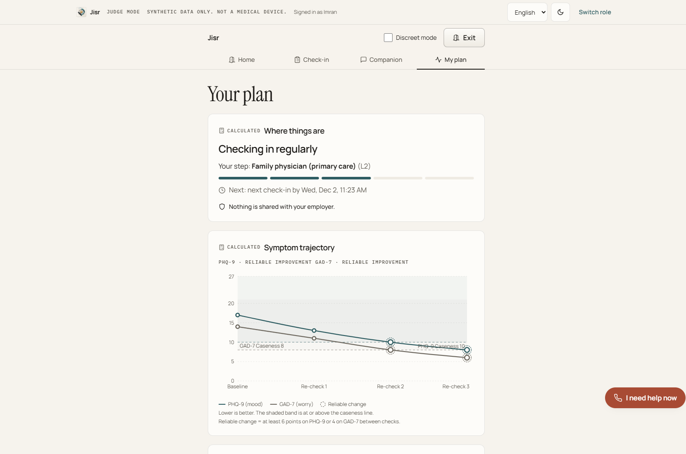

- **Implementation:** [`TrajectoryChart.tsx`](apps/web/src/components/charts/TrajectoryChart.tsx);
  `GET /v1/episodes/{eid}/trajectory`; classification in [`rci.py`](services/api/app/engines/rci.py).
- **Interaction:** compare each re-check with the caseness lines; a reliable change suggests a step up or down for the clinician.

### 9 - Companion with the crisis check `/en/me/companion`

A quiet chat space that cannot diagnose or give therapy. When Imran writes a crisis phrase in Roman
Urdu, the AI is paused, help numbers appear, and the care team is alerted.

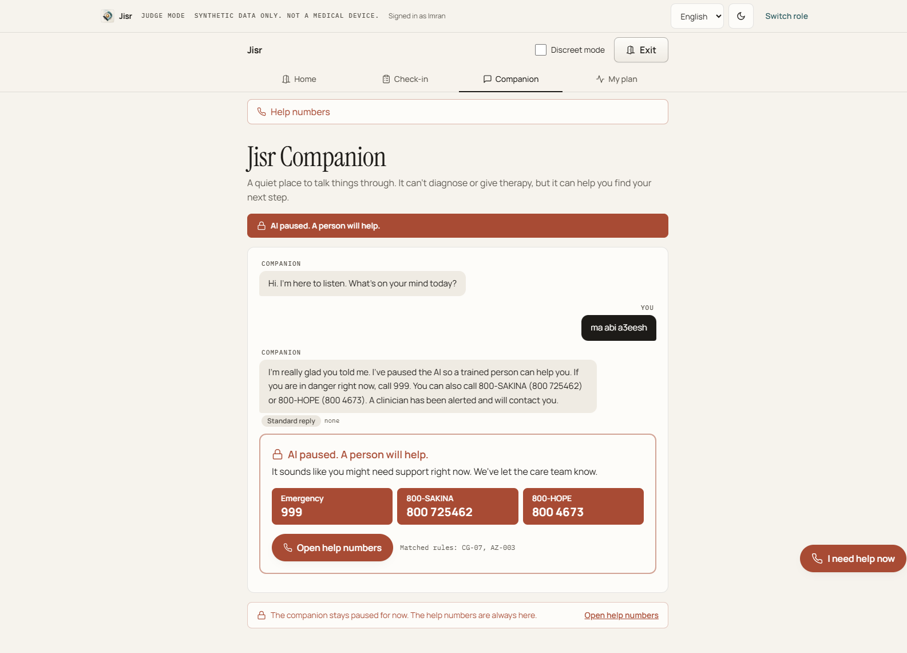

- **Implementation:** [`CompanionChat.tsx`](apps/web/src/components/person/CompanionChat.tsx);
  `POST /v1/companion/chat` runs [`crisis_gate.py`](services/api/app/engines/crisis_gate.py) before
  any model call.
- **Interaction:** the panel names the matched rules; the reply is a fixed standard text, not AI.

### 10 - Help numbers `/en/help`

999, 800-SAKINA (800 725462) and 800-HOPE (800 4673), with a copy button and confirmation that a
clinician has been alerted.

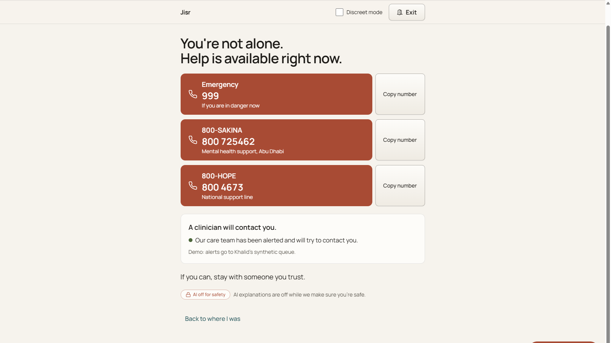

- **Implementation:** [`CrisisScreen.tsx`](apps/web/src/components/CrisisScreen.tsx); numbers from
  `crisis_lines_for()` in [`crisis_gate.py`](services/api/app/engines/crisis_gate.py).
- **Interaction:** reachable from every person page through "I need help now".

### 11 - Care queue `/en/staff` (Khalid)

RED cases are pinned on top with a live countdown to the `15-minute` acknowledgement deadline.

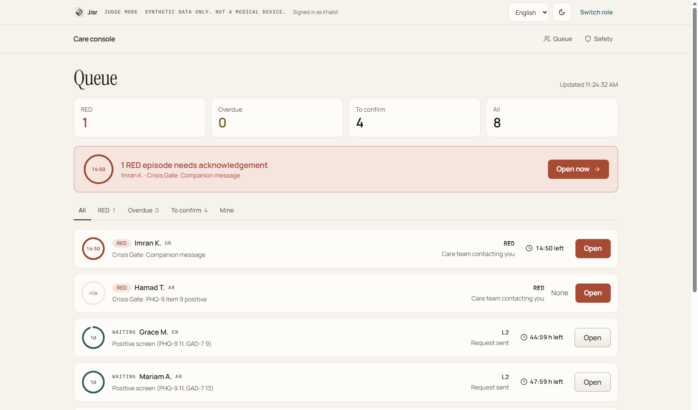

- **Implementation:** [`QueueView.tsx`](apps/web/src/components/staff/QueueView.tsx),
  [`SlaCountdown.tsx`](apps/web/src/components/staff/SlaCountdown.tsx); `GET /v1/staff/queue`.
- **Interaction:** "Open now" goes to the episode; acknowledging stops the clock and is logged.

### 12 - Clinician hand-off `/en/staff/episode/[id]` (Dr Salma)

An AI-drafted hand-off summary where every sentence carries fact tags (F1, F2, ...), a claim check
result, scores beside consented physical context, and the confirm-step control.

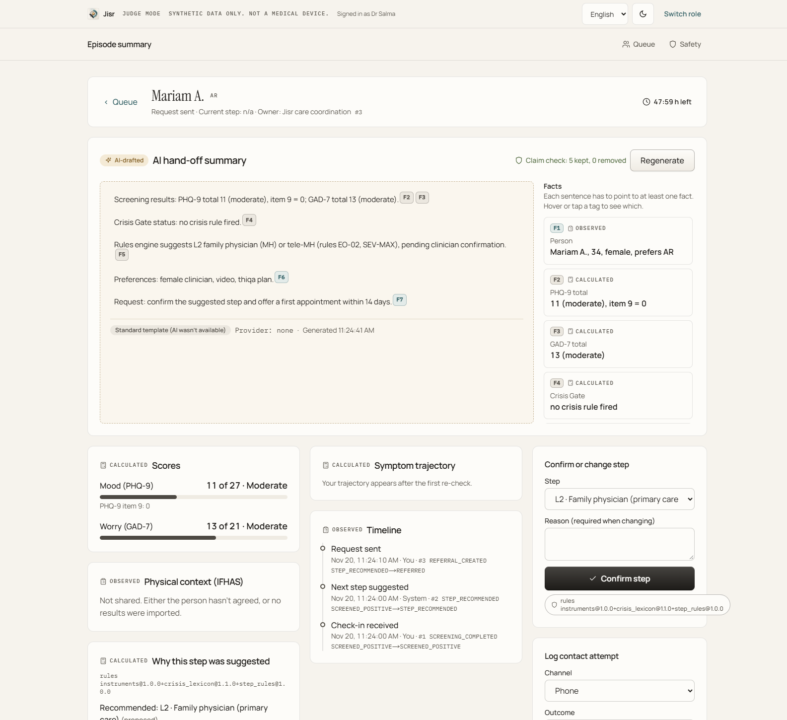

- **Implementation:** [`EpisodeConsole.tsx`](apps/web/src/components/staff/EpisodeConsole.tsx),
  [`HandoffSummary.tsx`](apps/web/src/components/staff/HandoffSummary.tsx);
  `POST /v1/episodes/{eid}/handoff-summary`, `POST /v1/episodes/{eid}/confirm-step`.
- **Interaction:** hover a tag to see its source fact; the step only changes when the clinician confirms.

### 13 - Programme dashboard `/en/programme`

Screens, conversion to care against the baseline, median days to care, crisis acknowledgement time,
the conversion funnel and drop-off reasons. Totals only, no individual is shown.

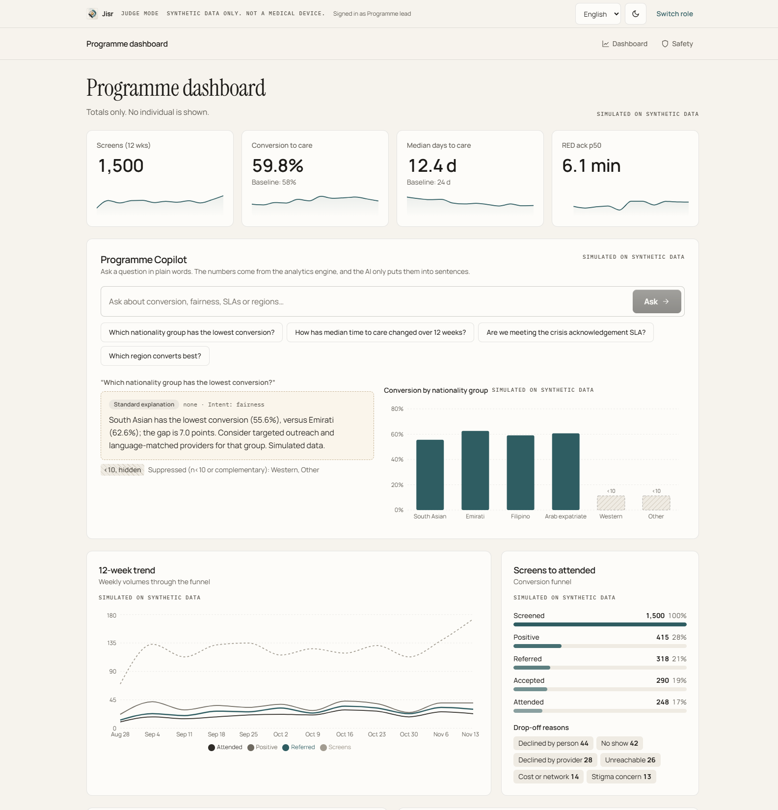

- **Implementation:** [`ProgrammeDashboard.tsx`](apps/web/src/components/programme/ProgrammeDashboard.tsx);
  `GET /v1/programme/metrics`, `/timeseries`, `/sla`, `/geo`.
- **Interaction:** every panel is labelled "simulated on synthetic data".

### 14 - Programme Copilot `/en/programme`

Ask a question in plain words. The analytics engine computes the numbers; Gemini only puts them into
sentences, and small groups stay hidden.

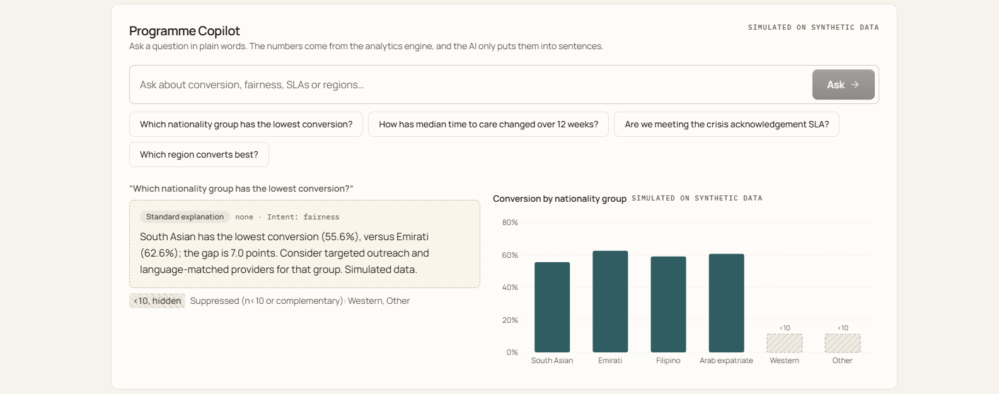

- **Implementation:** [`Copilot.tsx`](apps/web/src/components/programme/Copilot.tsx);
  `POST /v1/programme/ask`; prompt in [`programme_copilot.v1.md`](ai/prompts/programme_copilot.v1.md).
- **Interaction:** try "Which nationality group has the lowest conversion?"

### 15 - Fairness heatmap and regions `/en/programme`

Conversion, on-time follow-up and improvement by subgroup and region, with cells under 10 people
suppressed (and complementary cells hidden so they cannot be back-calculated).

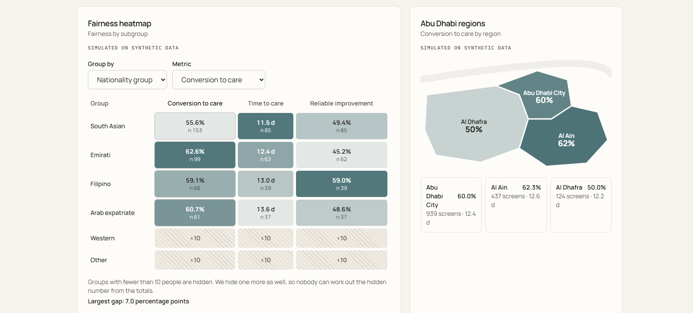

- **Implementation:** [`fairness.py`](services/api/app/engines/fairness.py) (`K = 10`, Wilson intervals);
  `GET /v1/programme/fairness`.
- **Interaction:** switch the grouping (nationality, language, age, sex) and the metric.

### 16 - Safety benchmark `/en/safety`

The crisis check run live against the full synthetic benchmark, with recall, precision, latency and a
breakdown by language and category. Shown above as [the money shot](#the-money-shot).

- **Implementation:** [`SafetyView.tsx`](apps/web/src/components/safety/SafetyView.tsx);
  `POST /v1/evals/crisis/run`; offline runner [`run_evals.py`](ai/evals/run_evals.py).
- **Interaction:** press "Run benchmark live"; the numbers are what the API returned, never rounded up.

---

## Interactive demo

A complete review session, the way a judge would run it:

```mermaid
flowchart LR
    A["Judge Mode<br/>passcode jisr-demo"] --> B["Mariam<br/>check-in"]
    B --> C["Result<br/>11 and 13, moderate"]
    C --> D["Next step<br/>L2, factors shown"]
    D --> E["Consent and<br/>book in 3 taps"]
    E --> F["Imran<br/>Companion crisis"]
    F --> G["Khalid<br/>15-min queue"]
    G --> H["Dr Salma<br/>sourced hand-off"]
    H --> I["Programme lead<br/>dashboard + Copilot"]
    I --> J["Safety<br/>benchmark"]
    style F fill:#F6E5DF,stroke:#9C4430,color:#1D1B18
    style H fill:#E3EBE9,stroke:#2F5D62,color:#1D1B18
    style J fill:#E3EBE9,stroke:#2F5D62,color:#1D1B18
```

1. **Open** [jisr.duckdns.org](https://jisr.duckdns.org), scroll to Judge Mode, enter the passcode `jisr-demo`.
2. **Enter as Mariam.** Take the check-in, read the result, open the next step, book in three taps.
3. **Enter as Imran.** In Companion, tap the demo phrase and watch the AI pause and the help numbers appear.
4. **Enter as Khalid.** Imran's RED case is on top with a live countdown; acknowledge it.
5. **Enter as Dr Salma.** Draft the hand-off summary, hover the fact tags, confirm the step.
6. **Enter as the Programme lead.** Read the outcomes, ask the Copilot a question, try the what-if simulator.
7. **Open** `/en/safety` and run the benchmark live.
8. **Press "Reset demo"** so the next reviewer starts from the same state.

> All data is synthetic and resettable. The person flow and the programme views read the same
> append-only episode ledger, so what Mariam does appears in Dr Salma's console and in the programme numbers.

---

## System architecture

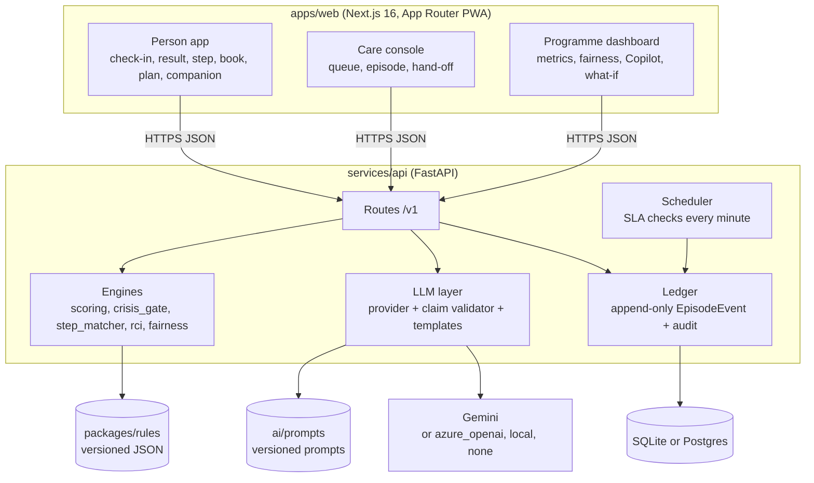

The crisis gate sits inside the engines and is called before the LLM layer on every screening
completion and every free-text input. The LLM layer can be switched to `none`, and every feature keeps
working with standard templates.

---

## Repository structure

```
Jisr/
├── README.md · CLAUDE.md · AGENTS.md · CHANGELOG.md · EVAL.md · Makefile
├── .github/
│   ├── workflows/            # ci.yml (api, web, rules) · evals.yml (crisis recall must be 100%)
│   │                         #   codeql.yml · dependency-review.yml · deploy.yml (manual)
│   ├── ISSUE_TEMPLATE/ · PULL_REQUEST_TEMPLATE.md · CODEOWNERS
│   └── CONTRIBUTING.md · CODE_OF_CONDUCT.md · SECURITY.md
│
├── apps/web/                 # Next.js 16 + React 19 + TypeScript + Tailwind 4 + next-intl
│   ├── messages/             #   en.json · ar.json (all UI copy, never inline)
│   └── src/
│       ├── app/[locale]/     #   routes: me/{screen,result,step,book,plan,companion} · help
│       │                     #     staff · staff/episode/[id] · programme · safety · tour
│       ├── components/       #   person/ · staff/ · programme/ · safety/ · charts/ · Logo.tsx
│       └── lib/              #   api.ts (only HTTP client) · session.ts · crisis.ts · sla.ts
│
├── services/api/             # FastAPI + SQLAlchemy, uv
│   ├── app/
│   │   ├── engines/          #   scoring.py · crisis_gate.py · normalise.py · step_matcher.py
│   │   │                     #     rci.py · fairness.py (pure, deterministic)
│   │   ├── llm/              #   provider.py · features.py · validator.py (claim checker)
│   │   ├── routes/           #   screening.py · episodes.py · people.py · programme.py
│   │   ├── ledger.py         #   append(), audit(), notify(): append-only events
│   │   ├── care.py · rules.py · seed.py · main.py (scheduler) · models.py
│   └── tests/                #   45 tests
│
├── packages/
│   ├── rules/                # instruments · crisis_lexicon · step_rules · sla (*.v1.json, cited)
│   └── contracts/openapi.yaml
├── ai/
│   ├── prompts/              # companion · handoff_summary · m01_explanation · programme_copilot (v1)
│   └── evals/                # run_evals.py · results/crisis_latest.json
├── data/synthetic/           # crisis_benchmark.v1.jsonl (157 cases)
├── deploy/                   # docker-compose.yml · compose.dev.yml · nginx/ · deploy.sh
└── docs/
    ├── 00-overview … 08-project/   # brief, product, design, engineering, AI, ops, security, business
    ├── MAP.md · README.md
    ├── assets/               # banner.svg · screens/ (16 screenshots)
    ├── jisr_logo/            # official logo set (mark, app icon, lockups, favicon)
    └── research/             # challenge research behind the idea
```

---

## The care pipeline

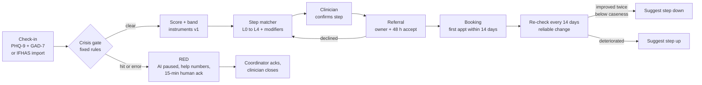

---

## Decision layer

Five deterministic engines make every decision. Each reads a versioned, cited rules file, returns its
reasons, and is covered by unit tests for every branch.

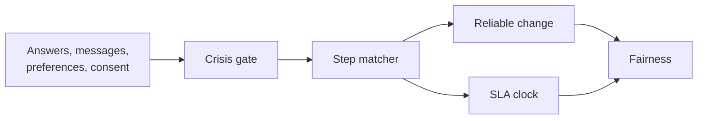

### Crisis gate: *"is this person safe right now?"*

Runs first, on every answer and every message. Any hit makes the episode RED. Errors also make it RED.
Nothing downstream, including the AI, can clear RED: a coordinator acknowledges, and only a clinician closes.

### Step matcher: *"what is the least intensive safe step?"*

The higher of the two instruments sets the level, modifiers can only move it up (capped at L4), and the
person's preferences rank providers within that level. The output is always a suggestion with
`requires_clinician_confirmation: true`.

### Reliable change: *"is this person actually improving?"*

Compares each re-check with the baseline, using the NHS Talking Therapies thresholds. A mixed result
counts as deterioration, so the system only ever errs towards more care.

### SLA clock: *"who owns this case, and by when?"*

Every open episode has a named owner and a deadline. A scheduler checks deadlines every minute and
escalates breaches.

### Fairness: *"who is falling behind?"*

Outcomes by subgroup with Wilson confidence intervals, small cells suppressed.

| Crisis signal | Severity band | Action |
|---|---|---|
| **Yes** (or gate error) | any | **RED**: AI paused, help numbers, human acknowledgement within 15 min |
| No | minimal or mild, no self-referral | no episode; explanation and optional re-check reminder |
| No | moderate (score 10 to 14) | **L2** suggested, clinician confirms |
| No | moderately severe or severe | **L3 / L4** suggested, clinician confirms |

---

## Algorithms

### Scoring ([`scoring.py`](services/api/app/engines/scoring.py))

PHQ-9 (0 to 27) and GAD-7 (0 to 21) summed from validated items. Out-of-range or non-integer input is
rejected (HTTP 422), never clamped; if a supplied total disagrees with the items, the recomputed total wins.
Bands: PHQ-9 `0-4` minimal, `5-9` mild, `10-14` moderate, `15-19` moderately severe, `20-27` severe;
GAD-7 `0-4`, `5-9`, `10-14`, `15-21`.

### Crisis gate ([`crisis_gate.py`](services/api/app/engines/crisis_gate.py), [`normalise.py`](services/api/app/engines/normalise.py))

Rules from [`step_rules.v1.json`](packages/rules/step_rules.v1.json) stage 1. Every matching rule fires and the highest severity wins:

| Rule | Condition | Severity |
|---|---|---|
| CG-00 | the gate errored, timed out or could not load its rules | review (fail-closed) |
| CG-01 | PHQ-9 item 9 ≥ 2 | high |
| CG-02 | PHQ-9 item 9 = 1 | same-day check |
| CG-03 | PHQ-9 started but item 9 unanswered | review |
| CG-06 / CG-07 | crisis lexicon hit in any free text | imminent / high |
| CG-08 | the optional AI second opinion raises risk | high (raise only) |

Free text is normalised (diacritics and invisible characters removed, script variants folded) and matched
against [`crisis_lexicon.v1.json`](packages/rules/crisis_lexicon.v1.json) `1.1.0`. Negation does not
suppress a match ("I am not going to..." still fires): recall comes first.
The AI second opinion is off by default and can only raise risk, never lower it.

### Step matching ([`step_matcher.py`](services/api/app/engines/step_matcher.py))

`level = max(level(PHQ-9), level(GAD-7))`, then modifiers: mild with functional impairment or physical
comorbidity becomes L2; GAD-7 ≥ 15 with complexity becomes L4. Providers pass hard filters (offers the
level, in the person's insurance network, accepting), then are scored:

```
score = 0.30 language + 0.20 clinician gender + 0.20 modality + 0.20 wait + 0.10 area
wait  = max(0, 1 - wait_days / 14)          tie-break: fewer wait days, then provider id
```

### Reliable change ([`rci.py`](services/api/app/engines/rci.py))

Thresholds PHQ-9 `6`, GAD-7 `4`. Deteriorated if any instrument rises by its threshold; improved if one
falls by its threshold and none deteriorates; mixed counts as deteriorated. A step-down is suggested only
when improved and below caseness (PHQ-9 < 10, GAD-7 < 8) at two consecutive re-checks.

### SLA clocks ([`sla.v1.json`](packages/rules/sla.v1.json))

| Clock | Default | Escalates to |
|---|---|---|
| RED acknowledgement | `15 min` | clinician on-call backup |
| Clinician step confirmation | `48 h` | coordinator |
| Clinic accepts referral | `48 h` | coordinator |
| First appointment | `14 days` from the positive screen | coordinator |
| Re-check | every `14 days` | reminder, then coordinator |

Lost to follow-up after three contact attempts within 14 days. Values can be overridden in `.env` and are
logged at startup.

### Claim checker ([`validator.py`](services/api/app/llm/validator.py))

Every AI draft is checked against the facts it was given. It is rejected if it contains a number or phone
number that is not in the facts, or a banned claim (diagnosis, cure or
guarantee, medication advice, "your employer will see", or telling someone they are safe or at risk).
A rejected draft is replaced by the standard template, so the feature never fails open.

### Fairness ([`fairness.py`](services/api/app/engines/fairness.py))

Rates with Wilson 95% intervals; any cell with `n < 10` is suppressed, plus a complementary cell where
needed so the hidden value cannot be derived from the totals.

---

## Privacy and safety

- **Synthetic data only** in this prototype. No real patient data anywhere in the repository.
- **Six revocable consent switches**: referral to the chosen clinician, physical health check results,
  AI-drafted summaries, keeping free text, SMS reminders and WhatsApp reminders (discreet wording).
- **No employer, insurer or family login** exists in the product.
- **Free text is not stored by default**; only the result of the safety check is kept.
- **Every read of an episode is audited**; logs carry IDs only, never free text or personal details.
- **Clinical rules are drafts** that need clinical lead sign-off before any non-synthetic use.

---

## Visual gallery

| | |
|---|---|
|  |  |
| **Check-in** · one validated question at a time | **Result** · Observed, Calculated and AI-drafted |
|  |  |
| **Companion** · AI paused on a Roman Urdu crisis phrase | **Help** · 999, 800-SAKINA, 800-HOPE |
|  |  |
| **Care queue** · RED pinned with a 15-minute clock | **Hand-off** · every sentence tagged to a fact |
|  |  |
| **Copilot** · engine numbers, AI wording | **Fairness** · small groups hidden |

---

## Technology stack

| Layer | Technology |
|---|---|
| **Web framework** | Next.js 16.4 (App Router) · React 19.3 · TypeScript 5.9 |
| **Styling and motion** | Tailwind CSS 4.3 · CSS custom-property design tokens · Motion 14 |
| **Languages** | next-intl 4 · English and Arabic (right-to-left) |
| **Charts** | Recharts 3 |
| **API** | FastAPI 0.164 · Pydantic models for every input and output · Python 3.12 · uv |
| **Data** | SQLAlchemy 2.1 · SQLite by default, Postgres 16 via `DATABASE_URL` |
| **Jobs** | APScheduler (SLA checks every minute) |
| **AI** | Gemini (`gemini-3.6-flash`) via google-genai, behind `LLMProvider`: `gemini` · `azure_openai` · `local` · `none` |
| **Interoperability** | FHIR R4 shapes: QuestionnaireResponse, ServiceRequest, Task, Consent, Provenance |
| **Quality** | pytest · ruff · mypy (strict on engines) · Vitest · ESLint |
| **CI** | GitHub Actions: CI, Evals (crisis recall gate), CodeQL, dependency review |
| **Deploy** | Docker Compose · nginx · Let's Encrypt |

---

## Installation

**Prerequisites:** Python 3.12, [uv](https://docs.astral.sh/uv/), Node.js 20 or later, pnpm, and
optionally Docker (for Postgres). No API key is needed: with `LLM_PROVIDER=none` every feature uses
standard templates and runs fully offline.

```bash
git clone https://github.com/mridulbansal4/Jisr.git && cd Jisr
cp .env.example .env                 # optional: add GEMINI_API_KEY, or set LLM_PROVIDER=none

# API (SQLite by default; tables are created and seeded with synthetic data on first start)
cd services/api && uv sync
uv run uvicorn app.main:app --reload --port 8000

# Web (in a second terminal)
cd apps/web && pnpm install && pnpm dev   # http://localhost:3000 → Judge Mode
```

Full setup, including Postgres: [ENVIRONMENT_SETUP](docs/03-engineering/ENVIRONMENT_SETUP.md).

---

## Running

| Command | Purpose |
|---|---|
| `make db` | Start local Postgres (`deploy/compose.dev.yml`), optional |
| `make api` | API on `:8000` with reload |
| `make web` | Web app on `:3000` |
| `make seed` | Reseed the synthetic data |
| `make test` | API tests (pytest) and web tests (Vitest) |
| `make lint` · `make types` | ruff and ESLint · mypy and `tsc` |
| `make evals` | Crisis benchmark; fails if recall is below 100%, writes `EVAL.md` |
| `cd apps/web && pnpm build` | Production build |

---

## API contract

The full contract is [`packages/contracts/openapi.yaml`](packages/contracts/openapi.yaml)
(see also [API_SPEC](docs/03-engineering/API_SPEC.md)). All routes live under `/v1`.

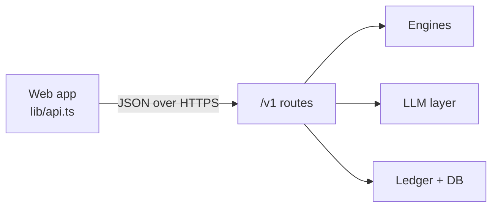

| Endpoint | Returns |
|---|---|
| `POST /v1/auth/demo-login` | Token for a Judge Mode persona |
| `POST /v1/screenings` · `/{sid}/answers` · `/{sid}/complete` | Screening session, gate result, scores, episode |
| `POST /v1/crisis/check` | Crisis gate decision for a piece of text |
| `GET /v1/episodes/{eid}/recommendation` | Suggested step, fired rules, factors, ranked providers |
| `POST /v1/episodes/{eid}/confirm-step` | Clinician confirmation (staff only) |
| `POST /v1/episodes/{eid}/referrals` · `POST /v1/referrals/{rid}/decision` | Referral and the clinic's accept or decline |
| `POST /v1/episodes/{eid}/recheck` · `GET /v1/episodes/{eid}/trajectory` | Re-check with reliable change, score history |
| `POST /v1/episodes/{eid}/red/ack` | RED acknowledgement, stops the 15-minute clock |
| `POST /v1/episodes/{eid}/handoff-summary` | AI-drafted, fact-tagged hand-off and claim check result |
| `POST /v1/companion/chat` · `POST /v1/explain` | Companion reply, plain-language explanation |
| `GET /v1/staff/queue` | Care queue with SLA status |
| `GET /v1/programme/metrics` · `/fairness` · `/geo` · `/timeseries` · `/sla` | Programme outcomes |
| `POST /v1/programme/ask` · `POST /v1/sim/run` | Copilot answer, what-if simulation |
| `GET /v1/fhir/export/{eid}` | FHIR R4 bundle for an episode |
| `POST /v1/evals/crisis/run` | Live crisis benchmark |
| `PUT /v1/consents` · `GET /v1/audit/me` | Consent switches, the person's own access log |

---

## Feature matrix

| Capability | Typical screening app or chatbot | **Jisr** |
|---|---|---|
| Validated instruments | sometimes | PHQ-9 and GAD-7, rules versioned and cited |
| Crisis detection | keywords or model | fixed rules, five written forms, fail-closed |
| Human crisis response | none | acknowledgement within 15 min, escalation |
| Step of care | none | L0 to L4, every factor shown, clinician confirms |
| Insurance network | ignored | hard filter, with an explicit out-of-network warning |
| Hand-off | phone number | owned referral, acceptance clock, re-matching |
| Follow-up | none | re-check every 14 days, reliable change |
| AI explanations | free-form | claim-checked, template fallback, works with AI off |
| Clinician summary | none | every sentence tagged to a source fact |
| Programme outcomes | none | all seven C10 outcomes |
| Fairness | none | by subgroup and region, small cells hidden |
| Audit | none | append-only ledger and per-read audit log |

---

## Performance

- **Crisis gate:** p95 `0.091 ms` per message in-process (budget `50 ms`), deterministic.
- **Tests:** `45` API tests and `26` web unit tests, all passing in CI on every push.
- **Benchmark gate:** CI fails if crisis recall drops below `100%` on the synthetic set.
- **Offline:** with `LLM_PROVIDER=none` the whole product runs without any network call to a model.
- **Determinism:** engines are pure functions of their inputs and the rules version; the same input and
  rules always give the same result, which is recorded in the ledger.

---

## UI design philosophy and design system

Calm, editorial and trustworthy: warm paper tones, a serif for headings, generous space, and no
alarm colours outside real alerts. Every number is labelled as Observed, Calculated or AI-drafted, and
the crisis screens stay quiet and clear.

Tokens live in [`globals.css`](apps/web/src/app/globals.css):

| Token group | Values (light theme) |
|---|---|
| **Surfaces** | background `#F6F3ED` · elevated `#FBF9F5` · surface `#FDFCF9` · muted `#EFEBE3` |
| **Text** | ink `#1D1B18` · muted `#57534B` · faint `#6C675E` |
| **Primary** | teal `#2F5D62` · soft `#E3EBE9` |
| **Status** | red `#9C4430` on `#F6E5DF` |
| **Accent (dawn)** | terracotta `#A84B34` → amber `#C58A3E` → teal `#2F5D62` |
| **Type** | Manrope (UI) · Instrument Serif (headings) · IBM Plex Sans Arabic · IBM Plex Mono (data) |

A dark theme mirrors every token. The logo set is in [`docs/jisr_logo/`](docs/jisr_logo).

---

## Data flow

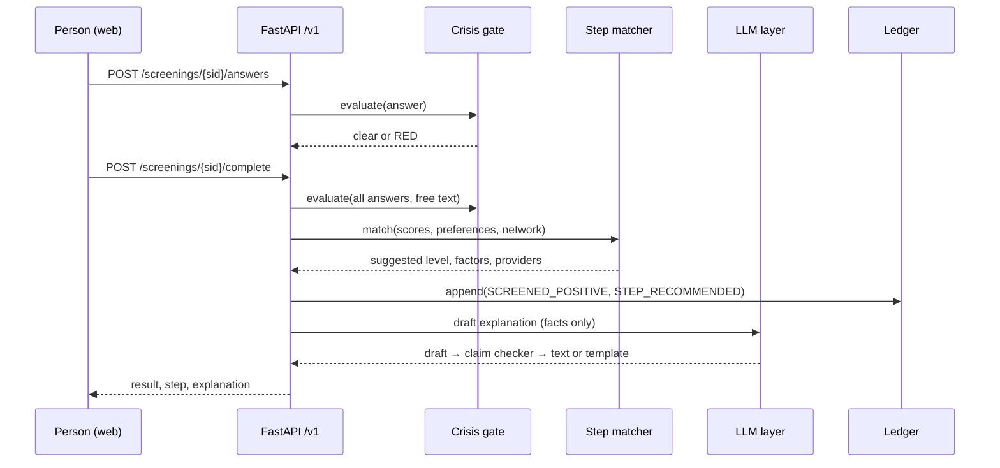

## State management

The episode is a state machine whose state is derived from an append-only list of `EpisodeEvent` rows,
never edited in place ([`ledger.py`](services/api/app/ledger.py)). On the web side there is no global
store: server components by default, a small tab-scoped session store in
[`session.ts`](apps/web/src/lib/session.ts) (sessionStorage only, cleared by "Exit"), and local
component state for forms and toggles. All HTTP goes through one client, [`api.ts`](apps/web/src/lib/api.ts).

---

## Roadmap

All planned, not built:

- **Phase 1, shadow pilot (days 0 to 60).** One primary care centre and one clinical lead; Jisr runs
  beside the current pathway and is measured against today, with clinical sign-off of every rule.
- **Phase 2, live pilot (days 60 to 90).** Real referrals at the pilot site; integration with Malaffi
  and IFHAS through FHIR R4.
- **Phase 3, scale.** UAE hosting with an in-country model, clinical validation of the crisis lexicon
  with native-speaker clinicians, and more instruments and languages.

---

## Team

- **Harshad Dhavane**, team lead: person app, care console, dashboard, Arabic right-to-left layout.
- **Srujan Satav**: FastAPI engines, episode ledger, step rules, clinical sources and validation.
- **Mridul Bansal**: crisis check, claim checker, benchmark, Gemini layer and evaluation.

---

## Acknowledgements

- **Department of Health Abu Dhabi** and the **Future Health Digital Innovation Challenge 2026**,
  statement C10 "Earlier, Safer Mental Wellbeing Support".
- **PHQ-9:** Kroenke, Spitzer and Williams (2001), DOI `10.1046/j.1525-1497.2001.016009606.x`.
- **GAD-7:** Spitzer, Kroenke, Williams and Löwe (2006), DOI `10.1001/archinte.166.10.1092`.
- **Stepped care and reliable change:** NICE CG123; NHS Talking Therapies manual.
- **DoH Standard of Care for Depression and Anxiety (2025)** for the primary care screening pathway.
- **Population Medicine**, Abu Dhabi adult depression and anxiety study (the `16.3%` figure).
- Helplines: 999, 800-SAKINA (800 725462), 800-HOPE (800 4673).

---

## Citation

```bibtex
@software{jisr2026,
  title  = {Jisr: Stepped-Care Navigation from a Positive Screen to the Right Care},
  author = {Dhavane, Harshad and Satav, Srujan and Bansal, Mridul},
  year   = {2026},
  note   = {Future Health Digital Innovation Challenge 2026, Statement C10},
  url    = {https://github.com/mridulbansal4/Jisr}
}
```

---

## License

No open-source licence has been chosen yet, so all rights are reserved by the authors. Jisr is a
prototype on synthetic data. It is not a medical device, does not diagnose and does not provide therapy.

<div align="center">
<br/>
<sub><b>Jisr · جسر</b> · From a positive screen to the right care, on time · Screen → Safety check → Right step → Owned hand-off → Measured follow-up</sub>
</div>
