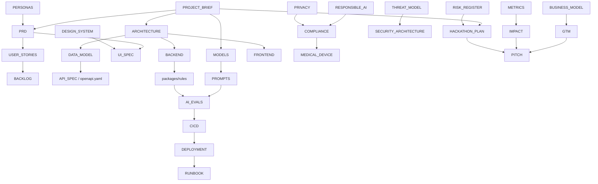

# MAP — Find anything in Jisr
> Project: Jisr · Owner: Product lead · Status: Draft v0.1 · Last updated: 2026-11-18
> Start here, then read [PROJECT_BRIEF](docs/00-overview/PROJECT_BRIEF.md) (the single source of truth).

## Directory tree
```
jisr/
├── README.md                 Front door: one-liner, quick start, docs index
├── MAP.md                    This file
├── CLAUDE.md                 Rules + commands for AI coding agents
├── AGENTS.md                 Pointer to CLAUDE.md for other agents
├── CONTRIBUTING.md           Branches, commits, PR template, definition of done
├── SECURITY.md               Vulnerability reporting; crisis-gate defects = Sev 1
├── CHANGELOG.md              Keep a Changelog
├── CODE_OF_CONDUCT.md        Contributor Covenant (short)
├── .env.example              Every env var, grouped, with comments + feature flags
├── docker-compose.yml        Local Postgres 16
├── EVAL.md                   (generated by ai/evals/run_evals.py — latest benchmark numbers)
├── .github/workflows/
│   ├── ci.yml                Web lint/type/test/build · API ruff/mypy/pytest · rule-file checks
│   ├── evals.yml             Crisis benchmark (fails if recall < 100%) · engine + LLM suites
│   ├── deploy.yml            CI + evals → Render (API) → Vercel (web) → smoke test
│   ├── codeql.yml            Static analysis (JS/TS, Python, Actions)
│   └── dependency-review.yml Blocks high/critical CVEs and GPL/AGPL deps
├── api/openapi.yaml          OpenAPI 3.1 for API-01…API-29
├── apps/web/                 Next.js 16 PWA: person app, staff console, programme dashboard, Judge Mode (to build)
├── services/api/             FastAPI: engines, routes, LLM provider + validator, jobs (to build)
├── packages/rules/           Versioned clinical rules (JSON) — the only place thresholds live
│   ├── instruments.v1.json   PHQ-2/9, GAD-2/7 items, scoring, bands, LOINC (AR/UR text to source)
│   ├── crisis_lexicon.v1.json AR/EN/Arabizi/UR crisis phrases + false-positive guards (DRAFT, needs clinical review)
│   ├── step_rules.v1.json    Crisis-gate rules, episode opening, L0–L4/RED, modifiers, RCI, matching
│   └── sla.v1.json           SLA defaults (env-overridable)
├── ai/
│   ├── prompts/              Versioned prompt files (to build from PROMPTS.md)
│   └── evals/README.md       How to run and extend the evals
├── data/synthetic/           Synthetic cohort, FHIR bundles, provider directory (to generate)
├── infra/ · scripts/ · tests/e2e/   IaC outline, helper scripts, Playwright tests (to build)
└── docs/
    ├── 00-overview/   PROJECT_BRIEF · VISION · PITCH · HACKATHON_PLAN
    ├── 01-product/    PRD · PERSONAS · USER_JOURNEYS · USER_STORIES · FEATURES · ROADMAP · METRICS · COMPETITIVE_ANALYSIS
    ├── 02-design/     DESIGN_SYSTEM · UI_SPEC · ACCESSIBILITY · LOCALIZATION
    ├── 03-engineering/ ARCHITECTURE · TECH_STACK · DATA_MODEL · API_SPEC · INTEGRATIONS · FRONTEND · BACKEND ·
    │                  CODING_STANDARDS · GIT_WORKFLOW · TESTING · PERFORMANCE · ENVIRONMENT_SETUP · MOBILE · adr/ADR-0000…0006
    ├── 04-ai/         MODELS · PROMPTS · AI_EVALS · DATA_PIPELINE · RESPONSIBLE_AI
    ├── 05-ops/        CICD · INFRASTRUCTURE · DEPLOYMENT · OBSERVABILITY · RUNBOOK · COST
    ├── 06-security-compliance/ SECURITY_ARCHITECTURE · THREAT_MODEL · PRIVACY · COMPLIANCE · RISK_REGISTER · MEDICAL_DEVICE
    ├── 07-business/   BUSINESS_MODEL · GTM · FINANCIALS · IMPACT
    ├── 08-project/    BACKLOG · TEAM · GLOSSARY
    └── assets/        Demo GIF, screenshots (placeholder)
```

## Where do I find…?
| Question | Doc |
|---|---|
| What are we building, and with what IDs? | [PROJECT_BRIEF](docs/00-overview/PROJECT_BRIEF.md) |
| What do we do in the next 36 hours, hour by hour? | [HACKATHON_PLAN](docs/00-overview/HACKATHON_PLAN.md) |
| What do I say on stage, and how do I click through the demo? | [PITCH](docs/00-overview/PITCH.md) |
| Which tickets are mine? | [BACKLOG](docs/08-project/BACKLOG.md) · [TEAM](docs/08-project/TEAM.md) |
| Exact requirements + acceptance criteria per feature | [PRD](docs/01-product/PRD.md) · [USER_STORIES](docs/01-product/USER_STORIES.md) |
| Who are the users (Mariam, Imran, Dr Salma, Khalid)? | [PERSONAS](docs/01-product/PERSONAS.md) · [USER_JOURNEYS](docs/01-product/USER_JOURNEYS.md) |
| What does each screen look like, and what does it say? | [UI_SPEC](docs/02-design/UI_SPEC.md) · [DESIGN_SYSTEM](docs/02-design/DESIGN_SYSTEM.md) |
| Arabic / Urdu / RTL handling | [LOCALIZATION](docs/02-design/LOCALIZATION.md) |
| How the system fits together | [ARCHITECTURE](docs/03-engineering/ARCHITECTURE.md) |
| Tables and fields | [DATA_MODEL](docs/03-engineering/DATA_MODEL.md) |
| Endpoints and JSON | [API_SPEC](docs/03-engineering/API_SPEC.md) · [openapi.yaml](api/openapi.yaml) |
| Crisis Gate, step matcher, RCI, SLA engines | [BACKEND](docs/03-engineering/BACKEND.md) · [step_rules.v1.json](packages/rules/step_rules.v1.json) |
| How to set up my machine | [ENVIRONMENT_SETUP](docs/03-engineering/ENVIRONMENT_SETUP.md) |
| Prompts and the claim validator | [PROMPTS](docs/04-ai/PROMPTS.md) |
| How we prove safety (benchmarks, thresholds) | [AI_EVALS](docs/04-ai/AI_EVALS.md) · `EVAL.md` |
| Where synthetic data comes from, and licences | [DATA_PIPELINE](docs/04-ai/DATA_PIPELINE.md) |
| Fairness, human oversight, DoH RAI alignment | [RESPONSIBLE_AI](docs/04-ai/RESPONSIBLE_AI.md) |
| How to deploy the live demo | [DEPLOYMENT](docs/05-ops/DEPLOYMENT.md) · [CICD](docs/05-ops/CICD.md) |
| What to do if the demo breaks | [RUNBOOK](docs/05-ops/RUNBOOK.md) |
| What it costs (AED) | [COST](docs/05-ops/COST.md) |
| Laws, consent text, threat model, SaMD position | [COMPLIANCE](docs/06-security-compliance/COMPLIANCE.md) · [PRIVACY](docs/06-security-compliance/PRIVACY.md) · [THREAT_MODEL](docs/06-security-compliance/THREAT_MODEL.md) · [MEDICAL_DEVICE](docs/06-security-compliance/MEDICAL_DEVICE.md) |
| Risks and mitigations | [RISK_REGISTER](docs/06-security-compliance/RISK_REGISTER.md) |
| Who pays, pilot path, impact | [BUSINESS_MODEL](docs/07-business/BUSINESS_MODEL.md) · [GTM](docs/07-business/GTM.md) · [IMPACT](docs/07-business/IMPACT.md) |
| Why we chose X over Y | [adr/](docs/03-engineering/adr/) |
| What does IFHAS / Thiqa / RCI mean? | [GLOSSARY](docs/08-project/GLOSSARY.md) |
| The original challenge text | `../../research/00-source/statement-C10.md` |

## Doc dependency graph


## Reading orders
| Reader | Order |
|---|---|
| **New developer** | README → PROJECT_BRIEF → ARCHITECTURE → BACKEND or FRONTEND → DATA_MODEL → API_SPEC → ENVIRONMENT_SETUP → BACKLOG (your tickets) → TESTING |
| **Judge / evaluator** | README → PITCH (30-second explainer) → `EVAL.md` → RESPONSIBLE_AI → ARCHITECTURE → PRIVACY → MEDICAL_DEVICE → GTM (pilot ask) |
| **Designer** | PROJECT_BRIEF §3, §14 → PERSONAS → USER_JOURNEYS → DESIGN_SYSTEM → UI_SPEC → ACCESSIBILITY → LOCALIZATION |
| **AI coding agent** | CLAUDE.md → PROJECT_BRIEF → ARCHITECTURE → BACKEND / FRONTEND → `packages/rules/*.json` → API_SPEC + openapi.yaml → PROMPTS → AI_EVALS → BACKLOG |
| **Pitch lead** | PITCH → HACKATHON_PLAN §6 (submission checklist) → COMPETITIVE_ANALYSIS → IMPACT → GTM → FINANCIALS |
