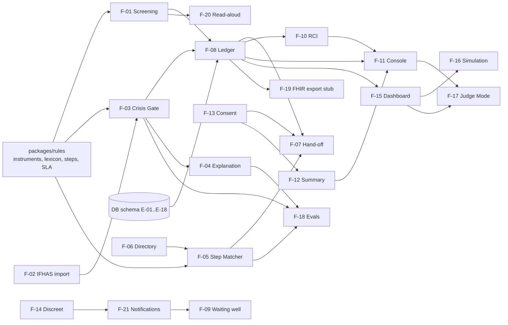

# Features
> Project: Jisr · Owner: Product lead · Status: Draft v0.1 · Last updated: 2026-11-18
> Related: [Project brief](../00-overview/PROJECT_BRIEF.md) · [PRD](PRD.md) · [User stories](USER_STORIES.md) · [Backlog](../08-project/BACKLOG.md) · [Team](../08-project/TEAM.md) · [`.env.example`](../../.env.example)

Feature IDs, names, MoSCoW and MVP status are copied from the brief (§5). Owner roles are defined in [TEAM.md](../08-project/TEAM.md): **PL** Product lead · **BE** Backend & rules engineer (tech lead) · **FE** Frontend engineer · **AI** AI & evals engineer. In a 2-person team, BE also owns AI and PL also owns FE (see TEAM.md).

## 1. Feature matrix
| ID | Feature | Description | Persona | MoSCoW | MVP? | Depends on | Owner | Stories |
|---|---|---|---|---|---|---|---|---|
| F-01 | Screening flow | PHQ-2/GAD-2 → PHQ-9/GAD-7 in AR / EN / UR | P-01, P-02 | Must | Yes | F-08 (episode creation), rules | FE (UI), BE (scoring) | US-01 – US-03, US-05 |
| F-02 | IFHAS import | FHIR `QuestionnaireResponse` bundle import (API-19) | P-01 | Should | Yes (seeded import) | F-01 scoring, F-03 | BE | US-04 |
| F-03 | **Crisis Gate** | Deterministic: item 9 > 0, C-SSRS screener items, AR/EN/Arabizi/UR lexicon; runs before any LLM | All persons, P-04 | Must | Yes | Rules, F-08 | BE (engine), AI (lexicon + benchmark) | US-06 – US-11 |
| F-04 | Result explanation | Templates + LLM narration behind a claim validator | P-01, P-02 | Must | Yes | M-01, M-03, F-03 (lock) | AI | US-12, US-13 |
| F-05 | **Step Matcher** | L0–L4 with transparent factors | P-01, P-02, P-03 | Must | Yes | F-01, F-06, rules | BE | US-14 – US-17 |
| F-06 | Provider directory | Synthetic, tagged by network / language / gender / modality / capacity / wait | P-01, P-02 | Must | Yes | Seed data | BE | US-15 – US-17 |
| F-07 | **Warm hand-off** | Referral packet, booking request, acceptance, SLA, escalation, re-match | P-01, P-02, P-04 | Must | Yes | F-05, F-08, F-13 | BE (API), FE (UI) | US-18 – US-21 |
| F-08 | **Episode Ledger** | State machine + append-only event log + SLA timers | All | Must | Yes | DB schema | BE | US-23, US-24 |
| F-09 | Waiting-well bridge | 3 low-intensity modules + scheduled re-check | P-01, P-02 | Should | Yes (3 modules) | F-08, F-21 | PL (content), FE | US-25, US-26 |
| F-10 | Measurement-based care | RCI → step-up/down suggestions; clinician confirms | P-03 | Must | Yes | F-01, F-08, F-11 | BE | US-27, US-28 |
| F-11 | Clinician console | Queue, RED episodes, confirm step, one-screen summary | P-03, P-04 | Must | Yes | F-08, F-03 | FE | US-10, US-29 – US-31 |
| F-12 | Coordinated care summary | IFHAS physical findings + MH episode, with consent | P-03 | Should | Yes | F-13, seed E-16 | FE, BE | US-30 |
| F-13 | Consent centre | Granular, revocable, immediate effect | P-01, P-02 | Must | Yes | E-02, AuditLog | BE (enforcement), FE (UI) | US-32, US-34 |
| F-14 | Discreet mode | Neutral notifications, quick exit, no badges | P-01, P-02 | Should | Yes | F-21 | FE | US-33, US-22 |
| F-15 | Programme dashboard | Funnel, time-to-care, follow-up, RCI, crisis response, drop-off, fairness (k < 10) | P-05 | Must | Yes | F-08 events, seed cohort | FE (UI), BE (API-16/17) | US-35, US-36 |
| F-16 | Simulation engine | Baseline vs Jisr on the synthetic cohort | P-05 | Should | Yes | Seed cohort, F-05 rules | AI | US-37 |
| F-17 | **Judge Mode** | Role switcher, seeded personas, guided 3-minute tour | Judges | Must | Yes | All demo features | PL (script), FE | US-38 |
| F-18 | Eval harness | Crisis benchmark, step-matcher cases, validator tests → `EVAL.md` | Judges, team | Must | Yes | F-03, F-05, F-04 | AI | US-39 |
| F-19 | Sahatna launch adapter + FHIR export | Deep link + SMART-style launch stub; API-20 | Partners | Could | Stub | F-08 | BE | US-40 |
| F-20 | Read-aloud | Browser TTS for low literacy | P-02 | Could | If time | F-01 | FE | US-03 |
| F-21 | Notification channels | In-app, SMS mock, WhatsApp mock | P-01, P-02, P-04 | Should | In-app + SMS mock | F-13 (reminder consent), F-14 | BE | US-22, US-26 |

## 2. Dependency graph (build order)

**Critical path for the demo north star:** rules → F-03 → F-08 → F-01 → F-05/F-06 → F-07 → F-11 → F-15 → F-17. F-18 runs in parallel from hour 4.

## 3. Feature flags
Flags are environment variables. Names that already exist in [`.env.example`](../../.env.example) are canonical; new flags proposed here must be added there by the BE owner before use (owner: BE, by 2026-11-18 H4).

| Flag | Values (default) | Controls | In `.env.example`? |
|---|---|---|---|
| `DEMO_MODE` / `NEXT_PUBLIC_DEMO_MODE` | `true` | F-17 Judge Mode login (API-22), seeded personas. **Must be false in production** | Yes |
| `LLM_PROVIDER` | `gemini` \| `azure_openai` \| `local` \| `none` (`gemini`) | M-01/M-02 backend; `none` = templates only (M-03) | Yes |
| `GEMINI_MODEL` | `gemini-3.6-flash` | Model id (pinned; prices double 1 Jan 2027) | Yes |
| `LLM_TIMEOUT_SECONDS` | `6` | F-04 timeout before template fallback | Yes |
| `LLM_CRISIS_SECOND_OPINION` | `false` | M-02 raise-only classifier in F-03 | Yes |
| `NOTIFY_CHANNELS` | `inapp,sms_mock` | F-21 channels (`whatsapp_mock` optional) | Yes |
| `CRISIS_LINES` | `999,800725462,8004673` | Numbers shown by F-03 | Yes |
| `SLA_RED_MINUTES` | `15` | RED SLA (F-03, F-08) | Yes |
| `SLA_REFERRAL_ACCEPT_HOURS` | `48` | Provider acceptance SLA (F-07) | Yes |
| `SLA_FIRST_APPOINTMENT_DAYS` | `14` | Time-to-care target (F-07, F-15) | Yes |
| `RECHECK_DAYS` | `14` | Re-check interval (F-09, F-10) | Yes |
| `SMALL_CELL_K` | `10` | Fairness suppression (F-15) | Yes |
| `FF_READ_ALOUD` | `false` | F-20 browser TTS button | Proposed |
| `FF_CSSRS_ITEMS` | `false` until licence check passes (A-03) | C-SSRS screener items in F-03 | Proposed |
| `FF_PHYSICAL_CONTEXT` | `true` | F-12 section in the summary | Proposed |
| `FF_SIMULATION` | `true` | F-16 panel and API-21 | Proposed |
| `FF_SAHATNA_LAUNCH` | `false` | F-19 launch stub route | Proposed |

## 4. Real vs mocked (MVP)
| Feature | Real in MVP | Mocked / synthetic in MVP | v1 change |
|---|---|---|---|
| F-01, F-03, F-05, F-08, F-10 | Engines and rules are real | Instrument translations not native-reviewed | Native clinical review |
| F-02 | Import code is real | Bundle is synthetic | IFHAS feed via Malaffi/portal under DoH approval |
| F-06 | Matching is real | Providers are synthetic | DoH facility registry / IHE mCSD |
| F-07 | Workflow is real | Provider actions are clicked in Judge Mode | Provider portal / Malaffi REF |
| F-21 | Abstraction is real | SMS / WhatsApp are mock inboxes | Licensed UAE provider |
| F-16 | Model is real | All parameters are assumptions | Calibrated on pilot data |
| F-19 | Export is real | Sahatna launch is a stub | Sahatna module |

## Addendum (2026-11-18)
| ID | Feature | Persona | MoSCoW | MVP? | Depends on | Owner |
|---|---|---|---|---|---|---|
| F-22 | Optional free-text box, crisis-gated; raw text stored only with consent | P-01, P-02 | Must | Yes | F-03, F-13 | BE + FE |
