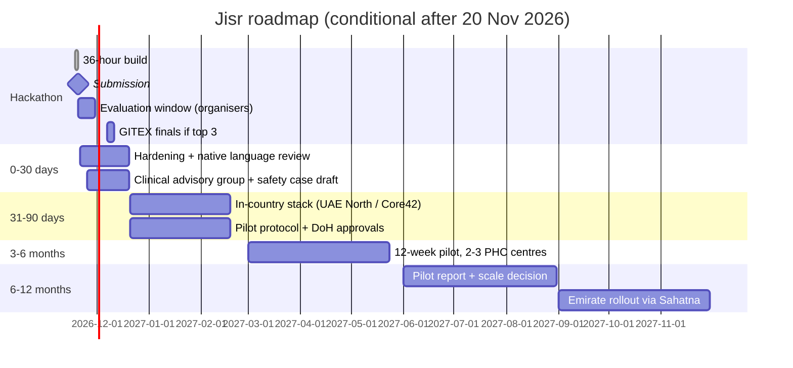

# Roadmap
> Project: Jisr · Owner: Product lead · Status: Draft v0.1 · Last updated: 2026-11-18
> Related: [Project brief](../00-overview/PROJECT_BRIEF.md) · [PRD](PRD.md) · [Features](FEATURES.md) · [Hackathon plan](../00-overview/HACKATHON_PLAN.md) · [GTM](../07-business/GTM.md) · [Compliance](../06-security-compliance/COMPLIANCE.md)

Dates after the hackathon are **plans, not commitments**: each depends on the outcome of judging and on a DoH / ADPHC partner. Every pilot statement is conditional.

## Timeline at a glance

## 1. Hackathon (18–20 Nov 2026) — MVP
**Goal:** a live, judge-testable prototype of the full loop on synthetic data, plus technical docs, assumptions/dependencies/limitations and a demo video (deliverables per brief §13).
- All MVP features in [FEATURES.md](FEATURES.md); F-19 stub; F-20 if time.
- `EVAL.md`: crisis recall 100% on the adversarial benchmark; 0 unsupported claims in validated LLM output.
- Exit criteria: [PRD release criteria](PRD.md#11-release-criteria-mvp-submission-20-nov-2026).

**Between submission and results (20–30 Nov):** keep the live link stable (R-08); no breaking deploys; monitor uptime daily (owner: BE).

**If finalist (GITEX, 7–11 Dec 2026):** pitch with a concrete pilot ask (cohort, sites, 12-week KPIs, what DoH must provide); bring a one-page pilot protocol and a draft letter of intent template (owner: PL, by 2026-12-05).

## 2. Next 30 days (to ~20 Dec 2026)
| Milestone | Detail | Owner |
|---|---|---|
| Native language review | Arabic (Emirati-dialect awareness) and Urdu review of every string, explanation template and crisis lexicon entry (R-04) | PL + contracted native clinical reviewers |
| Clinical advisory group | Recruit ≥ 1 psychiatrist, 1 psychologist, 1 family physician (Abu Dhabi licensed) to own the rule file and SLAs (A-04, A-05) | PL |
| Instrument licensing | Confirm C-SSRS terms (A-03, R-05); confirm validated Arabic and Urdu versions of PHQ-9/GAD-7 to use | AI |
| Safety case v0 | Hazard log for the Crisis Gate and Step Matcher; benchmark expanded with clinician-written cases | AI + clinical group |
| Regulatory triage | Determine whether Jisr is software as a medical device under UAE rules and which authority classifies it (regulator to confirm: MoHAP / Emirates Drug Establishment — **unverified**) (R-10) | PL |

## 3. 31–90 days (to ~Feb 2027)
| Milestone | Detail | Owner |
|---|---|---|
| In-country hosting | Migrate to Azure UAE North or Core42; LLM to in-country endpoint (Azure OpenAI UAE North or self-hosted Jais) or `LLM_PROVIDER=none` (Federal Law 2/2019 Art. 13, R-03) | BE |
| Security baseline | ADHICS gap assessment; pen test; encryption at rest with managed keys | BE |
| Identity | UAE PASS relying-party onboarding (citizens); facility SSO (staff) | BE |
| Integrations design sign-off | Malaffi HL7 v2 REF adapter (Circular 144/2026); Sahatna module path (Circular 170/2026); IFHAS result feed | BE + DoH integration team |
| Pilot protocol | Cohort, sites, consent text, outcome measures (METRICS.md), DECIDE-AI style reporting plan (https://www.nature.com/articles/s41591-022-01772-9), ethics approval route | PL + clinical group |
| Directory | Real provider directory for pilot sites, with capacity feeds or weekly manual updates | PL |

## 4. 3–6 months (Mar–May 2027) — pilot
**Proposed pilot (conditional on a partner):** 12 weeks; IFHAS positive mental-health screens at 2–3 PHC centres (site operator to be agreed; SEHA PHC centres were suggested in `ideas.md` as a hunch, not a contact); providers in Thiqa and at least one expat plan network.

Pilot KPIs (definitions in [METRICS.md](METRICS.md)): successful hand-off rate; follow-up within timeframe; median waiting time; reliable improvement (RCI); crisis-response completion within 15 minutes; adverse events; every KPI by age, gender, nationality, language and geography with suppression. Targets agreed with ADPHC at kick-off against a pre-pilot baseline measured at the same sites (owner: PL, at pilot kick-off).

What DoH / ADPHC must provide: data-sharing approval for IFHAS results, named family physicians and an on-call rota, Sahatna integration slot, access to Malaffi test environment.

## 5. 6–12 months (Jun–Nov 2027)
- Pilot report (published, including failures and fairness gaps) and scale decision with ADPHC.
- Rollout path: all IFHAS sites → all PHC centres via the Sahatna module → other emirates' screening programmes.
- v2 features: perinatal depression pathway (same episode engine), opt-in wearable sleep signal as a re-check prompt (never inference of risk), capacity forecasting for planners, more languages (Hindi, Malayalam, Tagalog considered in `ideas.md`).
- Certification roadmap: ADHICS compliance audit; ISO 27001 and ISO/IEC 42001 considered (owner: BE, decision by 2027-06-30).

## 6. Partnerships (targets, none confirmed)
| Partner type | Why | Status |
|---|---|---|
| DoH Abu Dhabi / ADPHC screening programme | Buyer and pilot owner | Not contacted |
| PHC operator (e.g. SEHA) | Sites, family physicians | Not contacted (hunch) |
| Crisis lines (800-SAKINA, 800-HOPE) | Warm-transfer protocol | Not contacted |
| Insurers (Daman for Thiqa; expat plan insurers) | Network data only, never individual results | Not contacted |
| Microsoft / Inception / Core42 | In-country cloud and Arabic models | Not contacted |

## 7. What we will not build (any phase)
AI therapy; diagnosis; covert monitoring; employer or insurer access to individual data; autonomous step changes (brief non-goals).
