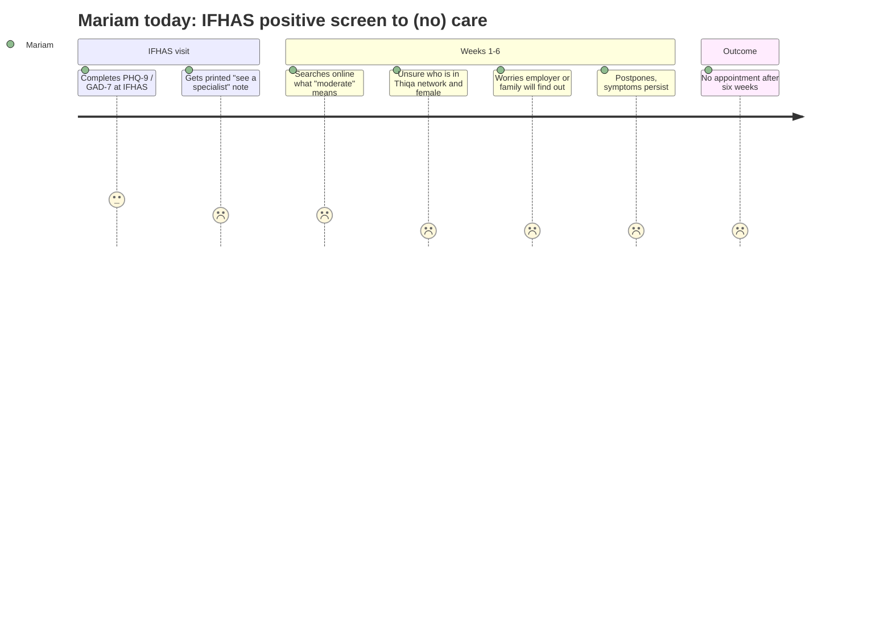
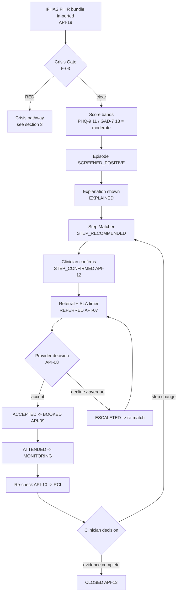
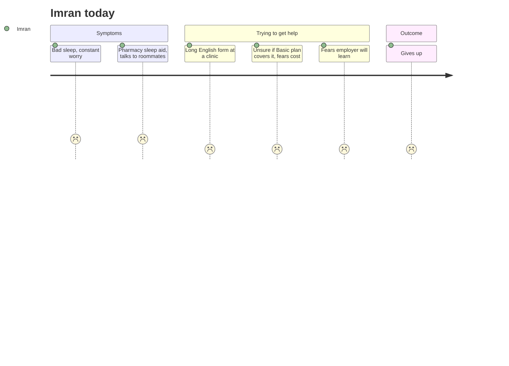
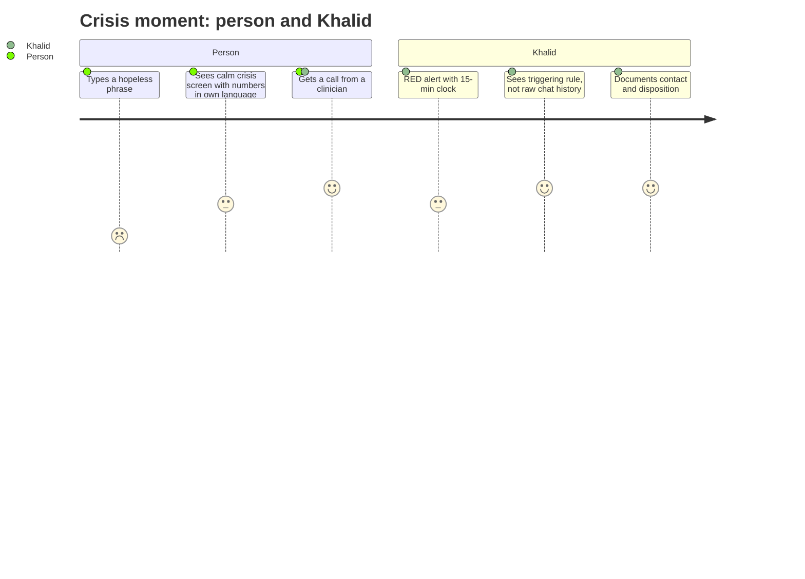
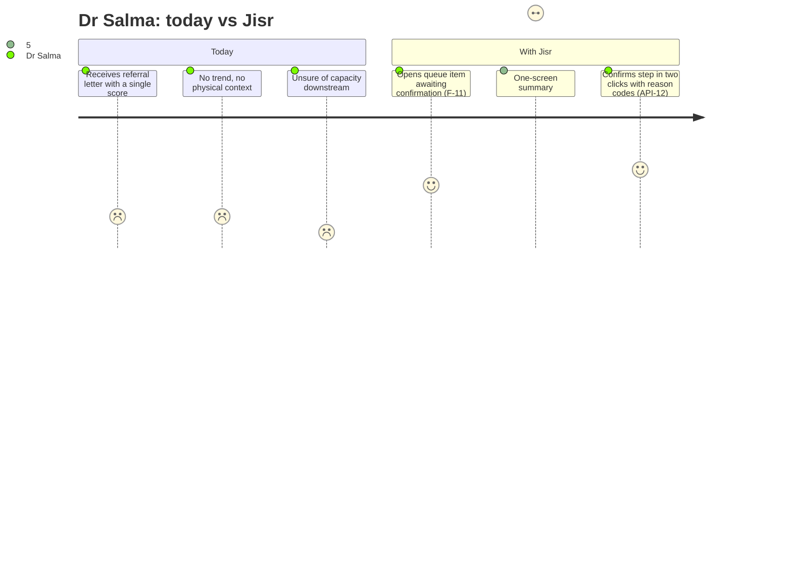
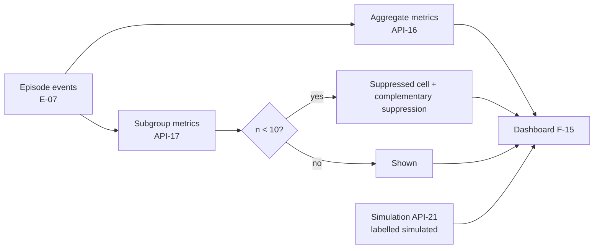

# User Journeys
> Project: Jisr · Owner: Product lead · Status: Draft v0.1 · Last updated: 2026-11-18
> Related: [Project brief](../00-overview/PROJECT_BRIEF.md) · [Personas](PERSONAS.md) · [PRD](PRD.md) · [User stories](USER_STORIES.md) · [UI spec](../02-design/UI_SPEC.md)

Current-state journeys are **inferred** from the C10 statement's named barriers (stigma, not knowing where to go, fragmented pathways, uneven capacity) and published data (see [PERSONAS.md](PERSONAS.md)). They are not observed. Scores in Mermaid `journey` charts are emotion scores (1 = very bad, 5 = very good).

---

## 1. P-01 Mariam

### Current state


### Future state with Jisr
```mermaid
journey
  title Mariam with Jisr
  section Result arrives
    IFHAS result imported (F-02), Crisis Gate clear: 3: Mariam, Jisr
    Reads "what this means / what it doesn't" in Arabic (F-04): 4: Mariam
  section Choose care
    Sees L2/L3 option with reasons: female, Arabic, Thiqa, tele (F-05): 4: Mariam
    Checks consent: nothing goes to employer (F-13): 5: Mariam
    Three taps to request booking (F-07): 5: Mariam
  section While waiting
    Provider accepts within SLA, Thursday tele-session: 5: Mariam, Provider
    Worry-time module + 14-day re-check (F-09, F-10): 4: Mariam
  section Outcome
    Attends; re-check shows reliable improvement: 5: Mariam, Dr Salma
```

### Flow


**Moments of truth.** (1) The first sentence of the explanation: it must reduce fear without false reassurance. (2) Seeing "nothing is shared with your employer" before tapping. (3) Provider acceptance arriving quickly.

**Note.** Mariam's demo route (tele-session with a female Arabic-speaking clinician) depends on open question OQ-03 in the [PRD](PRD.md): moderate scores map to L2 (family physician) by the brief's table; a tele-session may be an L2 teleconsult rather than L3.

---

## 2. P-02 Imran

### Current state


### Future state with Jisr
```mermaid
journey
  title Imran with Jisr
  section Screen
    Opens link, chooses Urdu (F-01): 4: Imran
    Questions read aloud, one per screen (F-20): 4: Imran
  section Result
    Short Urdu explanation, icons (F-04): 4: Imran
    Option: Urdu-speaking clinician, Basic network, tele after shift (F-05, F-06): 4: Imran
  section Hand-off
    Booking request, discreet SMS (F-07, F-14, F-21): 5: Imran
    Waiting-well sleep module (F-09): 4: Imran
  section Outcome
    Attends tele-session; re-check: 4: Imran, Provider
```

**Moments of truth.** Language choice on the first screen; cost/network shown before booking; SMS text that roommates cannot interpret.

**Edge cases.** No Urdu-speaking provider with capacity in his network → Step Matcher shows the trade-off (wait longer vs Arabic/English clinician with interpreter, v1) and flags a capacity gap to P-05. Shared phone → discreet mode on by default for SMS. Browser lacks an Urdu TTS voice → read-aloud hides gracefully.

---

## 3. Crisis path (any person → P-04 Khalid)

```mermaid
sequenceDiagram
  autonumber
  actor P as Person
  participant W as Web app
  participant API as API (FastAPI)
  participant G as Crisis Gate (deterministic)
  participant L as LLM (M-02, raise-only)
  participant Q as Coordinator queue
  actor K as Khalid (on-call)
  P->>W: Types indirect Arabic phrase in free text
  W->>API: POST /v1/crisis/check (API-04)
  API->>G: lexicon + item 9 + C-SSRS rules
  G-->>API: RED (matched rule ids)
  Note over API,L: M-02 only consulted if gate is clear and flag on;<br/>it can add RED, never remove it
  API->>API: CrisisEvent E-05, Episode -> RED_CRISIS, LLM locked
  API-->>W: RED response (< 1 s)
  W-->>P: Crisis screen: 999, 800-SAKINA, 800-HOPE (tel:)
  API->>Q: RED item, SLA 15 min
  Q-->>K: Alert with clock
  K->>API: Acknowledge, document contact + disposition
  API->>API: EpisodeEvent appended; crisis response complete
```



**Moments of truth.** The crisis screen appears in under a second and never shows AI text; the person sees human options first; Khalid's alert shows *why* it fired.

**Edge cases.** Gate service error → fail closed (RED). Person closes the app before seeing numbers → RED episode still created; Khalid's queue uses contact details only if consent and contact exist (MVP: synthetic). False positive (for example a quoted song lyric) → Khalid closes RED with reason "false positive", which feeds the benchmark review; the episode is never auto-cleared. Out of hours → v1 needs an on-call rota agreement; MVP shows the rota as synthetic.

---

## 4. P-03 Dr Salma



**Moments of truth.** The summary fits on one screen; the step recommendation shows its factors; confirming is faster than writing a letter.

**Edge cases.** Physical-context consent revoked → section shows "not shared by the person" (F-13). Disagreement with the rule → she changes the step with a reason; the change is logged and counted in metrics (override rate).

---

## 5. P-05 Programme lead



**Moments of truth.** Seeing drop-off reasons, not just counts; fairness gaps highlighted; simulated numbers visibly labelled.

**Edge cases.** All subgroups suppressed in a small pilot → dashboard explains why and shows the emirate-level total only.

---

## 6. Cross-journey edge cases
| Case | Expected behaviour | Feature |
|---|---|---|
| Person declines all options | `DECLINED_BY_PERSON`; L0 content offered; re-check reminder only with consent | F-08, F-09 |
| Lost to follow-up (no response after reminders) | `LOST_TO_FOLLOW_UP` after the configured window; appears in drop-off reasons | F-08, F-15 |
| Score improves before appointment | RCI shows improvement; clinician may step down; appointment kept unless the person cancels | F-10 |
| Score worsens while waiting | Step-up suggestion to clinician; item 9 > 0 → RED | F-10, F-03 |
| Network says provider at capacity | Matcher ranks next provider; wait shown | F-05, F-06 |
| LLM down or validator rejects | Template explanation, no visible error | F-04, M-03 |
| Language switched mid-flow | Answers preserved | F-01 |
| Quick exit pressed | Neutral page, history state replaced | F-14 |
