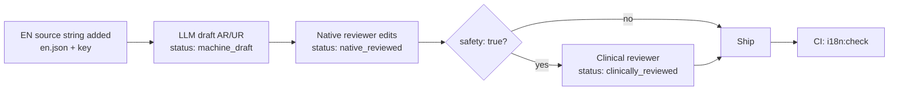

# Localization
> Project: Jisr · Owner: Localization lead (with Clinical lead for safety strings) · Status: Draft v0.1 · Last updated: 2026-11-18
> Related: [Project brief](../00-overview/PROJECT_BRIEF.md) · [PRD](../01-product/PRD.md) · [Design system](DESIGN_SYSTEM.md) · [UI spec](UI_SPEC.md) · [Accessibility](ACCESSIBILITY.md) · [Prompts](../04-ai/PROMPTS.md) · [Architecture](../03-engineering/ARCHITECTURE.md)

**Principle:** humans own every word a person reads in Jisr. LLMs may draft translations and runtime explanations, but nothing safety-relevant reaches a person without (a) native-speaker review for static copy, or (b) the claim validator for runtime AI text (M-01, E-18). Validated instrument translations are never re-translated.

---

## 1. Languages

### 1.1 MVP (hackathon)

| Priority | Locale | Script / direction | Why | Surfaces |
|---|---|---|---|---|
| 1 | `ar` (Arabic, MSA with UAE conventions) | Arabic, RTL | Official language; P-01 Mariam is Arabic-first; demo north star §14.1–14.2 is in Arabic | Person app + staff + dashboard |
| 2 | `en` (English) | Latin, LTR | Lingua franca of Abu Dhabi healthcare staff; judges; source language for copy | All |
| 3 | `ur` (Urdu) | Arabic script (Nastaliq), RTL | P-02 Imran; South Asian workers are a large part of the non-Emirati population where stress burden is higher (brief §2 [4]). Exact Urdu-speaker share in Abu Dhabi: **unverified** | Person app only; staff/dashboard fall back to `en` |

Default locale: `ar`. Locale detection uses `Accept-Language`, so judges with English browsers land on `en`. Judge Mode personas set their locale explicitly (Mariam → `ar`, Imran → `ur`, staff → `en`).

### 1.2 v1 (production) candidates

| Locale | Reason | Notes |
|---|---|---|
| `hi` Hindi, `ml` Malayalam, `tl` Tagalog, `bn` Bengali | Large expatriate communities; ideas.md proposed 6 languages (AR, EN, UR, HI, ML, TL) | Requires validated PHQ-9/GAD-7 translations per language and native crisis-line support check |
| Arabizi input | Already handled by the crisis lexicon (F-03); not a UI locale | Free-text detection only |

---

## 2. i18n framework: next-intl 4.15

next-intl 4.15.x is published on npm (4.15.1 README observed on jsDelivr, 2026-11-18). APIs below follow the next-intl 4 App Router pattern; confirm against the installed version's docs when scaffolding.

### 2.1 Files

```
apps/web/
  i18n/routing.ts        # locales, defaultLocale, localePrefix
  i18n/request.ts        # loads messages per request
  middleware.ts          # next-intl middleware (locale detection + redirect)
  messages/
    en.json  ar.json  ur.json          # UI strings (namespaced)
    _meta/review-status.json           # per-key review status (see §4)
packages/rules/
  instruments/phq9.v1.json             # official item text per locale + source
  instruments/gad7.v1.json
  crisis/lexicon.v1.json               # AR / EN / Arabizi / UR phrases (F-03)
  copy/banned-terms.{en,ar,ur}.json    # copy-lint lists (DESIGN_SYSTEM §9.3)
```

### 2.2 Configuration

```ts
// apps/web/i18n/routing.ts
import { defineRouting } from "next-intl/routing";

export const routing = defineRouting({
  locales: ["ar", "en", "ur"],
  defaultLocale: "ar",
  localePrefix: "always",          // /ar/..., /en/..., /ur/... — explicit, shareable
});

export const RTL_LOCALES = new Set(["ar", "ur"]);
```

```tsx
// apps/web/app/[locale]/layout.tsx (excerpt)
import { NextIntlClientProvider, hasLocale } from "next-intl";
import { notFound } from "next/navigation";
import { routing, RTL_LOCALES } from "@/i18n/routing";

export default async function LocaleLayout({ children, params }) {
  const { locale } = await params;
  if (!hasLocale(routing.locales, locale)) notFound();
  return (
    <html lang={locale} dir={RTL_LOCALES.has(locale) ? "rtl" : "ltr"}>
      <body><NextIntlClientProvider>{children}</NextIntlClientProvider></body>
    </html>
  );
}
```

Staff routes in `ur`: `i18n/request.ts` merges `en.json` under `ur.json` for the `staff` and `programme` namespaces only (deep-merge fallback), and the staff layout renders `lang="en" dir="ltr"` for those namespaces' containers so screen readers pronounce correctly.

### 2.3 Message conventions

- Namespaces mirror screens: `welcome`, `start`, `q`, `note`, `result`, `crisis`, `step`, `book`, `plan`, `wait`, `recheck`, `consent`, `settings`, `updates`, `staff.queue`, `staff.red`, `staff.summary`, `programme`, `judge`, `common`.
- Keys are semantic (`crisis.h1`), never English sentences.
- ICU MessageFormat for plurals, select and numbers; no string concatenation.
- No inline copy in components (CLAUDE.md rule); ESLint `no-literal-string` on JSX text in `apps/web/app` and `components`.
- `TypeScript` type-safe messages: `global.d.ts` declares `Messages` from `en.json`; missing keys in `ar`/`ur` fail the `pnpm i18n:check` script.

---

## 3. What gets translated by whom

| Content | Source of truth | Who translates | LLM role | Review needed before demo |
|---|---|---|---|---|
| **PHQ-9, GAD-7 items, stems, answer options** | Official translations from the PHQ screeners site (https://www.phqscreeners.com/select-screener — "no permission is required to reproduce, translate, display or distribute"). Availability of Arabic and Urdu versions there: **to confirm on download** (owner: Clinical lead, 19 Nov 2026 10:00) | **Nobody** — use the official text verbatim, record source URL + download date in `phq9.v1.json` | None. Never | Clinical lead checks the file matches the official PDF |
| C-SSRS screener items | Columbia Lighthouse Project official translations; terms of use **unverified** (R-05) | Nobody | None | Only enabled if licence confirmed |
| **Crisis screen copy** (S-06), HelpNow label, crisis numbers | `messages/*.json` `crisis.*`, `common.help` | Native AR reviewer (Gulf/Emirati) and native UR reviewer (Pakistani) | May draft first version | **Mandatory** native + clinical review; if not reviewed in time, the screen shows AR/UR **and** EN text together |
| Results "means / doesn't mean" templates (M-03) | `messages/*.json` `result.*` and `packages/rules` templates | Native reviewers | Draft | Mandatory native + clinical review |
| Other UI copy | `messages/*.json` | Native reviewers | Draft | Native review; marked "pending" in Judge Mode if not reviewed |
| **Crisis lexicon** (AR, EN, Arabizi, UR) | `packages/rules/crisis/lexicon.v1.json` | Clinical lead + native speakers; every phrase also added to the eval benchmark (CLAUDE.md "Do") | May propose candidate variants for **recall** testing only; humans accept each | Mandatory; changes need a benchmark run |
| Runtime explanations (F-04, M-01) | Generated per episode from structured facts | Gemini drafts in target locale | **Drafts at runtime** | Claim validator (E-18) blocks unsupported claims; on failure → M-03 template. Urdu/Arabic output quality is a known risk (R-04): if the validator pass rate for a locale is low in evals, set `LLM_LOCALES=en,ar` and use templates for `ur` |
| Provider directory (F-06) | Synthetic JSON with `name_ar`, `name_en`, `name_ur` | Team | Draft | Low risk; synthetic |
| Notifications (F-21) | Neutral templates in `messages/*.json` `notify.*` | Native reviewers | Draft | Native review (discreet wording) |

**LLM used for drafting static strings:** the M-01 Gemini model may be used **offline, at development time,** on English UI strings only (no personal data). Output lands in `messages/ar.json` / `ur.json` with status `machine_draft`. It is never shipped as `reviewed`.

---

## 4. Translation workflow



`messages/_meta/review-status.json` (one entry per key per locale):

```json
{
  "crisis.h1": {
    "safety": true,
    "ar": { "status": "native_reviewed", "by": "AR reviewer", "date": "2026-11-19" },
    "ur": { "status": "machine_draft" }
  }
}
```

**CI rules (`pnpm i18n:check`)**
1. Every key in `en.json` exists in `ar.json` and `ur.json` (person namespaces) — fail if missing.
2. ICU syntax parses in every locale; placeholders match the English set — fail on mismatch.
3. Copy-lint: banned terms per locale (DESIGN_SYSTEM §9.3) — fail.
4. `safety: true` keys with status below `clinically_reviewed` → **MVP: warning + bilingual fallback rendering; v1: build failure**.
5. Instrument files: the hash of each locale's item text must match the recorded hash of the official source — fail on any edit.

**Reviewers (MVP):** at least one native Arabic speaker and one native Urdu speaker inside or near the team, named in `TEAM.md` (owner: Product lead, by 19 Nov 2026 09:00). If no Urdu reviewer is available, Urdu ships with a visible "Translation in review" note in Judge Mode and R-04 stays open.

---

## 5. Language-specific rules

### 5.1 Arabic (`ar`)
- **Register:** Modern Standard Arabic, short sentences, warm but not colloquial. Avoid heavy classical vocabulary. Gulf dialect only in the crisis lexicon (input), not in UI output.
- **Clinical terms:** use the term in the official instrument translation; on first use in explanations, avoid clinical labels («اضطراب») for persons and prefer descriptions («القلق يؤثر على أيامك»).
- **Terms list (draft, pending review):**

| EN | AR |
|---|---|
| screen / check | فحص أولي |
| result | نتيجة |
| care team | فريق الرعاية |
| family physician | طبيب الأسرة |
| psychologist (f) | أخصائية نفسية |
| consent / sharing | الموافقة / المشاركة |
| discreet mode | الوضع الخفي |
| I need help now | أحتاج مساعدة الآن |
| Observed / Calculated / AI-drafted | مُسجَّل / محسوب / صياغة بالذكاء الاصطناعي |
| step (of care) | مستوى الرعاية |
| RED episode (staff) | حالة حمراء |

### 5.2 Urdu (`ur`)
- **Register:** simple, everyday Urdu; avoid Persianised literary vocabulary; English loanwords commonly used by speakers are fine ("اپائنٹمنٹ" for appointment) — reviewer decides.
- Polite «آپ» throughout.
- Font: Noto Nastaliq Urdu (DESIGN_SYSTEM §3.1); see §6.4 for layout issues.
- Terms (draft): help now «مجھے ابھی مدد چاہیے», care team «نگہداشت ٹیم», doctor «ڈاکٹر», privacy «رازداری», update «اپ ڈیٹ».

### 5.3 Gendered address (AR and UR)
Arabic second-person forms and many Urdu verb forms agree with the addressee's gender.
1. **Default:** write gender-neutral constructions (verbal nouns, passive voice, imperatives that are identical when unvocalised, «يمكنك…»). Most person copy should be neutral.
2. **Where impossible:** use ICU `select` on `addressForm`:
   ```json
   "plan.ready": "{addressForm, select, feminine {أنتِ جاهزة للخطوة التالية} masculine {أنتَ جاهز للخطوة التالية} other {كل شيء جاهز للخطوة التالية}}"
   ```
   `addressForm` comes from Settings (S-13) "How should we address you?" — optional; default `other` (neutral).
3. Never infer gender from the name or the clinician-gender preference.
4. The LLM prompt (PROMPTS.md) receives `addressForm` and must use it; validator does not check grammar, so templates are preferred for short, high-visibility strings.

### 5.4 English (`en`)
- UAE/British spelling ("programme", "colour") in UI copy. Plain language target reading age ≈ 9–11.

---

## 6. Script, layout and font issues

### 6.1 Direction
- `dir` on `<html>` from the locale; **CSS logical properties only** (`margin-inline-start`, Tailwind `ms-*`, `ps-*`, `start-*`, `text-start`). Physical classes are lint errors (DESIGN_SYSTEM §4).
- Flex/grid follow `dir` automatically; never use `flex-row-reverse` to fake RTL.
- Icons: mirror directional icons only (DESIGN_SYSTEM §5).
- User input: `dir="auto"` on text inputs and the free-text box, because people mix Arabic, English and Arabizi.

### 6.2 Bidi isolation (must-do list)
Wrap these in `<bdi>` (or `dir="ltr"` + `unicode-bidi: isolate`) inside RTL text:

| Item | Example | Why |
|---|---|---|
| Phone numbers | `<bdi dir="ltr">800 725462</bdi>` | Digit groups otherwise reorder |
| Crisis line names | `<bdi dir="ltr">800-SAKINA</bdi>` | Hyphen + Latin in RTL flips order |
| Scores "11 of 27" | `{score} من {max}` with each number isolated | Prevents "27 من 11" visual swaps around punctuation |
| Ranges "15–29" | `<bdi dir="ltr">15–29</bdi>` | En dash direction |
| **Suppressed cells "<10"** | `<bdi dir="ltr">&lt;10</bdi>` or prefer words «أقل من 10» | `<` is a bidi-mirrored character; bare "<10" in RTL can display as ">10" — a privacy-meaning inversion |
| Times "4:30 pm", SLA "13:52" | isolated | Colon-separated digits |
| Rule versions, IDs | `<bdi dir="ltr">rules v1.0.0</bdi>` | Mixed Latin |
| Percentages | via `Intl.NumberFormat` (gives correct RTL percent) | Placement of % differs by locale |

### 6.3 Arabic font
- IBM Plex Sans Arabic for UI; Noto Naskh Arabic as fallback and optional long-reading face. No letter-spacing, no italics, no uppercase transforms.
- Diacritics (tashkeel) only where needed to disambiguate (e.g. «لستَ/لستِ» avoided by neutral phrasing instead).

### 6.4 Urdu Nastaliq
- Line heights per DESIGN_SYSTEM §3.2 (≈ 2.2× font size for body). Nastaliq's diagonal stacking extends above and below the line box.
- No fixed-height containers, no `overflow: hidden` on text in person UI; buttons use `min-height` + vertical padding, not `height`.
- Chips and badges grow vertically in `ur`; layout must allow it (tested in Playwright screenshots).
- Truncation with ellipsis is unreliable in Nastaliq; avoid it in person UI.
- Web font size: Noto Nastaliq Urdu is large; load only weights 400/600 and only on `ur` routes (`next/font` per-locale font variables).
- Fallback: if the web font fails, fall back to Noto Naskh Arabic (system Nastaliq support varies by device).

### 6.5 Charts (Recharts) in RTL
- Time axes stay left-to-right (earliest at left) in all locales — common practice in Arabic data displays and avoids reversing a baseline/Jisr comparison. **Assumption — confirm with AR reviewer.**
- Legends, titles and tables follow `dir`. Axis tick numbers use the locale formatter with Latin digits (§7).

---

## 7. Number, date, time and currency formats

All formatting goes through next-intl's `useFormatter` / `getFormatter` (Intl under the hood). Locale tags carry explicit extensions so behaviour does not depend on device defaults:

| Locale | Formatting tag | Digits | Calendar |
|---|---|---|---|
| `ar` | `ar-AE-u-nu-latn-ca-gregory` | Western (0–9) — the convention on UAE government services; Arabic-Indic digits available as a v1 setting | Gregorian |
| `en` | `en-AE` | Western | Gregorian |
| `ur` | `ur-PK-u-nu-latn` (Urdu UI for a UAE resident; `ur-AE` is not a standard CLDR locale — verify) | Western | Gregorian |

| Item | `en` | `ar` (draft) | `ur` (draft) | Notes |
|---|---|---|---|---|
| Date | 21 Nov 2026 | 21 نوفمبر 2026 | 21 نومبر 2026 | `dateStyle: "medium"`; output depends on ICU version — snapshot test |
| Weekday + time | Thursday 4:30 pm | الخميس 4:30 م | جمعرات 4:30 PM / شام 4:30 (reviewer to choose) | 12-hour clock for persons; 24-hour (`HH:mm`) in staff console |
| Relative | in 2 days | بعد يومين | 2 دن میں | `formatRelativeTime`; Arabic dual handled by ICU |
| Week start | Monday in UI calendars | | | UAE weekend is Saturday–Sunday since 2022 (verify for calendar UI) |
| Time zone | `Asia/Dubai` (UTC+4, no DST) for display; UTC in the API | | | Set `timeZone` in next-intl config to avoid server/client mismatch |
| Percent | 78% | ‎78٪ or 78% (depends on ICU with `nu-latn`) | 78% | Always via formatter |
| Currency | AED 150.00 | ‏150.00 د.إ.‏ (ICU output; verify) | AED 150.00 | `style:"currency", currency:"AED"`; persons see whole dirhams (`maximumFractionDigits: 0`): "AED 20". The new UAE dirham symbol (announced 2025) has no confirmed Unicode/font support — **do not use it**; use "AED" / «د.إ» |
| Phone | 800 725462 | isolated LTR | isolated LTR | Never formatted by Intl; static strings |
| Names | as entered | as entered | as entered | No transliteration; staff see name in the script the person used |

**Plurals:** Arabic uses six CLDR plural categories (`zero`, `one`, `two`, `few`, `many`, `other`); Urdu and English use `one`/`other`. Every count message in `ar.json` must provide all six (enforced by `i18n:check` via `Intl.PluralRules("ar").resolvedOptions().pluralCategories`).

Example:
```json
"queue.redCount": "{count, plural, zero {لا توجد حالات حمراء} one {حالة حمراء واحدة} two {حالتان حمراوان} few {# حالات حمراء} many {# حالة حمراء} other {# حالة حمراء}}"
```

---

## 8. Testing localization

| Check | How | Gate |
|---|---|---|
| Missing keys / ICU errors / placeholder mismatch | `pnpm i18n:check` | CI fail |
| Banned terms | `copy-lint.ts` | CI fail |
| Instrument text integrity | hash check vs recorded official source | CI fail |
| RTL layout | Playwright screenshots of every person screen in `ar` and `ur` at 360 px and 1280 px | Visual diff review |
| Bidi | Unit tests render phone numbers, "<10", scores inside RTL containers and assert DOM order + `dir` | CI fail |
| Pseudo-locale | `en-XA`-style long-string pseudo locale (+40 % length) generated at build for dev only | Manual |
| Native review | `review-status.json` report printed in CI and shown in Judge Mode (S-40 footer: "AR 92 % reviewed · UR 60 % reviewed") | Visible honesty |
| LLM output per locale | Validator pass rate by locale in `ai/evals` | Switch `ur` to templates if below threshold set in AI_EVALS |

---

## 9. MVP (hackathon) vs v1 (production)

| Area | MVP (hackathon) | v1 (production) |
|---|---|---|
| Locales | `ar`, `en`, `ur` (person app); `ar`, `en` (staff) | + `hi`, `ml`, `tl`, `bn` after validated instruments and crisis-line language check |
| Review | Best-effort native review; safety strings bilingual fallback if unreviewed; Judge Mode shows review % | All strings native-reviewed; safety strings clinically reviewed; CI blocks unreviewed safety keys |
| Translation tooling | JSON in repo + review-status file | TMS (e.g. Crowdin or Lokalise) with glossary and translation memory; reviewer roles |
| Runtime LLM | Gemini drafts AR/EN/UR behind validator; synthetic data only | In-country LLM endpoint (Azure OpenAI UAE North or Jais 3, brief §10); Arabic-native model evaluation |
| Audio | Browser TTS if available | Recorded native audio for instruments and crisis screen |
| Digits | Western digits | User setting for Arabic-Indic digits |
| Calendar | Gregorian | Optional Hijri display alongside Gregorian for appointments (user setting) |

## 10. Open questions

| # | Question | Owner | Due |
|---|---|---|---|
| LQ-1 | Are official Arabic and Urdu PHQ-9 / GAD-7 translations available from phqscreeners.com, and which dialect/version? | Clinical lead | 19 Nov 2026 10:00 |
| LQ-2 | Named native AR and UR reviewers | Product lead | 19 Nov 2026 09:00 |
| LQ-3 | Urdu 12-hour time style (AM/PM vs صبح/شام) | UR reviewer | 19 Nov 2026 12:00 |
| LQ-4 | Do 800-SAKINA / 800-HOPE answer in Urdu? (affects crisis copy for `ur`) | Clinical lead | 19 Nov 2026 12:00 |
