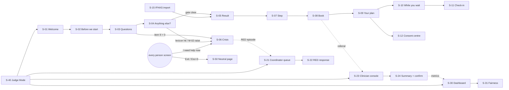

# UI Specification
> Project: Jisr · Owner: Design lead · Status: Draft v0.1 · Last updated: 2026-11-18
> Related: [Project brief](../00-overview/PROJECT_BRIEF.md) · [PRD](../01-product/PRD.md) · [Design system](DESIGN_SYSTEM.md) · [Accessibility](ACCESSIBILITY.md) · [Localization](LOCALIZATION.md) · [API spec](../03-engineering/API_SPEC.md) · [Architecture](../03-engineering/ARCHITECTURE.md)

This document specifies **every screen** in the MVP. Each screen lists: purpose, persona, features (F-xx), APIs (API-xx), entities (E-xx), ASCII wireframe, components, states, copy (EN with AR examples) and analytics events.

**Conventions**
- Wireframes are drawn **LTR (English)**. Arabic and Urdu mirror them using logical properties (DESIGN_SYSTEM §4). Where mirroring needs a decision, it is noted.
- `[■ I need help now]` = `HelpNowButton`. `[Exit]` = `QuickExit`. Both are on **every person-facing screen** (S-01 … S-15), including the crisis screen.
- `⟦Observed⟧`, `⟦Calculated⟧`, `⟦AI-drafted⟧` = `ContentTypeBadge` + its `ProvenanceBlock`. `{Gate: …}` = `GateBadge`.
- The Judge Mode bar (`JudgeModeBar`) appears at the top of every screen in the MVP; it is omitted from most wireframes for space.
- Arabic and Urdu copy here is **draft, pending native review** (R-04). Official PHQ-9 / GAD-7 / C-SSRS item text is never written by the team or an LLM; it is loaded from the licensed translations (LOCALIZATION §3).
- MVP = hackathon build. v1 = production. Items marked **v1** are not built in the MVP.

---

## 0. Screen inventory and routes

All routes live under `apps/web/app/[locale]/` where `locale ∈ {ar, en, ur}`.

| ID | Screen | Route | Persona | Features | APIs | MVP? |
|---|---|---|---|---|---|---|
| S-01 | Welcome & language | `/` | P-01, P-02 | F-01, F-14 | — | Yes |
| S-02 | Before we start (privacy + consent to screen) | `/start` | P-01, P-02 | F-13 | API-14, API-01 | Yes |
| S-03 | Screening question | `/screen/[sessionId]/q/[n]` | P-01, P-02 | F-01, F-20 | API-02 | Yes |
| S-04 | Anything else? (free text) | `/screen/[sessionId]/note` | P-01, P-02 | F-03 | API-04 | Yes |
| S-05 | Your result | `/episode/[id]/result` | P-01, P-02 | F-04 | API-03, API-18, API-05 | Yes |
| S-06 | **Crisis screen** | `/help` (also rendered inline as an overlay route) | all persons | F-03 | API-04 (already fired), API-05 | Yes |
| S-07 | Suggested next step | `/episode/[id]/step` | P-01, P-02 | F-05 | API-06 | Yes |
| S-08 | Choose who and when | `/episode/[id]/book` | P-01, P-02 | F-06, F-07 | API-15, API-07 | Yes |
| S-09 | Your plan (hand-off tracker) | `/home` | P-01, P-02 | F-07, F-08 | API-05 | Yes |
| S-10 | While you wait (modules) | `/wait` and `/wait/[moduleId]` | P-01, P-02 | F-09 | API-05 | Yes (3 modules) |
| S-11 | Check-in (re-check) | `/episode/[id]/recheck` | P-01, P-02 | F-10 | API-10 | Yes |
| S-12 | **Consent centre** + access log | `/privacy` | P-01, P-02 | F-13, F-12 | API-14, API-23 | Yes |
| S-13 | Settings | `/settings` | P-01, P-02 | F-14, F-20 | API-26 | Yes |
| S-14 | Updates (notification inbox) | `/updates` | P-01, P-02 | F-21 | API-27 | Yes (in-app + SMS mock) |
| S-15 | Results arrived from IFHAS | `/imported/[episodeId]` | P-01 | F-02 | API-19 (server-side), API-05 | Yes (seeded) |
| S-21 | **Coordinator queue** | `/staff/queue` | P-04 Khalid | F-07, F-08, F-11 | API-11 | Yes |
| S-22 | RED episode response | `/staff/episode/[id]/crisis` | P-04 | F-03, F-08 | API-05, API-24, API-25 (clinician: API-12/13) | Yes |
| S-23 | **Clinician console** (my hand-offs) | `/staff/clinician` | P-03 Dr Salma | F-11, F-07 | API-11, API-08, API-09 | Yes |
| S-24 | One-screen summary + confirm step | `/staff/episode/[id]` | P-03 | F-10, F-11, F-12 | API-05, API-06, API-12, API-18 | Yes |
| S-25 | Close episode (dialog) | dialog on S-24 | P-03, P-04 | F-08 | API-13 | Yes |
| S-30 | **Programme dashboard** | `/programme` | P-05 | F-15, F-16 | API-16, API-21 | Yes |
| S-31 | Fairness | `/programme/fairness` | P-05 | F-15 | API-17 | Yes |
| S-32 | Simulation | `/programme/simulation` | P-05 | F-16 | API-21 | Yes |
| S-40 | **Judge Mode** start / role switcher | `/judge` | Judges | F-17 | API-22 | Yes |
| S-41 | Guided 3-minute tour | overlay on any route | Judges | F-17 | — | Yes |
| S-42 | Evaluation results | `/judge/eval` | Judges | F-18 | static (`EVAL.md` rendered) | Yes |
| S-50 | Quick-exit destination | external neutral URL | — | F-14 | — | Yes |
| S-51 | Error / not found / offline | `error.tsx`, `not-found.tsx` | all | — | — | Yes |

Staff routes (`/staff/*`, `/programme/*`) are available in `en` and `ar` in the MVP; `ur` falls back to `en` there (LOCALIZATION §1).

### 0.1 Navigation map



### 0.2 Mariam's "three taps" (demo north star §14.1)
After the result is explained, Mariam reaches booking in exactly three taps:
1. **S-05** "See my next step" → S-07
2. **S-07** "Choose this" (pre-matched: Arabic-speaking female clinician, Thiqa network, video, Thursday) → S-08 with the top slot preselected
3. **S-08** "Send booking request" → S-09 shows "Request sent · nothing shared with your employer"

---

## 1. Global elements (every person screen)

### 1.1 Person shell

```
┌──────────────────────────────────────────┐
│ Judge Mode · synthetic data · Mariam ▾  ⟲│  ← JudgeModeBar (MVP only)
├──────────────────────────────────────────┤
│ ←  Your plan                AR|EN|UR [Exit]│  ← TopBar
├──────────────────────────────────────────┤
│                                          │
│            (screen content)              │
│                                          │
│                                          │
│                     ┌──────────────────┐ │
│                     │ ■ I need help now│ │  ← HelpNowButton, fixed bottom-end
│                     └──────────────────┘ │
└──────────────────────────────────────────┘
```
RTL: back arrow, Exit and HelpNow mirror to the opposite corners (HelpNow at bottom-left in AR/UR, which is "bottom-end").

| Element | EN | AR (draft) | UR (draft) |
|---|---|---|---|
| Help button | I need help now | أحتاج مساعدة الآن | مجھے ابھی مدد چاہیے |
| Quick exit | Exit | خروج | باہر نکلیں |
| Quick exit accessible name | Exit to a neutral page | الخروج إلى صفحة محايدة | ایک عام صفحے پر جائیں |
| Skip link | Skip to content | انتقل إلى المحتوى | مواد پر جائیں |

**Behaviour**
- HelpNow → S-06 instantly (client-side route, crisis content is statically bundled; no network needed to show numbers). It also calls `API-04` with `{source:"help_button"}` so a RED episode is created; if the call fails, the screen still shows and retries in the background.
- Quick exit → `window.location.replace("https://www.ncm.gov.ae")` (Open question Q-3 in DESIGN_SYSTEM), clears in-memory state and `sessionStorage`; screening answers already saved server-side stay saved. Esc pressed 3 times within 2 s does the same. Limitation shown in S-13: "Exit can't erase your browser history. Use a private window for extra privacy."

**Analytics (global)**: `help_now_tapped {screen_id}`, `quick_exit_used {screen_id, method: button|esc}`, `locale_changed {from, to}`.

### 1.2 Analytics rules (apply to every event in this doc)
- Events carry **no PII, no scores, no answers, no free text**, only: `event`, `screen_id`, `locale`, `role`, `discreet_mode` (bool), `session_hash` (rotating, per-visit), timestamps and the listed enum properties.
- MVP sink: `track()` in `apps/web/lib/analytics.ts` writes to the Judge Mode `EventInspector` and `console.debug`. No third-party analytics SDK. **v1:** a first-party aggregate endpoint inside the UAE hosting boundary (needs an API ID; not in the brief — see report).
- Clinical facts (episode transitions, SLA breaches) are **not** analytics: they are E-07 EpisodeEvents written by the API.

---

## 2. Person app

### S-01 Welcome & language
**Purpose:** set language, set expectations (time, privacy), offer discreet mode. **Persona:** P-01, P-02.

```
┌──────────────────────────────────────────┐
│                                [Exit]    │
│              ⌒  (bridge arc)             │
│                                          │
│   Let's find the right support for you.  │
│   About 5 minutes. Your answers are      │
│   private.                               │
│                                          │
│   Choose your language                   │
│   ┌────────────┐┌──────────┐┌─────────┐  │
│   │  العربية   ││ English  ││  اردو   │  │
│   └────────────┘└──────────┘└─────────┘  │
│                                          │
│   [ ] Discreet mode — neutral titles     │
│       and notifications  (?)             │
│                                          │
│   ┌──────────────────────────────────┐   │
│   │            Start                 │   │
│   └──────────────────────────────────┘   │
│   🔈 Listen                               │
│                     [■ I need help now]  │
└──────────────────────────────────────────┘
```

| Copy key | EN | AR (draft) |
|---|---|---|
| `welcome.title` | Let's find the right support for you. | لنجد الدعم المناسب لك. |
| `welcome.sub` | About 5 minutes. Your answers are private. | نحو 5 دقائق. إجاباتك خاصة. |
| `welcome.discreet` | Discreet mode — neutral titles and notifications | الوضع الخفي — عناوين وإشعارات محايدة |
| `welcome.start` | Start | ابدأ |

UR example: `welcome.title` = «آئیے آپ کے لیے صحیح مدد تلاش کریں۔»

**States:** default; language pre-selected from `Accept-Language` (highlighted, not auto-advanced); offline (Start still works, answers queue locally); returning user with open episode → button becomes "Continue" and routes to S-09.
**Analytics:** `welcome_viewed`, `language_selected {locale}`, `discreet_mode_toggled {on}`, `screening_start_tapped`.

### S-02 Before we start
**Purpose:** plain privacy facts + the minimum consent needed to screen (E-02 ConsentRecord `scope=screening`). Links to the full consent centre. **APIs:** API-14 (PUT screening consent), API-01 (create session).

```
┌──────────────────────────────────────────┐
│ ←  Before we start              [Exit]   │
│                                          │
│  What happens to your answers            │
│  ✓ Used to suggest the right support     │
│  ✓ Seen by the care team only if you     │
│    book or need urgent help              │
│  ✗ Never shared with your employer       │
│  ✗ Never shared with your insurer's      │
│    HR or your family                     │
│                                          │
│  This is a screen, not a diagnosis.      │
│                                          │
│  [ ✓ ] I agree to answer these questions │
│        and have them scored.  Read more ›│
│                                          │
│  ┌──────────────────────────────────┐    │
│  │            Continue              │    │
│  └──────────────────────────────────┘    │
│  Manage all sharing choices ›  (S-12)    │
│                     [■ I need help now]  │
└──────────────────────────────────────────┘
```

| Copy key | EN | AR (draft) |
|---|---|---|
| `start.employer` | Never shared with your employer | لا تتم مشاركتها أبداً مع جهة عملك |
| `start.notDiagnosis` | This is a screen, not a diagnosis. | هذا فحص أولي، وليس تشخيصاً. |
| `start.agree` | I agree to answer these questions and have them scored. | أوافق على الإجابة عن هذه الأسئلة واحتساب نتيجتها. |

Note on wording: "never shared with your insurer" would be false where a claim is filed for a booked appointment. Copy therefore says "insurer's HR" is not a party and the claim line appears at booking (S-08). PRIVACY.md must confirm exact wording.

**States:** Continue disabled until the box is ticked (with visible hint, not only disabled styling); API-14 error → "We couldn't save that. Try again." + retry; API-01 error → same.
**Analytics:** `consent_screening_given`, `consent_read_more_opened`.

### S-03 Screening question
**Purpose:** one instrument item per screen. Flow: PHQ-2 + GAD-2 (4 items) → if PHQ-2 ≥ 3 or GAD-2 ≥ 3 (threshold read from `packages/rules`, not hard-coded) continue to remaining PHQ-9 and GAD-7 items; otherwise go to S-04. **API-02** after each answer (autosave).

```
┌──────────────────────────────────────────┐
│ ←  Question 3 of 9    ▬▬▬▭▭▭▭▭▭  [Exit]  │
│                                          │
│  Over the last 2 weeks, how often have   │
│  you been bothered by…                   │
│                                          │
│  [Official PHQ-9 item text, loaded from  │
│   the licensed translation]       🔈     │
│                                          │
│  ┌──────────────────────────────────┐    │
│  │ ○  Not at all                    │    │
│  ├──────────────────────────────────┤    │
│  │ ○  Several days              •   │    │
│  ├──────────────────────────────────┤    │
│  │ ○  More than half the days   ••  │    │
│  ├──────────────────────────────────┤    │
│  │ ○  Nearly every day          ••• │    │
│  └──────────────────────────────────┘    │
│                                          │
│  Take your time. No right or wrong       │
│  answers.              Save and finish later
│                     [■ I need help now]  │
└──────────────────────────────────────────┘
```

- Tapping an option selects it and advances after 300 ms (user can go back; `prefers-reduced-motion` → no slide). Keyboard: arrow keys move within the radio group, Enter/Space selects and advances.
- **PHQ-9 item 9:** answer > 0 → client routes immediately to **S-06** (the server confirms via API-03 at completion; client routing is for speed, the server is the authority). The remaining questions are not asked in that flow.
- C-SSRS screener items (F-03) are shown only if the rule file enables them (licence terms R-05).

| Copy key | EN | AR (draft) |
|---|---|---|
| `q.progress` | Question {n} of {total} | السؤال {n} من {total} |
| `q.stem` | (official instrument stem) | (النص الرسمي المعتمد) |
| `q.reassure` | Take your time. No right or wrong answers. | خذ وقتك. لا توجد إجابات صحيحة أو خاطئة. |
| `q.later` | Save and finish later | احفظ وأكمل لاحقاً |

**States:** loading next item (instant — items are bundled); autosave failed → small inline "Saved on this phone — will sync" (IndexedDB queue); offline → same; resume → returns to first unanswered item.
**Analytics:** `screening_item_viewed {instrument, item_index}`, `screening_item_answered {instrument, item_index}` (no value), `screening_paused`, `screening_resumed`. **Never** log the answer value.

### S-04 Anything else?
**Purpose:** optional free text; **Crisis Gate runs on it first** (API-04: lexicon AR/EN/Arabizi/UR, then optional M-02 raise-only). This is where the judge types the indirect Arabic crisis phrase (demo §14.2).

```
┌──────────────────────────────────────────┐
│ ←  Almost done                   [Exit]  │
│                                          │
│  Is there anything else you'd like us    │
│  to know? (optional)                     │
│  ┌──────────────────────────────────┐    │
│  │                                  │    │
│  │                                  │    │
│  └──────────────────────────────────┘    │
│  0 / 500         Only your care team     │
│                  can read this.          │
│                                          │
│  ┌──────────────────────────────────┐    │
│  │        See my result             │    │
│  └──────────────────────────────────┘    │
│  Skip                                    │
│                     [■ I need help now]  │
└──────────────────────────────────────────┘
```

| Copy key | EN | AR (draft) |
|---|---|---|
| `note.prompt` | Is there anything else you'd like us to know? (optional) | هل هناك أي شيء آخر تودّ أن نعرفه؟ (اختياري) |
| `note.privacy` | Only your care team can read this. | فريق الرعاية فقط يمكنه قراءة هذا. |
| `note.submit` | See my result | اعرض نتيجتي |

**States:** submitting ("Checking…", ≤ 1 s target; spinner after 300 ms); **gate fired** → S-06 with no intermediate screen; gate clear → API-03 complete → S-05; API-04 timeout/error → **fail closed**: show S-06-lite ("We couldn't check your message. If you're struggling, help is here" + numbers) with a "Continue to result" link, and flag the episode for coordinator review (decision for ARCHITECTURE/API_SPEC to confirm).
`dir="auto"` on the textarea so mixed Arabic/English/Arabizi input renders correctly.
**Analytics:** `note_viewed`, `note_submitted {has_text}`, `note_skipped`, `crisis_gate_result {fired, source: lexicon|item9|cssrs|m02|help_button}` (no text).

### S-05 Your result
**Purpose:** "what this means / what it doesn't" (F-04) with the three content types visibly separated and the gates shown. **APIs:** API-03 (scores), API-18 (validated explanation), API-05.

```
┌──────────────────────────────────────────┐
│ ←  Your result                   [Exit]  │
│ {Gate: Crisis check — clear}             │
│                                          │
│ ┌ ⟦Observed⟧ Your answers ─────────────┐ │
│ │ 9 mood questions · 7 worry questions │ │
│ │ Answered today, 10:12 · View answers │ │
│ └──────────────────────────────────────┘ │
│ ┌ ⟦Calculated⟧ rules v1.0.0 ───────────┐ │
│ │ Worry (GAD-7)        13 of 21        │ │
│ │ ░░░▒▒▒▓▓▓[▓]███  Moderate            │ │
│ │ Mood (PHQ-9)         11 of 27        │ │
│ │ ░░░▒▒▒[▓]▓▓▓███  Moderate            │ │
│ │                                      │ │
│ │ What this means                      │ │
│ │ • Worry and low mood are affecting   │ │
│ │   your days more than usual.         │ │
│ │ • This is common and responds well   │ │
│ │   to support.                        │ │
│ │ What it doesn't mean                 │ │
│ │ • It is not a diagnosis.             │ │
│ │ • It doesn't mean something is       │ │
│ │   "wrong with you".                  │ │
│ └──────────────────────────────────────┘ │
│ ┆ ⟦AI-drafted⟧ In your words ┄┄┄┄┄┄┄┄┄┆ │
│ ┆ "You mentioned sleep has been hard.  ┆ │
│ ┆  Your answers about worry were …"    ┆ │
│ ┆ {Gate: Checked — no unsupported      ┆ │
│ ┆  claims}                    Why AI? ⓘ┆ │
│ ┆┄┄┄┄┄┄┄┄┄┄┄┄┄┄┄┄┄┄┄┄┄┄┄┄┄┄┄┄┄┄┄┄┄┄┄┄┄┆ │
│  ┌──────────────────────────────────┐    │
│  │      See my next step  (tap 1)   │    │
│  └──────────────────────────────────┘    │
│                     [■ I need help now]  │
└──────────────────────────────────────────┘
```

| Copy key | EN | AR (draft) |
|---|---|---|
| `result.means` | What this means | ماذا تعني هذه النتيجة |
| `result.doesnt` | What it doesn't mean | ما لا تعنيه |
| `result.notDx` | It is not a diagnosis. | إنها ليست تشخيصاً. |
| `result.common` | This is common and responds well to support. | هذا أمر شائع، ويتحسّن عادةً مع الدعم. |
| `result.next` | See my next step | اعرض خطوتي التالية |
| `badge.observed` / `calculated` / `ai` | Observed / Calculated / AI-drafted | مُسجَّل / محسوب / صياغة بالذكاء الاصطناعي |
| `gate.validatorPassed` | Checked — no unsupported claims | تم التحقق — لا ادعاءات غير مدعومة |
| `ai.why` | Why AI? An AI wrote this summary from your scores only. Rules checked it. It can't change your result or your next step. | لماذا الذكاء الاصطناعي؟ كتب الذكاء الاصطناعي هذا الملخص من نتائجك فقط، وتحققت منه القواعد. لا يمكنه تغيير نتيجتك أو خطوتك التالية. |

**States:**
- Loading: Observed + Calculated render first (from API-03); AI panel shows a skeleton for ≤ 3 s, then the template is shown with `{Gate: Standard explanation}`.
- Validator blocked (E-18 `passed=false`): AI panel replaced by `{Gate: AI text blocked — standard explanation shown}`; no AI text displayed.
- `LLM_PROVIDER=none`: AI panel omitted entirely; Calculated block carries the full explanation.
- Minimal scores (both < 5): copy "Your answers don't suggest anxiety or low mood right now" + L0 self-help offer.
- Imported (S-15): Observed block says "From your IFHAS check, 12 Nov 2026".
- Error: "We couldn't load your result. Your answers are saved." + retry.
**Analytics:** `result_viewed {source: app|ifhas}`, `explanation_rendered {kind: ai|template|none, validator: passed|blocked|n/a}`, `ai_why_opened`, `answers_viewed`, `next_step_tapped`.

### S-06 Crisis screen
**Purpose:** immediate, calm, unmissable emergency guidance (F-03). Rendered when the gate fires (item 9, C-SSRS, lexicon, M-02 raise) or HelpNow is tapped. **No LLM content, ever.** Statically bundled so it renders offline and in < 1 s. Creates/attaches a RED episode (E-05 CrisisEvent + E-06 `RED_CRISIS`) via the API that triggered it.

```
┌──────────────────────────────────────────┐
│                                  [Exit]  │
│                                          │
│  You're not alone.                       │
│  Help is available right now.            │
│                                          │
│  ┌──────────────────────────────────┐    │
│  │ ☎  Call 999                      │    │
│  │    If you are in danger now      │    │
│  └──────────────────────────────────┘    │
│  ┌──────────────────────────────────┐    │
│  │ ☎  800-SAKINA   800 725462       │    │
│  │    Mental health support,        │    │
│  │    Abu Dhabi                     │    │
│  └──────────────────────────────────┘    │
│  ┌──────────────────────────────────┐    │
│  │ ☎  800-HOPE     800 4673         │    │
│  │    National support line         │    │
│  └──────────────────────────────────┘    │
│                                          │
│  ● Our care team has been alerted and    │
│    will try to contact you.              │
│                                          │
│  If you can, stay with someone you trust.│
│                                          │
│  ┆ AI explanations are off while we      │
│  ┆ make sure you're safe.  {Gate: AI off}│
│                                          │
│  Back to where I was                     │
│                     [■ I need help now]  │
└──────────────────────────────────────────┘
```

**Layout rules**
- No transition animation; appears instantly. No `--status-red`: uses `--text` on `--bg`, call buttons in `--help` with `--on-help` text (6.76:1).
- Call buttons: full width, 64 px tall, number in `display`-size tabular digits, wrapped in `<bdi dir="ltr">` so "800 725462" never reorders in RTL. `href`: `tel:999`, `tel:800725462`, `tel:8004673`.
- Desktop / no `tel:` support: the button stays (some desktops hand off to a phone app) and a "Copy number" text button appears beside each number.
- HelpNow button remains (tapping it again scrolls to top and re-announces the heading). Quick exit remains: a person may need to hide the screen from someone nearby.
- "Back to where I was" returns to the previous screen but **does not close the RED episode**; only staff can (S-22). The previous screen shows a slim persistent banner: "Help numbers ›".
- Focus moves to the H1 on open; `aria-live="assertive"` is **not** used (the route change + focus is enough and less startling).
- Line "Our care team has been alerted…" shows only after the API confirms the RED episode exists. Until then: "Connecting to the care team…". If it fails after retries: "We couldn't alert the care team. Please call one of the numbers above." In the MVP, Judge Mode adds a small note: "Demo: alerts go to Khalid's synthetic queue."

| Copy key | EN | AR (draft) | UR (draft) |
|---|---|---|---|
| `crisis.h1` | You're not alone. | لست وحدك. | آپ اکیلے نہیں ہیں۔ |
| `crisis.h1b` | Help is available right now. | المساعدة متاحة الآن. | مدد ابھی دستیاب ہے۔ |
| `crisis.999` | Call 999 — if you are in danger now | اتصل بالرقم 999 — إذا كنت في خطر الآن | 999 پر کال کریں — اگر آپ ابھی خطرے میں ہیں |
| `crisis.sakina` | 800-SAKINA · Mental health support, Abu Dhabi | ‏800-SAKINA · دعم الصحة النفسية، أبوظبي | ‏800-SAKINA · ذہنی صحت کی مدد، ابوظبی |
| `crisis.hope` | 800-HOPE · National support line | ‏800-HOPE · خط الدعم الوطني | ‏800-HOPE · قومی مدد لائن |
| `crisis.alerted` | Our care team has been alerted and will try to contact you. | تم تنبيه فريق الرعاية، وسيحاول التواصل معك. | ہماری نگہداشت ٹیم کو اطلاع دے دی گئی ہے، وہ آپ سے رابطہ کرنے کی کوشش کرے گی۔ |
| `crisis.trust` | If you can, stay with someone you trust. | إن استطعت، ابقَ مع شخص تثق به. | اگر ممکن ہو تو کسی قابلِ اعتماد شخص کے ساتھ رہیں۔ |
| `crisis.aiOff` | AI explanations are off while we make sure you're safe. | شروحات الذكاء الاصطناعي متوقفة حتى نتأكد من سلامتك. | جب تک ہم آپ کی حفاظت یقینی بنائیں، اے آئی وضاحتیں بند ہیں۔ |
| `crisis.back` | Back to where I was | العودة إلى حيث كنت | واپس جائیں |

Crisis-line names, numbers and descriptions come from brief §11 / source [7]. Operating hours and whether 800-SAKINA and 800-HOPE take Urdu calls are **unverified**; do not state hours or languages until confirmed (owner: Clinical lead, by 19 Nov 2026 12:00). Arabic/Urdu crisis strings are safety-critical and require native + clinical review before demo (LOCALIZATION §4).

**States:** default; RED-creation pending/failed (above); offline (numbers work; alert queued, copy "We'll alert the care team as soon as you're back online. Please call now if you need help."); repeat trigger in same episode (no duplicate RED, the CrisisEvent is appended).
**Analytics:** `crisis_screen_shown {source}`, `crisis_call_tapped {line: 999|sakina|hope}`, `crisis_copy_number {line}`, `crisis_back_tapped`, `red_alert_status {ok|pending|failed}`.

### S-07 Suggested next step
**Purpose:** show the Step Matcher result (F-05) with transparent factors; let the person accept or choose differently. **API-06.**

```
┌──────────────────────────────────────────┐
│ ←  Your next step                [Exit]  │
│ ┌ ⟦Calculated⟧ rules v1.0.0 ───────────┐ │
│ │ Talk to a family doctor by video     │ │
│ │ (step L2 · family physician)         │ │
│ │                                      │ │
│ │ ┌──────────────────────────────────┐ │ │
│ │ │ Dr Salma H. · family physician   │ │ │
│ │ │ Arabic · English · Female        │ │ │
│ │ │ Video · Thiqa network ✓          │ │ │
│ │ │ Next: Thursday 4:30 pm           │ │ │
│ │ │ Cost to you: AED 0 (Thiqa)       │ │ │
│ │ └──────────────────────────────────┘ │ │
│ │ Why this step                    ▾   │ │
│ │ ✓ Your answers: moderate worry       │ │
│ │ ✓ You prefer: a female clinician     │ │
│ │ ✓ Your language: Arabic              │ │
│ │ ✓ Your plan: Thiqa — in network      │ │
│ │ ✓ You prefer: video                  │ │
│ │ • Available within 7 days            │ │
│ └──────────────────────────────────────┘ │
│ {Gate: Waiting for a clinician to        │
│  confirm — you can book now}             │
│  ┌──────────────────────────────────┐    │
│  │      Choose this  (tap 2)        │    │
│  └──────────────────────────────────┘    │
│  See other options · Change preferences  │
│                     [■ I need help now]  │
└──────────────────────────────────────────┘
```

Notes
- Mariam's bands (PHQ-9 11, GAD-7 13 = moderate) map to **L2 family physician** in brief §6. The demo line "Arabic-speaking female clinician, Thiqa network, tele-session Thursday" (§14.1) is therefore rendered as an L2 **video consultation with Dr Salma** (P-03, the receiving family physician), which also ties the demo to S-24. If the rule file returns a different level, the UI renders whatever API-06 returns (see UQ-1).
- Preferences (language, clinician gender, modality) are asked inline the first time via a short sheet ("Anything that matters to you?") — chips, all optional, defaults "No preference".
- Cost line in AED from the synthetic provider directory (F-06); always labelled "estimate". Imran (Basic plan): "Cost to you: about AED 20 (estimate, Basic plan)" — synthetic value.

| Copy key | EN | AR (draft) |
|---|---|---|
| `step.why` | Why this step | لماذا هذه الخطوة |
| `step.choose` | Choose this | اختر هذا |
| `step.matchSummary` | Arabic-speaking female clinician · Thiqa network · Video, Thursday | طبيبة تتحدث العربية · ضمن شبكة ثقة · جلسة فيديو يوم الخميس |
| `step.cost` | Cost to you: {amount} (estimate) | التكلفة عليك: {amount} (تقديرية) |
| `gate.clinicianPending` | Waiting for a clinician to confirm — you can book now | بانتظار تأكيد الطبيب — يمكنك الحجز الآن |

**States:** loading (skeleton); no capacity in preferred filters → "No one matches all your preferences this week" + relaxed options with what changed ("Male clinician available Tuesday"); L0/L1 → module offer instead of provider card; error → retry. RED episode → S-07 is not reachable (routes to S-06/S-09 RED view).
**Analytics:** `step_viewed {level}`, `why_expanded`, `preferences_set {fields_changed_count}`, `step_chosen {level, rank}`, `other_options_opened`.

### S-08 Choose who and when
**Purpose:** confirm provider + slot and send the warm hand-off (F-07: referral packet `ServiceRequest` + `Task`, SLA timer). **API-15**, **API-07**.

```
┌──────────────────────────────────────────┐
│ ←  Book                          [Exit]  │
│  Dr Salma H. · Video                     │
│  ◉ Thu 21 Nov · 4:30 pm                  │
│  ○ Thu 21 Nov · 6:00 pm                  │
│  ○ Sun 24 Nov · 10:00 am     More times ›│
│                                          │
│  What we'll send to Dr Salma             │
│  ✓ Your scores and answers               │
│  ✓ Your preferences                      │
│  ✗ Your physical check results  (off) ›  │
│  ✗ Anything to your employer — never     │
│                                          │
│  ┌──────────────────────────────────┐    │
│  │  Send booking request  (tap 3)   │    │
│  └──────────────────────────────────┘    │
│  Dr Salma's team confirms within 1       │
│  working day.                            │
│                     [■ I need help now]  │
└──────────────────────────────────────────┘
```

- "What we'll send" is the same `SharePreview` component as S-12; tapping a line opens the relevant consent toggle in a sheet.
- SLA wording ("within 1 working day") is read from the rule file's SLA config; the value here is a placeholder assumption (owner: Product lead, confirm in `packages/rules` by 19 Nov 2026 10:00).

| Copy key | EN | AR (draft) |
|---|---|---|
| `book.send` | Send booking request | أرسل طلب الحجز |
| `book.whatSent` | What we'll send to {name} | ما سنرسله إلى {name} |
| `book.employerNever` | Anything to your employer — never | أي شيء لجهة عملك — أبداً |

**States:** sending; success → S-09 with toast "Request sent · nothing shared with your employer" («تم إرسال الطلب · لم تتم مشاركة أي شيء مع جهة عملك»); slot taken (409) → "That time was just taken" + next slot preselected; error → retry, nothing sent.
**Analytics:** `booking_viewed`, `slot_selected {rank}`, `share_line_opened {field}`, `booking_request_sent`, `booking_conflict`.

### S-09 Your plan (home / hand-off tracker)
**Purpose:** the person's view of the episode (F-08): where the hand-off is, what's next, when. **API-05.**

```
┌──────────────────────────────────────────┐
│ Your plan                AR|EN|UR [Exit] │
│ ┌ ⟦Calculated⟧ ────────────────────────┐ │
│ │ ● Request sent        Tue 10:20      │ │
│ │ ● Accepted by Dr Salma Tue 14:05     │ │
│ │ ◉ Booked — Thu 21 Nov, 4:30 pm       │ │
│ │ ○ Session                            │ │
│ │ ○ 2-week check-in      ~3 Dec        │ │
│ └──────────────────────────────────────┘ │
│  Add to calendar · Join link (Thursday)  │
│                                          │
│  While you wait                          │
│  ┌────────────┐ ┌────────────┐           │
│  │ Sleep      │ │ Breathing  │  more ›   │
│  │ 6 min      │ │ 5 min      │           │
│  └────────────┘ └────────────┘           │
│  Privacy & sharing ›   Updates (1) ›     │
│                     [■ I need help now]  │
└──────────────────────────────────────────┘
```

**States:** no episode → "No plan yet" + Start check (S-01); waiting for acceptance (with SLA "Usually within 1 working day"); **declined by provider** → "Dr Salma's team can't take this. We've found other options." + list (escalation is automatic; person sees the next option, not the failure); overdue → "This is taking longer than it should. A coordinator is following up." (ESCALATED); RED episode → top card "Help numbers" + "A care team member will contact you"; closed → "Plan complete" + summary + "Check in again anytime"; discreet mode → header "Home", no clinical words in cards (e.g. "Appointment Thursday 4:30 pm").
**Analytics:** `plan_viewed {state}`, `calendar_added`, `module_opened {module_id}`.

### S-10 While you wait (F-09)
List of 3 MVP modules (e.g. Sleep basics, Slow breathing, Planning one small activity — content source and licence to be recorded in DATA_PIPELINE). Module player: text + optional audio, step pages, "Mark done".

```
┌──────────────────────────────────────────┐
│ ←  Sleep basics · 6 min          [Exit]  │
│  Step 2 of 5                             │
│  Try to get up at the same time each     │
│  day, even after a bad night.            │
│  🔈 Listen                               │
│              [ Back ]   [ Next ]         │
│                     [■ I need help now]  │
└──────────────────────────────────────────┘
```
**States:** offline (modules cached by service worker); audio unavailable for locale → text only. **Analytics:** `module_started {module_id}`, `module_completed {module_id}`.

### S-11 Check-in (re-check, F-10)
Re-administers PHQ-9 and GAD-7 (reuses S-03 / S-04, with the crisis gate). Result view:

```
┌──────────────────────────────────────────┐
│ ←  Your check-in                 [Exit]  │
│ ┌ ⟦Calculated⟧ rules v1.0.0 ───────────┐ │
│ │ Worry   13 → 8   Reliable improvement│ │
│ │ Mood    11 → 9   No reliable change  │ │
│ │  ─●────────●─  (2 points over 2 wks) │ │
│ └──────────────────────────────────────┘ │
│  Your clinician will look at this and    │
│  talk with you about next steps.         │
│  {Gate: Waiting for clinician}           │
│                     [■ I need help now]  │
└──────────────────────────────────────────┘
```
RCI wording: "Reliable improvement" / "No reliable change" / "Reliable worsening" (the last phrased "Things seem harder — your clinician will review this soon"). Step-up/down is a suggestion to the clinician only; the person is never told "you've been stepped up" until confirmed (S-24). **Analytics:** `recheck_started`, `recheck_completed {rci_category}` (category only).

### S-12 Consent centre + access log (F-13)
**Purpose:** granular, revocable consent where every toggle visibly changes what is shared. **API-14** (GET/PUT), **API-23**.

```
┌──────────────────────────────────────────┐
│ ←  Privacy & sharing             [Exit]  │
│                                          │
│  Who can see what                        │
│  ┌──────────────────────────────────┐    │
│  │ Care team for my booking   [●━]  │    │
│  │ Scores, answers, preferences     │    │
│  ├──────────────────────────────────┤    │
│  │ AI-drafted summaries       [●━]  │    │
│  │ Plain-language text from scores  │    │
│  ├──────────────────────────────────┤    │
│  │ Physical check results     [━○]  │    │
│  │ (HbA1c, BMI, sleep) with my      │    │
│  │ care team                        │    │
│  ├──────────────────────────────────┤    │
│  │ Programme statistics       [●━]  │    │
│  │ Counted anonymously, groups ≥ 10 │    │
│  ├──────────────────────────────────┤    │
│  │ Reminders by SMS           [●━]  │    │
│  └──────────────────────────────────┘    │
│  Employer · Insurer HR · Family:         │
│  never — there is no way to turn this on │
│                                          │
│  Preview: what Dr Salma sees      ▾      │
│  ┌──────────────────────────────────┐    │
│  │ Name, age             ✓          │    │
│  │ GAD-7 13, PHQ-9 11    ✓          │    │
│  │ HbA1c, BMI, sleep  ✗ Not shared  │    │
│  │ Your note          Not shared    │    │
│  └──────────────────────────────────┘    │
│                                          │
│  Who looked at my record ›  (API-23)     │
│                     [■ I need help now]  │
└──────────────────────────────────────────┘
```

**Interaction:** toggling a switch updates the preview **in the same frame** (optimistic, 120 ms highlight on the changed row), then PUT API-14; on failure the switch and preview revert with "Couldn't save. Nothing changed." Turning off a share that a clinician is actively using shows a confirm sheet: "Dr Salma will no longer see your physical check results. Your booking isn't affected." The judge can open S-24 in another tab (Judge Mode) and see the field disappear on refresh.

Access log rows: "Dr Salma · viewed your summary · Tue 14:02 · reason: referral review". Empty: "No one has viewed your record yet."

| Copy key | EN | AR (draft) |
|---|---|---|
| `consent.title` | Privacy & sharing | الخصوصية والمشاركة |
| `consent.never` | Employer · Insurer HR · Family: never — there is no way to turn this on | جهة العمل · الموارد البشرية لدى شركة التأمين · العائلة: أبداً — لا توجد طريقة لتفعيل ذلك |
| `consent.preview` | Preview: what {name} sees | معاينة: ما يراه {name} |
| `consent.notShared` | Not shared | غير مُشارَك |
| `consent.log` | Who looked at my record | من اطّلع على سجلي |

**States:** loading; saving; error revert; revoked-all → booking card warns "Your care team can't see your answers. They'll ask you at the appointment." **Analytics:** `consent_viewed`, `consent_toggled {scope, on}`, `consent_preview_opened {recipient}`, `access_log_viewed`.

### S-13 Settings
Rows: Language · Discreet mode (with explanation and Quick exit tip "Press Esc 3 times to leave fast") · Text size (Standard/Large/Largest) · Theme (System/Light/Dark) · Read aloud (on/off; hidden if no TTS voice for locale) · "How should we address you?" (Masculine / Feminine / Prefer neutral wording) · Reminders channel (In-app / SMS mock). **Analytics:** `setting_changed {key}`.

### S-14 Updates (F-21)
In-app inbox. Each item: neutral title in discreet mode, full title otherwise, time, link. SMS mock items are shown with "Sent by SMS (demo)" tag in Judge Mode. Empty: "No updates." **Analytics:** `update_opened {type}`.

### S-15 Results arrived from IFHAS (F-02)
Landing after a seeded FHIR import (API-19 runs server-side). "Your IFHAS check on 12 Nov found some answers worth following up. Let's look at them together." → S-05 with Observed block sourced "IFHAS · 12 Nov 2026" (`QuestionnaireResponse`, LOINC 44249-1 / 69737-5). Asks S-02 consent first if not yet given. **Analytics:** `ifhas_import_viewed`.

---

## 3. Staff surfaces

Staff shell: left (inline-start) nav — Queue · My hand-offs · Programme (by role) — top bar with role, locale (EN/AR), Judge Mode bar. Density: `staff-body` 15 px. Every episode open writes an E-14 AuditLog entry (shown to the person in S-12).

### S-21 Coordinator queue (Khalid, P-04)
**Purpose:** own the RED queue and overdue/declined referrals. **API-11** (`role=coordinator`), polled every 5 s in MVP (SSE in v1).

```
┌──────────────────────────────────────────────────────────────────────────┐
│ Judge Mode · synthetic · Role: Khalid (coordinator) ▾   Tour   Reset     │
├──────────────────────────────────────────────────────────────────────────┤
│ ▲ 1 RED episode unacknowledged — 13:52 left            [Open now]        │ ← RedBanner
├───────────┬──────────────────────────────────────────────────────────────┤
│ Queue  (7)│ Filter: [All ▾] [RED] [Overdue] [Declined] [Unassigned]      │
│ My hand-  │ ┌──────┬─────────┬───────────────────┬─────┬────────┬───────┐│
│ offs      │ │Status│ Person  │ Reason            │Step │Owner   │ SLA   ││
│ Programme │ ├──────┼─────────┼───────────────────┼─────┼────────┼───────┤│
│           │ │▲ RED │ M.A. 25–29│ Free-text lexicon│ RED │ —      │ 13:52 ││
│           │ │      │         │ (AR) · just now   │     │        │       ││
│           │ │◆ Over│ I.K. 30–34│ Not accepted     │ L2  │ Khalid │ -2:14h││
│           │ │◆ Decl│ F.R. 40–44│ Declined: no cap │ L3  │ —      │ 5:40h ││
│           │ │● Wait│ ...     │ Awaiting accept   │ L3  │ Dr Rana│ 21:10h ││
│           │ └──────┴─────────┴───────────────────┴─────┴────────┴───────┘│
└───────────┴──────────────────────────────────────────────────────────────┘
```

- Sort: unacknowledged RED → acknowledged RED → breached SLA → by SLA remaining. Status always icon + text + colour.
- Person column shows initials + age band only; full name opens on click (audited).
- New RED row: one 200 ms highlight, `RedBanner` appears, screen-reader announcement via polite live region "New RED episode" (assertive is reserved for nothing; the banner is persistent).
- `SlaCountdown` thresholds: neutral > 25 % remaining, amber ≤ 25 %, red at breach showing negative time "Overdue 02:14".

| Copy key | EN | AR (draft) |
|---|---|---|
| `queue.redBanner` | {count, plural, one {# RED episode unacknowledged} other {# RED episodes unacknowledged}} — {time} left | ICU with Arabic plural forms, e.g. «حالة حمراء واحدة لم تُستلم — متبقٍ {time}» |
| `queue.openNow` | Open now | افتح الآن |
| `queue.overdue` | Overdue {time} | متأخر {time} |

**States:** empty ("Nothing needs you right now"); loading (skeleton rows); poll error ("Live updates paused — retrying" banner; last-updated time shown; never silently stale); offline (read-only banner).
**Analytics:** `queue_viewed {role}`, `queue_filter_changed {filter}`, `red_opened {seconds_since_created}`, `sla_breach_seen` (clinical breach itself is an E-07 event).

### S-22 RED episode response
**Purpose:** acknowledge within the 15-minute SLA (demo §14.2), log contact attempts, record outcome. **API-05** to read; **API-24** acknowledge (stops the SLA clock); **API-25** log contact attempts; a clinician leaves RED via **API-12** / closes via **API-13**.

```
┌──────────────────────────────────────────────────────────────────────────┐
│ ← Queue    RED · M.A., 27, F · Arabic        SLA ⏱ 13:41 left            │
├───────────────────────────────────┬──────────────────────────────────────┤
│ ⟦Observed⟧ Trigger                 │ Actions                              │
│ Free text (AR), 10:31:04           │ [ Acknowledge — I'm on it ]          │
│ "…" (shown to staff only)          │                                      │
│ ⟦Calculated⟧ Crisis Gate           │ Contact attempts                     │
│ Lexicon rule AR-IND-07 matched     │ ○ Call 1  [Reached] [No answer]      │
│ rules v1.0.0 · 0.08 s              │ ○ Call 2  (after 5 min if no answer) │
│ {Gate: LLM locked for this episode}│                                      │
│ M-02 secondary: not run (gate      │ Outcome                              │
│ already fired)                     │ ( ) Safe, plan agreed → step review  │
│                                    │ ( ) Referred to emergency (999)      │
│ Contact: +971 5x xxx xx12  ☎       │ ( ) Not reached → escalate on-call   │
│ Preferred: Arabic, female          │ Reason / note [________________]     │
│                                    │ [ Save outcome ]                     │
│ Timeline (E-07)                    │                                      │
│ 10:31:04 CrisisEvent created       │                                      │
│ 10:31:04 Episode → RED_CRISIS      │                                      │
│ 10:31:05 Assigned to on-call       │                                      │
└───────────────────────────────────┴──────────────────────────────────────┘
```
- No AI-drafted content anywhere on this screen.
- Acknowledge stops the "acknowledge" SLA and starts the "contact" SLA (values from rules; demo 15 min acknowledge).
- Outcome requires a selection and a note; closing RED requires clinician role.
**States:** already acknowledged by someone else ("Khalid acknowledged at 10:33" — prevents double handling); breached (header turns `--status-red` "Overdue 01:20", escalation event shown); save error (form keeps input, retry).
**Analytics:** `red_acknowledged {seconds_to_ack}`, `contact_attempt_logged {result}`, `red_outcome_saved {outcome}`.

### S-23 Clinician console — my hand-offs (Dr Salma, P-03)
**Purpose:** accept/decline incoming referrals (API-08), record appointments (API-09), open summaries. **API-11** (`role=clinician`).

```
┌──────────────────────────────────────────────────────────────────────────┐
│ My hand-offs   [Incoming 3] [Booked 5] [Needs step review 2] [Monitoring]│
├──────────────────────────────────────────────────────────────────────────┤
│ M.A. 27 F · GAD-7 13 · PHQ-9 11 · L2 suggested · sent 10:20 · ⏱ 21:40h   │
│   [Open summary]   [Accept]   [Decline ▾]                                │
│ I.K. 34 M · Urdu · PHQ-9 14 · L2 suggested · sent Mon · ⏱ Overdue 2:14h  │
│   [Open summary]   [Accept]   [Decline ▾]                                │
└──────────────────────────────────────────────────────────────────────────┘
```
Decline reasons (select): No capacity · Not my scope · Needs higher step · Other (text). Decline triggers escalation per F-07.
**States:** empty per tab; error; accepted → row moves to Booked with "Record appointment".
**Analytics:** `handoff_tab_viewed {tab}`, `referral_accepted {seconds_since_sent}`, `referral_declined {reason}`, `appointment_recorded {status: booked|attended|no_show}`.

### S-24 One-screen summary + confirm step (demo §14.3)
**Purpose:** everything Dr Salma needs in her 6 minutes on one screen (F-11, F-12), and confirming or changing the step (F-10, API-12).

```
┌──────────────────────────────────────────────────────────────────────────┐
│ ← My hand-offs   Mariam A., 27, F · Arabic · Thiqa   Episode E-06 #1042  │
│ {Consent: summary shared ✓ · physical check shared ✓}                    │
├─────────────────────────────┬────────────────────────────────────────────┤
│ ⟦Observed⟧ Screening         │ ⟦Calculated⟧ Step suggestion  rules v1.0.0 │
│ IFHAS 12 Nov · app 18 Nov    │ L2 Family physician                         │
│ GAD-7 13 · PHQ-9 11          │ Factors: moderate band ✓ · female pref ✓    │
│ Item 9: 0                    │ Arabic ✓ · Thiqa ✓ · capacity 3 slots/7d    │
│ Note: "sleep is hard" (AR)   │ RCI: n/a (first screen)                     │
│                              │                                            │
│ ⟦Observed⟧ Physical context  │  ┌──────────────────────────────────────┐  │
│ (IFHAS 12 Nov 2026)          │  │ Confirm L2      Change step ▾        │  │
│ HbA1c 5.4 % · BMI 24 ·       │  └──────────────────────────────────────┘  │
│ Sleep 5 h/night (self-report)│  {Gate: Clinician — pending}               │
│                              │                                            │
│ ⟦Calculated⟧ Trajectory      │ ┆⟦AI-drafted⟧ Summary for clinician ┄┄┄┄┆ │
│ GAD-7 ─●  PHQ-9 ─●           │ ┆ "27-year-old, first presentation,     ┆ │
│                              │ ┆  moderate anxiety and low mood…"      ┆ │
│ Timeline (last 5)       all ›│ ┆ {Gate: Validator passed}  Sources ›   ┆ │
│                              │ ┆┄┄┄┄┄┄┄┄┄┄┄┄┄┄┄┄┄┄┄┄┄┄┄┄┄┄┄┄┄┄┄┄┄┄┄┄┄┆ │
│                              │ [Export FHIR] (API-20)   [Close episode]   │
└─────────────────────────────┴────────────────────────────────────────────┘
```

- If the person has turned off physical-context sharing (S-12), that block shows "Not shared by the person" — not hidden, so the clinician knows it exists but is withheld.
- `ConfirmStepDialog`: suggested step vs chosen step side by side; changing needs a reason (select: clinical judgement / person preference / risk factor / other + text). On confirm: `{Gate: Clinician — confirmed by Dr Salma, 10:42}` and an E-07 `STEP_CONFIRMED` event.
- "Sources ›" on the AI block lists the exact facts the LLM received (E-18 inputs), so the clinician can audit it.

| Copy key | EN | AR (draft) |
|---|---|---|
| `summary.confirm` | Confirm {level} | تأكيد {level} |
| `summary.change` | Change step | تغيير الخطوة |
| `summary.notShared` | Not shared by the person | لم يشاركه الشخص |
| `summary.reasonRequired` | Give a reason for changing the suggested step | اذكر سبب تغيير الخطوة المقترحة |

**States:** loading (skeleton two-column); AI unavailable (block omitted, "No AI summary — template facts above"); validator blocked (badge, no text); RED episode (banner on top, step confirm disabled → "Handle via RED response"); confirm error (dialog stays open, retry).
**Analytics:** `summary_opened {seconds_since_referral}`, `ai_sources_opened`, `step_confirmed {changed: bool, reason_code}`, `fhir_export_clicked`.

### S-25 Close episode (dialog)
Evidence checklist: ✓ attended appointment · ✓ re-check recorded — or — clinician decision with reason (select + text). Button disabled until satisfied, with a visible explanation of what's missing. **API-13.** **Analytics:** `episode_closed {basis: evidence|clinician_decision}`.

---

## 4. Programme dashboard (P-05)

All numbers are aggregates from the synthetic cohort. Every chart has "View as table". Every value from F-16 has a "Simulated" tag.

### S-30 Programme dashboard (demo §14.4)
**APIs:** API-16, API-21.

```
┌──────────────────────────────────────────────────────────────────────────┐
│ Programme · Abu Dhabi (synthetic cohort, n = 1,200) · Last 90 days ▾     │
├──────────────┬──────────────┬──────────────┬──────────────┬──────────────┤
│ Hand-off     │ Median days  │ Follow-up    │ Reliable     │ RED ack      │
│ completed    │ to first appt│ in time      │ improvement  │ within SLA   │
│ 78 %         │ 6.5 d        │ 71 %         │ 44 %         │ 100 %        │
│ ▲ vs 31 % baseline (Simulated)│ ▼ vs 23 d   │ ...          │ n = 14       │
├──────────────┴──────────────┴──────────────┴──────────────┴──────────────┤
│ Conversion funnel            baseline ┄┄  Jisr ━━        [View as table] │
│ Screened positive  ████████████████████████████  1,200                   │
│ Step confirmed     ██████████████████████ ┄┄┄┄┄┄                         │
│ Referred           ████████████████████ ┄┄┄┄                             │
│ Booked             ████████████████ ┄┄                                   │
│ Attended           ██████████████ ┄                                      │
│ Re-checked         ███████████                                           │
├──────────────────────────────────────┬───────────────────────────────────┤
│ Time to care (median days)           │ Drop-off reasons                  │
│  ┄┄┄baseline                          │ No response to booking   34 %     │
│  ━━━Jisr                              │ Declined by provider     12 %     │
│                                      │ Person declined          <10      │
├──────────────────────────────────────┴───────────────────────────────────┤
│ Fairness snapshot (worst gap) → Open fairness ›                          │
└──────────────────────────────────────────────────────────────────────────┘
```
(Numbers in the wireframe are placeholders; real values come from API-16 / API-21 on the synthetic cohort and must not be quoted as outcomes.)

**States:** loading; no data for period ("No episodes in this period"); simulation not yet run ("Run simulation" CTA → S-32); API error.
**Analytics:** `dashboard_viewed {period}`, `chart_table_toggled {chart}`, `period_changed {period}`.

### S-31 Fairness (F-15, API-17)

```
┌──────────────────────────────────────────────────────────────────────────┐
│ Fairness · Hand-off completed · by subgroup      Metric: [Hand-off ▾]    │
│ Cells with fewer than 10 people are hidden to protect privacy. ⓘ        │
├────────────────────┬─────────┬──────────┬──────────┬─────────────────────┤
│ Group              │ n       │ Baseline │ Jisr     │ Gap vs overall      │
├────────────────────┼─────────┼──────────┼──────────┼─────────────────────┤
│ Language: Arabic   │ 512     │ 34 %     │ 80 %     │ +2 pts              │
│ Language: Urdu     │ 141     │ 22 %     │ 72 %     │ −6 pts              │
│ Language: Tagalog  │ ░<10░   │ ░<10░    │ ░<10░    │ ░ hidden ░          │
│ Gender: Female     │ 640     │ ...      │ ...      │ ...                 │
│ Age 15–29          │ 388     │ ...      │ ...      │ ...                 │
└────────────────────┴─────────┴──────────┴──────────┴─────────────────────┘
```
- `SuppressedCell`: hatched background, "<10" in `<bdi dir="ltr">` (in RTL a bare "<10" can render mirrored as ">10" because `<` is a bidi-mirrored character), accessible name "Fewer than 10 people — hidden to protect privacy". The n itself is also suppressed.
- If suppressing one cell would let it be recomputed from a row/column total, a second cell is suppressed too (complementary suppression) — **needs a rule decision; brief only says k < 10** (see report).

| Copy key | EN | AR (draft) |
|---|---|---|
| `fair.suppressedNote` | Cells with fewer than 10 people are hidden to protect privacy. | الخلايا التي تضم أقل من 10 أشخاص مخفية لحماية الخصوصية. |
| `fair.cell` | <10 | أقل من 10 |

**Analytics:** `fairness_viewed {metric}`, `fairness_metric_changed {metric}`, `suppression_info_opened`.

### S-32 Simulation (F-16, API-21)
Controls: cohort size, baseline conversion assumption, capacity per week, SLA values → "Run" → baseline vs Jisr funnel and time-to-care. Prominent label: "Simulation on synthetic data. Not a clinical outcome." Assumptions table below with sources. **States:** running (progress), done, error. **Analytics:** `simulation_run {params_hash}`.

---

## 5. Judge Mode (F-17)

### S-40 Judge Mode start / role switcher
**API-22** (`POST /v1/auth/demo-login` with role/persona).

```
┌──────────────────────────────────────────────────────────────┐
│ Jisr · Judge Mode                       Synthetic data only  │
│                                                              │
│ Positive screen → right care, measured. Crisis-safe.         │
│                                                              │
│  ┌──────────────────────────┐  ┌──────────────────────────┐  │
│  │ ▶ Start 3-minute tour     │  │ Evaluation results  ›    │  │
│  └──────────────────────────┘  └──────────────────────────┘  │
│                                                              │
│  Or explore as:                                              │
│  ┌─────────────┐┌─────────────┐┌─────────────┐┌───────────┐  │
│  │ Mariam      ││ Imran       ││ Dr Salma    ││ Khalid    │  │
│  │ Person · AR ││ Person · UR ││ Clinician   ││ Coordinator│ │
│  └─────────────┘└─────────────┘└─────────────┘└───────────┘  │
│  ┌──────────────┐                                            │
│  │ Programme lead│        [Reset demo data]                  │
│  └──────────────┘                                            │
│  What's Observed, Calculated and AI-drafted? (legend)        │
└──────────────────────────────────────────────────────────────┘
```
- Legend shows the three content-type badges and the gate badges with one-line explanations.
- "Reset demo data" reseeds the synthetic cohort (confirmation dialog; demo-only endpoint per API_SPEC).
- Role switcher in `JudgeModeBar` is available on every screen; switching keeps the tour step if the tour is running.
**States:** login failure ("Demo login unavailable — retry"; backup video link shown per R-08); reset in progress.
**Analytics:** `judge_mode_opened`, `role_switched {role}`, `tour_started`, `demo_reset`.

### S-41 Guided 3-minute tour
Coachmarks follow the demo north star (brief §14). Each step auto-switches role via API-22 and navigates.

| Step | Role | Screen | Coachmark text (EN) | Target time |
|---|---|---|---|---|
| 1 | Mariam (AR) | S-15 → S-05 | "Mariam's IFHAS check flagged worry and low mood. See the three kinds of content: what she said, what rules calculated, what AI drafted." | 0:00–0:30 |
| 2 | Mariam | S-07 → S-08 → S-09 | "Three taps: Arabic-speaking female clinician, Thiqa network, video Thursday. Nothing shared with her employer." | 0:30–1:00 |
| 3 | Mariam | S-04 | "Now type an indirect crisis phrase in Arabic (example provided on tap, from the benchmark). Watch the gate." Prefill button inserts a benchmark phrase from `ai/evals` | 1:00–1:30 |
| 4 | Mariam | S-06 | "The gate fired in {ms} ms. AI is locked. Emergency numbers shown." (timing from API-04 response) | — |
| 5 | Khalid | S-21 → S-22 | "The RED episode landed in Khalid's queue with a 15-minute SLA clock." | 1:30–2:00 |
| 6 | Dr Salma | S-24 | "One screen: mental and physical context. She confirms the step; AI can't." | 2:00–2:30 |
| 7 | Programme lead | S-30 → S-31 | "Simulated conversion and time-to-care vs baseline. Small groups are hidden (<10)." | 2:30–2:50 |
| 8 | — | S-42 | "Crisis recall and validator results on our benchmark." | 2:50–3:00 |

Controls: Next, Back, Exit tour (Esc), step dots. Coachmarks never cover the target element, the HelpNow button or Quick exit; they use `role="dialog"` non-modal with focus moved to the coachmark and returned on close.
**Analytics:** `tour_step_viewed {step}`, `tour_completed {seconds}`, `tour_exited {step}`.

### S-42 Evaluation results
Renders the eval summary (F-18): crisis recall on the adversarial benchmark, step-matcher case pass rate, validator unsupported-claim count, date and commit of the run. Values come from the eval output file generated in CI; never typed by hand. **Analytics:** `eval_viewed`.

---

## 6. System screens

### S-50 Quick-exit destination
External neutral page (DESIGN_SYSTEM Q-3). Requirements: loads fast, no login, culturally neutral, no tracking parameters appended (no referrer: use `rel="noreferrer"` semantics via `Referrer-Policy: no-referrer` on the app).

### S-51 Error / not found / offline
```
┌──────────────────────────────────────────┐
│                                  [Exit]  │
│  Something went wrong on our side.       │
│  Your answers are saved.                 │
│  [ Try again ]   Go to your plan         │
│                     [■ I need help now]  │
└──────────────────────────────────────────┘
```
Not found: "We can't find that page." Offline: "You're offline. Help numbers still work." with the three numbers inline. The HelpNow button and Quick exit are present on all of them.

---

## 7. Analytics event catalogue (summary)

| Event | Screen(s) | Properties (besides the common set in §1.2) |
|---|---|---|
| `help_now_tapped` | all person | `screen_id` |
| `quick_exit_used` | all person | `screen_id`, `method` |
| `locale_changed` | all | `from`, `to` |
| `welcome_viewed`, `language_selected`, `discreet_mode_toggled`, `screening_start_tapped` | S-01 | `locale`, `on` |
| `consent_screening_given`, `consent_read_more_opened` | S-02 | — |
| `screening_item_viewed`, `screening_item_answered`, `screening_paused`, `screening_resumed` | S-03 | `instrument`, `item_index` |
| `note_viewed`, `note_submitted`, `note_skipped`, `crisis_gate_result` | S-04 | `has_text`, `fired`, `source` |
| `result_viewed`, `explanation_rendered`, `ai_why_opened`, `answers_viewed`, `next_step_tapped` | S-05 | `source`, `kind`, `validator` |
| `crisis_screen_shown`, `crisis_call_tapped`, `crisis_copy_number`, `crisis_back_tapped`, `red_alert_status` | S-06 | `source`, `line`, `status` |
| `step_viewed`, `why_expanded`, `preferences_set`, `step_chosen`, `other_options_opened` | S-07 | `level`, `rank` |
| `booking_viewed`, `slot_selected`, `share_line_opened`, `booking_request_sent`, `booking_conflict` | S-08 | `rank`, `field` |
| `plan_viewed`, `calendar_added`, `module_opened` | S-09 | `state`, `module_id` |
| `module_started`, `module_completed` | S-10 | `module_id` |
| `recheck_started`, `recheck_completed` | S-11 | `rci_category` |
| `consent_viewed`, `consent_toggled`, `consent_preview_opened`, `access_log_viewed` | S-12 | `scope`, `on`, `recipient` |
| `setting_changed` | S-13 | `key` |
| `update_opened` | S-14 | `type` |
| `ifhas_import_viewed` | S-15 | — |
| `queue_viewed`, `queue_filter_changed`, `red_opened`, `sla_breach_seen` | S-21 | `role`, `filter`, `seconds_since_created` |
| `red_acknowledged`, `contact_attempt_logged`, `red_outcome_saved` | S-22 | `seconds_to_ack`, `result`, `outcome` |
| `handoff_tab_viewed`, `referral_accepted`, `referral_declined`, `appointment_recorded` | S-23 | `tab`, `reason`, `status` |
| `summary_opened`, `ai_sources_opened`, `step_confirmed`, `fhir_export_clicked` | S-24 | `changed`, `reason_code` |
| `episode_closed` | S-25 | `basis` |
| `dashboard_viewed`, `chart_table_toggled`, `period_changed` | S-30 | `period`, `chart` |
| `fairness_viewed`, `fairness_metric_changed`, `suppression_info_opened` | S-31 | `metric` |
| `simulation_run` | S-32 | `params_hash` |
| `judge_mode_opened`, `role_switched`, `tour_started`, `demo_reset`, `tour_step_viewed`, `tour_completed`, `tour_exited`, `eval_viewed` | S-40–S-42 | `role`, `step`, `seconds` |

---

## 8. MVP (hackathon) vs v1 (production)

| Area | MVP (hackathon) | v1 (production) |
|---|---|---|
| Auth | Judge Mode demo login (API-22) | UAE PASS for persons, facility SSO for staff; Judge Mode removed |
| Queue updates | Poll every 5 s | Server-sent events / websockets |
| Crisis | Static screen, `tel:` links, RED episode in synthetic queue | Warm transfer protocol with 800-SAKINA / 800-HOPE operators; verified hours and languages displayed |
| Staff locales | EN, AR | + UR for coordinators if requested |
| Read-aloud | Browser TTS where a voice exists (F-20, if time) | Pre-recorded, reviewed audio for instrument items and crisis screen in AR/UR |
| Notifications | In-app + SMS mock (F-21) | Licensed UAE SMS/WhatsApp provider; neutral templates pre-approved |
| Sahatna | Deep-link stub (F-19) | Embedded Sahatna module, shared design tokens with host |
| Analytics | Local `EventInspector` only | First-party aggregate endpoint in-country |
| Simulation | F-16 on synthetic cohort | Replaced by real programme data under DoH approval |

## 9. Open questions

| # | Question | Owner | Due |
|---|---|---|---|
| UQ-1 | Mariam's bands map to L2 (brief §6); UI assumes an L2 video consult with Dr Salma. Confirm the rule file + provider seed give this (female, Arabic, Thiqa, video, Thursday slot) | Product lead | 19 Nov 2026 10:00 |
| UQ-2 | Fail-closed behaviour when API-04 errors: block result until coordinator review, or show result with help banner? | Clinical lead | 19 Nov 2026 10:00 |
| UQ-3 | SLA values other than RED 15 min (acceptance, booking, re-check window) | Product lead | 19 Nov 2026 10:00 |
| UQ-4 | Complementary suppression rule for fairness tables | Data lead | 19 Nov 2026 12:00 |
| UQ-5 | Crisis-line hours and call languages | Clinical lead | 19 Nov 2026 12:00 |
