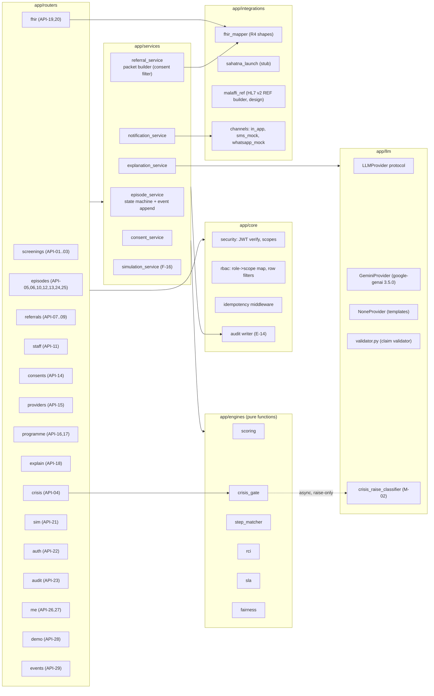
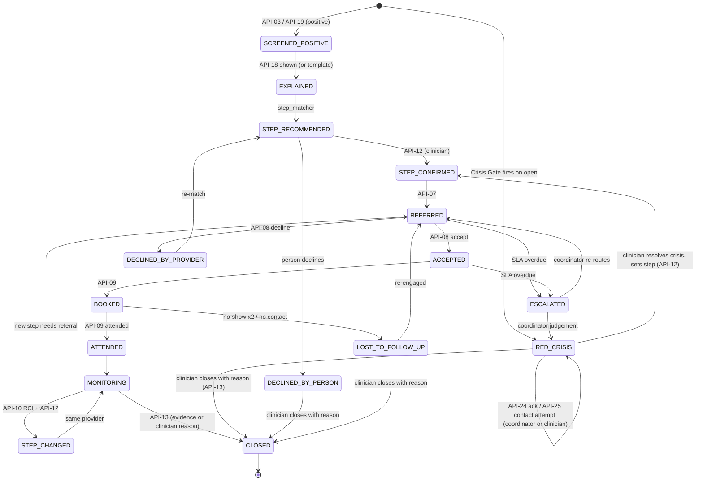
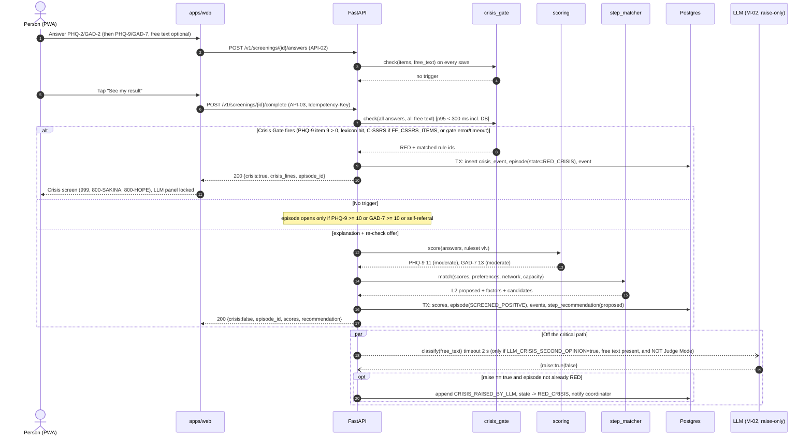
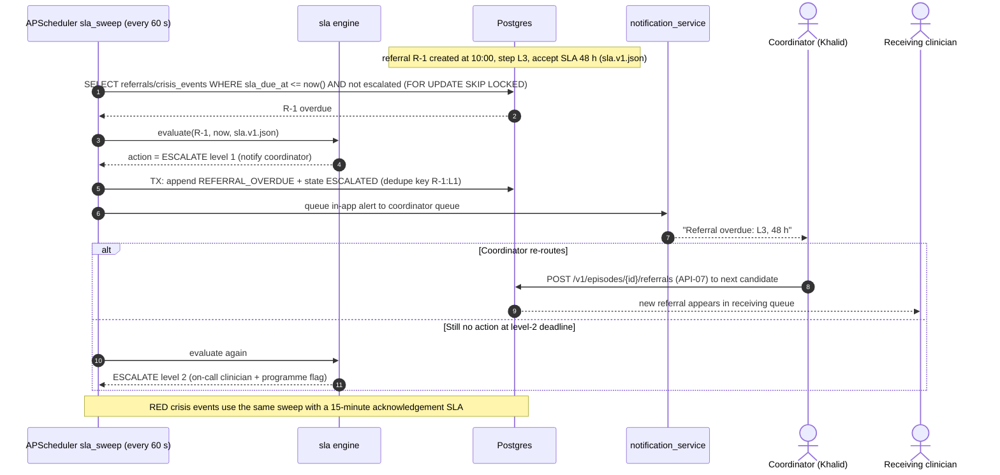
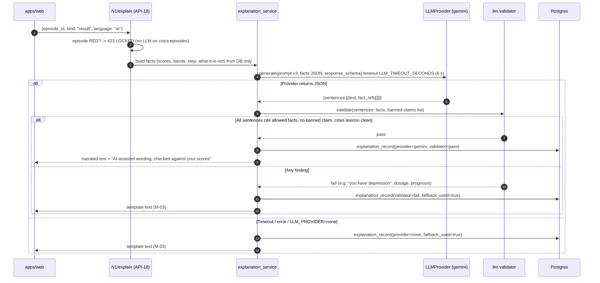
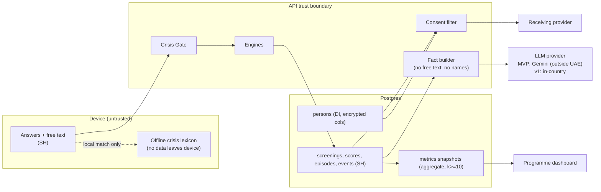
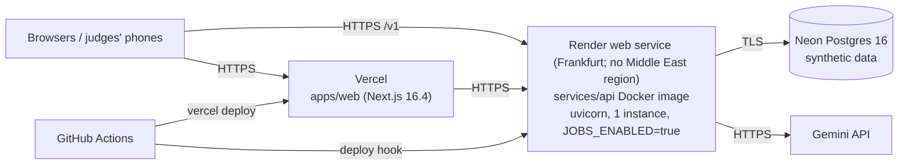
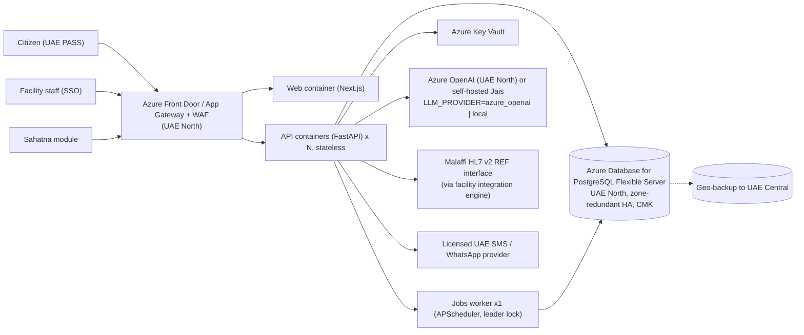

# Architecture
> Project: Jisr · Owner: Tech lead · Status: Draft v0.1 · Last updated: 2026-11-18
> Related: [Project brief](../00-overview/PROJECT_BRIEF.md) · [PRD](../01-product/PRD.md) · [Tech stack](TECH_STACK.md) · [Data model](DATA_MODEL.md) · [API spec](API_SPEC.md) · [Integrations](INTEGRATIONS.md) · [Backend](BACKEND.md) · [Frontend](FRONTEND.md) · [Performance](PERFORMANCE.md) · [ADRs](adr/)

Jisr is a **measurement-based stepped-care ledger**. A Next.js PWA talks to one FastAPI service. Deterministic engines (scoring, Crisis Gate, Step Matcher, RCI, SLA, fairness) make every decision from versioned JSON rules in `packages/rules`. An append-only episode event log is the record of truth. An LLM (Gemini in the MVP, an in-country model in v1) only **explains** and may only **raise** crisis risk.

## 1. Architectural principles

| # | Principle | Where it is enforced |
|---|---|---|
| AP-1 | **Crisis first.** The Crisis Gate runs before scoring output, before any LLM call, on every free-text field | `engines/crisis_gate.py`, called from API-03, API-04, API-10 and any endpoint that accepts free text ([ADR-0006](adr/ADR-0006-crisis-gate-raise-only-llm.md)) |
| AP-2 | **Rules decide, clinicians confirm, AI explains** | Step Matcher output is a `StepRecommendation` (E-08) with status `proposed`. Only API-12 (clinician scope) moves it to `confirmed` ([ADR-0003](adr/ADR-0003-deterministic-rules-engine-json.md)) |
| AP-3 | **The event log is the truth** | `episode_events` (E-07) is append-only and hash-chained. `episodes` (E-06) is a projection written in the same transaction ([ADR-0002](adr/ADR-0002-postgres-event-sourced-episode-log.md)) |
| AP-4 | **The LLM is replaceable and optional** | `LLMProvider` interface; `LLM_PROVIDER=none` gives a fully working product on templates ([ADR-0004](adr/ADR-0004-gemini-mvp-llmprovider-in-country-v1.md)) |
| AP-5 | **Minimum necessary, consent-gated** | Referral packets and FHIR exports are built through a consent filter (E-02). Programme views are aggregate-only, with k < 10 suppression |
| AP-6 | **Synthetic data only in the MVP** | `persons.is_synthetic` is `NOT NULL DEFAULT true` with a `CHECK (is_synthetic)` constraint in the MVP schema |

## 2. C4 level 1: System context

```mermaid
flowchart LR
  person(["Person<br/>P-01 Mariam, P-02 Imran<br/>(phone browser / PWA)"])
  clin(["Clinician<br/>P-03 Dr Salma"])
  coord(["Care coordinator<br/>P-04 Khalid"])
  prog(["Programme lead<br/>P-05 ADPHC"])
  judge(["Hackathon judge<br/>(Judge Mode)"])

  jisr["Jisr<br/>stepped-care ledger:<br/>screening, crisis gate, step matching,<br/>warm hand-off, measurement, dashboards"]

  ifhas["IFHAS results<br/>(FHIR bundle, seeded in MVP)"]
  sahatna["Sahatna app<br/>(launch stub in MVP)"]
  malaffi["Malaffi HIE<br/>(HL7 v2 REF, design only in MVP)"]
  uaepass["UAE PASS<br/>(v1 only)"]
  gemini["Gemini API<br/>(MVP, synthetic data only)"]
  incountry["In-country LLM<br/>Azure OpenAI UAE North / Jais<br/>(v1)"]
  sms["SMS / WhatsApp<br/>(mock in MVP)"]
  crisis["Crisis lines<br/>999 · 800-SAKINA · 800-HOPE"]

  person -->|screens, consents, books| jisr
  clin -->|confirms step, records attendance| jisr
  coord -->|works crisis + overdue queue| jisr
  prog -->|reads aggregate KPIs| jisr
  judge -->|switches persona, runs tour| jisr
  ifhas -->|QuestionnaireResponse bundle| jisr
  sahatna -.->|deep link / launch context| jisr
  jisr -.->|REF^I12 referral (v1)| malaffi
  person -.->|OIDC sign-in (v1)| uaepass
  jisr -->|structured facts -> narration| gemini
  jisr -.->|v1 swap| incountry
  jisr -->|neutral notifications| sms
  jisr -->|tel: links shown| crisis
```

## 3. C4 level 2: Containers

```mermaid
flowchart TB
  subgraph Client["Client device"]
    pwa["apps/web<br/>Next.js 16.4 App Router PWA<br/>TypeScript, Tailwind 4.3, next-intl (ar/en/ur, RTL)<br/>Serwist service worker: offline crisis page + lexicon"]
  end

  subgraph Edge["Vercel (MVP) / Azure UAE North (v1)"]
    ssr["Next.js server<br/>RSC + route handlers<br/>(BFF: forwards JWT, no PHI cache)"]
  end

  subgraph API["services/api (Docker, Render MVP / Azure v1)"]
    fastapi["FastAPI 0.163 app<br/>routers, RBAC, idempotency"]
    engines["Deterministic engines<br/>scoring · crisis_gate · step_matcher · rci · sla · fairness"]
    llm["LLM layer<br/>LLMProvider: gemini | azure_openai | local | none<br/>claim validator + templates"]
    jobs["APScheduler 3.11<br/>SLA sweep, re-check due, LTFU, metrics snapshot"]
  end

  rules[("packages/rules<br/>versioned JSON + JSON Schema<br/>(baked into the image, hash recorded in E-17)")]
  db[("PostgreSQL 16<br/>Neon (MVP) / Azure Database for PostgreSQL UAE North (v1)<br/>projections + append-only episode_events + audit_log")]
  gem["Gemini API (MVP)"]
  notif["Notification mocks<br/>(SMS / WhatsApp) -> notifications table"]

  pwa -->|HTTPS JSON /v1| ssr
  pwa -->|HTTPS JSON /v1 (direct for mutations)| fastapi
  ssr --> fastapi
  fastapi --> engines
  fastapi --> llm
  engines --> rules
  fastapi --> db
  jobs --> db
  jobs --> engines
  llm -->|HTTPS, API key| gem
  fastapi --> notif
```

**Why one API service.** Two to four people have about 36 hours. One deployable Python service keeps the clinical logic in one language and one test suite, and keeps the crisis path free of network hops ([ADR-0001](adr/ADR-0001-monorepo-nextjs-fastapi.md)).

## 4. C4 level 3: Components of `services/api`



Engines are **pure functions**: input dataclasses in, result dataclasses out, no I/O, no clock reads (time is passed in). This makes them property-testable and lets the eval harness (F-18) call them directly.

## 5. Episode state machine (E-06)

Copied from the brief, with the transitions the engine allows.



- **Any state → `RED_CRISIS`** is always allowed (Crisis Gate on a re-check, free text, LLM raise, or clinician). It is omitted above for readability.
- `RED_CRISIS` can only be left by a **clinician** action (API-12 with `resolve_crisis=true`, or API-13). A coordinator may acknowledge it (API-24, stops the 15-minute clock) and log contact attempts (API-25); both are events with no state change. No system job or LLM can leave it.
- **When an episode opens** (`packages/rules/episode_open.v1.json`, brief §6): PHQ-9 ≥ 10 or GAD-7 ≥ 10, or PHQ-9 item 9 > 0, or a Crisis Gate fire on free text, or self-referral at any score (typically L0/L1). Below threshold with no request: explanation + optional re-check reminder, no episode.
- **Step rule:** separate PHQ-9 and GAD-7 bands; the **more severe instrument wins**; L4 via GAD-7 needs a complexity flag; modality is a preference within a level (Mariam: PHQ-9 11, GAD-7 13 → L2, family physician by tele-consult).
- The allowed-transition table lives in `packages/rules/transitions.v1.json`, so tests and the UI read the same file. An illegal transition returns `409 CONFLICT_STATE`.

## 6. Key flows (sequence diagrams)

### 6.1 Screening → Crisis Gate → episode (F-01, F-03, F-08)



The response to the person never waits on the LLM. If M-02 later raises, the PWA receives the change on its next poll of API-05 (every 10 s while a result screen is open) and switches to the crisis screen.

### 6.1b RED acknowledgement and contact attempts (F-03, F-11; API-24, API-25)

```mermaid
sequenceDiagram
  autonumber
  participant J as sla_sweep (60 s)
  participant DB as Postgres
  actor K as Coordinator (Khalid)
  actor D as On-call clinician
  Note over DB: crisis_event C-1, sla_due_at = detected_at + 15 min (SLA_RED_MINUTES)
  K->>DB: GET /v1/staff/queue?view=red (API-11)
  K->>DB: POST /v1/episodes/{id}/red/ack (API-24) -> RED_ACKNOWLEDGED, clock stops
  K->>DB: POST /v1/episodes/{id}/contact-attempts (API-25) {phone, no_answer}
  K->>DB: POST contact-attempts {phone, reached_safe}
  alt Not acknowledged by sla_due_at
    J->>DB: append ESCALATED level 1 (dedupe crisis:C-1:L1), page on-call clinician
  end
  D->>DB: POST /v1/episodes/{id}/confirm-step (API-12) {resolve_crisis: true, crisis_resolution: contacted_safe, step: L3, reason}
  Note over K,D: Coordinator can ack and log contacts; only a clinician leaves RED
```

Three `no_answer` attempts within 60 minutes escalate to the on-call clinician (rule in `sla.v1.json`).

### 6.2 Referral SLA escalation (F-07, F-08)



The sweep is idempotent: each escalation event carries a dedupe key (`{referral_id}:L{level}`) with a unique index, so a duplicate scheduler run cannot double-escalate.

### 6.3 Re-check → RCI → step change (F-09, F-10)

```mermaid
sequenceDiagram
  autonumber
  actor P as Person
  participant A as FastAPI
  participant CG as crisis_gate
  participant R as rci engine
  participant SM as step_matcher
  participant DB as Postgres
  actor D as Clinician

  P->>A: POST /v1/episodes/{id}/recheck (API-10) PHQ-9 + GAD-7
  A->>CG: check(item 9, free text)
  CG-->>A: no trigger
  A->>R: compare(baseline PHQ-9 16, now 9; rci.v1.json)
  R-->>A: delta -7, |delta| >= 6 -> reliable improvement (PHQ-9)
  A->>SM: suggest(step L3, reliable improvement, weeks in step 6)
  SM-->>A: suggest step-down L3 -> L2 (proposed)
  A->>DB: TX: scores(is_recheck), RECHECK_RECORDED, step_recommendation(source=rci, proposed)
  A-->>P: "Your scores improved. Your clinician will review."
  D->>A: GET /v1/staff/queue (API-11) -> "step change to confirm"
  D->>A: POST /v1/episodes/{id}/confirm-step (API-12) {step: L2, reason}
  A->>DB: TX: STEP_CHANGED event, recommendation confirmed, new SLA if a referral is needed
```

No step ever changes without API-12. If the re-check fires the Crisis Gate, the flow stops at step 3 and the episode goes to `RED_CRISIS`.

### 6.4 Explanation with claim validator (F-04, M-01, M-03)



The validator checks four things: (1) every sentence cites at least one `fact_ref` that exists in the input facts; (2) numbers in the text equal the numbers in the cited facts; (3) no phrase from `packages/rules/banned_claims.v1.json` (diagnosis, medication, prognosis, "you are fine", "no need to see anyone"); (4) the output is run back through the Crisis Gate lexicon. Details are in `docs/04-ai/PROMPTS.md`.

## 7. Data flow and classification



| Flow | Data | Control |
|---|---|---|
| Device → API | Answers, optional F-22 free text | TLS 1.2+. Free text is crisis-gated first; only the gate result and matched category are stored. Raw text is stored (encrypted: pgcrypto in MVP, Key Vault key in v1) **only** with consent `store_free_text` |
| API → LLM | De-identified structured facts only: instrument, total, band, step, language. **No name, no free text, no identifiers.** Only if consent `ai_drafted_summaries` is granted; otherwise templates | Fact builder whitelist; MVP data is synthetic; v1 endpoint in-country ([ADR-0004](adr/ADR-0004-gemini-mvp-llmprovider-in-country-v1.md)) |
| API → M-02 crisis classifier | Free text (synthetic in the MVP) | Off by default; **always off in Judge Mode** (judges type free text that must not leave the system). v1: in-country model only, or M-02 disabled |
| API → Provider | Referral packet: scores, step, preferences, crisis flag, physical context only if consented | Consent filter (E-02); every read is written to E-14 |
| API → Programme | Aggregates, suppressed where cell n < 10 | `fairness` engine; no row-level endpoint exists for the programme role |
| Person → own data | Episode, consents, access log | API-05, API-14, API-23 |

## 8. Deployment view

### MVP (hackathon)



- A single API instance runs the scheduler (`JOBS_ENABLED=true`). If a second instance is ever added, it starts with `JOBS_ENABLED=false`. A Postgres advisory lock (`pg_try_advisory_lock(4711)`) guards the sweep as a second line of defence.
- Free-tier cold starts on Render can exceed 30 s. For the demo, use a paid instance or a warm-up ping from the Judge Mode landing page plus an uptime check ([R-08](../06-security-compliance/RISK_REGISTER.md)).
- Fallback demo: `docker compose up` on a laptop with local Postgres ([ENVIRONMENT_SETUP.md](ENVIRONMENT_SETUP.md)), or `NEXT_PUBLIC_OFFLINE_DEMO=true`, which runs the web app from bundled seed data if the API is unreachable. SQLite is for local development only: the append-only triggers on `episode_events` and `audit_log` need Postgres (brief §10).

### v1 (production, in-country)



The v1 compute product (Azure Container Apps vs AKS vs App Service) and model availability in UAE North are **unverified**. Owner: Tech lead, confirm against the Azure products-by-region page before the pilot proposal (target: 2026-12-15). Core42 sovereign cloud is the alternative ([INTEGRATIONS.md](INTEGRATIONS.md)).

## 9. Scalability approach

| Concern | MVP | v1 |
|---|---|---|
| API | 1 instance; engines are CPU-light (< 5 ms per call) | Stateless containers behind a load balancer; scale on CPU and p95 latency |
| Scheduler | In-process APScheduler | Single dedicated worker with a leader lock. Move to a queue (for example Azure Service Bus) only if the sweep exceeds 10k due items per minute |
| DB | One Neon database | Flexible Server with read replica for programme metrics; `episode_events` partitioned by month once it passes ~50M rows |
| Programme metrics | Computed on request from projections (< 10k episodes) | Hourly `metrics_snapshot` table; dashboard reads snapshots only |
| LLM | Synchronous with a 6 s timeout (LLM_TIMEOUT_SECONDS), templates on failure | Cache explanations keyed by `(facts_hash, language, prompt_version)`; most explanations repeat because facts are banded |

Back-of-envelope for Abu Dhabi: about 16% of screened adults are moderate-to-severe ([brief §2](../00-overview/PROJECT_BRIEF.md)). Even 100k screens a year gives roughly 16k–30k episodes and under 1M events a year. One Postgres instance handles this comfortably.

## 10. Offline and sync strategy

- **Crisis content works offline.** The service worker precaches `/[locale]/crisis`, the crisis numbers, and the compiled crisis lexicon (`packages/rules/crisis_lexicon.v1.json`, about 30 KB). If the network drops while the person types, a local lexicon match shows the crisis screen at once. The server Crisis Gate is still authoritative; the local check only ever **adds** a safety screen.
- **Screening answers** are saved per item (API-02). Unsent answers are queued in IndexedDB and replayed with the same `Idempotency-Key` when the connection returns.
- **No PHI is cached by the service worker.** API responses use `Cache-Control: no-store`. Only static assets, translations and the crisis bundle are cached.
- Staff and programme screens are online-only.

## 11. Failure modes

| # | Failure | Detection | Behaviour (fail-safe direction) | Risk |
|---|---|---|---|---|
| FM-01 | LLM timeout, error or quota exhausted | Provider exception or > LLM_TIMEOUT_SECONDS (6 s) | Template text (M-03); `fallback_used=true` in E-18; banner unchanged | R-02, R-08 |
| FM-02 | LLM output fails validator | Validator finding | Template text; finding logged for the eval set | R-02 |
| FM-03 | LLM tries to lower risk ("not a crisis") | Not possible: M-02 output schema only has `raise: bool`; `false` is a no-op | Crisis state unchanged | R-01 |
| FM-04 | Crisis Gate exception **or timeout** (> 250 ms internal budget) | Exception or deadline in `crisis_gate.check` | **Fail closed** (`CRISIS_FAILSAFE=red`): treat as RED, show emergency guidance, open a RED episode (`source=gate_error`) for human review, page coordinator | R-01 |
| FM-05 | Rules file missing or hash mismatch at boot | Startup check against E-17 | API refuses to start (`/healthz` fails); last good image keeps serving | R-01 |
| FM-06 | DB unavailable | Health check, SQLAlchemy error | API returns 503 problem+json; PWA shows offline crisis page and numbers; answers stay queued on the device | R-08 |
| FM-07 | Scheduler not running | `last_sweep_at` older than 2 min on `/healthz` | Health check goes amber; uptime alert; queue screen shows "SLA clock paused" banner | R-08 |
| FM-08 | Duplicate scheduler instances | Dedupe-key unique violation (expected, swallowed) | No double escalation | — |
| FM-09 | Provider declines | API-08 decline | `DECLINED_BY_PROVIDER` → re-match with that provider excluded | R-12 |
| FM-10 | No provider with capacity | Step Matcher returns zero candidates | Recommendation still made; episode flagged `NO_CAPACITY`, goes to coordinator queue; waiting-well modules (F-09) assigned | R-12 |
| FM-11 | Consent revoked mid-referral | Consent change event | Pending packet rebuilt without revoked scopes; provider view re-filtered on next read | R-09 |
| FM-12 | Render cold start during the demo | Warm-up ping latency | Judge Mode landing page pings `/healthz` on load; local docker fallback | R-08 |
| FM-13 | Gemini sends data outside the UAE | By design in the MVP | Synthetic data only, enforced by `is_synthetic` check; v1 swaps provider | R-03 |

## 12. Trade-offs

| Decision | We gain | We give up |
|---|---|---|
| Monolith API, not microservices | Speed, one test suite, no network hop on the crisis path | Independent scaling of engines (not needed at this volume) |
| Event log + projection in Postgres, not a dedicated event store | One database, transactional consistency, simple ops | Built-in replay tooling (we write a small rebuild script) |
| JSON rules, not a rules DSL or Drools | Clinicians can review diffs; both Python and TS can read it | Expressiveness (complex logic stays in Python with tests) |
| LLM explain-only | Safety case is simple and testable | Some fluency; template text is plainer |
| APScheduler, not Celery/Redis | No extra infrastructure | Horizontal workers (single-leader is enough) |
| PWA, not native | One codebase, no store review in 36 h | Push notifications on iOS need home-screen install; see [MOBILE.md](MOBILE.md) |

## 13. ADR index

| ADR | Decision |
|---|---|
| [ADR-0001](adr/ADR-0001-monorepo-nextjs-fastapi.md) | Monorepo: Next.js web + FastAPI API |
| [ADR-0002](adr/ADR-0002-postgres-event-sourced-episode-log.md) | Postgres with an event-sourced episode log |
| [ADR-0003](adr/ADR-0003-deterministic-rules-engine-json.md) | Deterministic rules engine in JSON; LLM explain-only |
| [ADR-0004](adr/ADR-0004-gemini-mvp-llmprovider-in-country-v1.md) | Gemini for the MVP behind `LLMProvider`; in-country swap for v1 |
| [ADR-0005](adr/ADR-0005-demo-auth-judge-mode-uae-pass-later.md) | Demo auth and Judge Mode now; UAE PASS later |
| [ADR-0006](adr/ADR-0006-crisis-gate-raise-only-llm.md) | Crisis Gate with a raise-only LLM policy |
