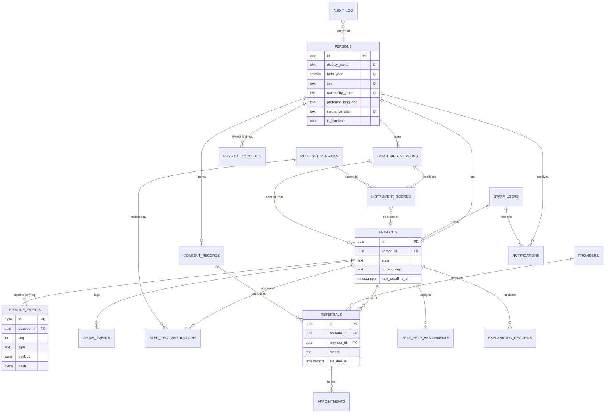

# Data Model
> Project: Jisr · Owner: Backend lead · Status: Draft v0.1 · Last updated: 2026-11-18
> Related: [Project brief](../00-overview/PROJECT_BRIEF.md) · [Architecture](ARCHITECTURE.md) · [API spec](API_SPEC.md) · [Privacy](../06-security-compliance/PRIVACY.md) · [ADR-0002](adr/ADR-0002-postgres-event-sourced-episode-log.md)

Postgres 16 is the store. Tables are snake_case plurals. All primary keys are UUID v7 (time-ordered, generated in Python) except `episode_events.id` and `audit_log.id` (`bigint identity`). All timestamps are `timestamptz` in UTC; the UI renders in `Asia/Dubai`.

## 1. PII classification

| Class | Meaning | Handling |
|---|---|---|
| **DI** | Direct identifier (name, phone, national/insurance number) | Encrypted column in v1 (`pgcrypto` / app-level AES-GCM with Key Vault key); never logged; never sent to an LLM |
| **SH** | Special-category health data (answers, scores, crisis, episode, free text) | Access by role + consent; every read written to E-14; free text encrypted; never sent to a non-UAE endpoint in v1 |
| **QI** | Quasi-identifier (birth year, sex, nationality group, insurance plan, language) | Used for matching and fairness in aggregate only; k ≥ 10 for any programme output |
| **OP** | Operational, not about a person (provider directory, rule versions, IDs, timestamps) | Normal |

## 2. Retention

| Environment | Rule |
|---|---|
| **MVP (hackathon)** | Postgres only for any shared environment (SQLite is local dev only, because the append-only triggers need Postgres). All data is synthetic (`is_synthetic = true`, enforced by `CHECK`). The demo DB is reset by `python -m app.seed --reset` and deleted 30 days after judging (owner: Tech lead, by 2026-12-31). |
| **v1 (production)** | Clinical records (E-03..E-11, E-15, E-16, E-18): **at least 25 years from the last encounter**, per UAE Federal Law 2/2019 Art. 20 as commonly summarised ([K], legal review needed, owner: Product lead, before pilot contract). Audit log (E-14): same as the clinical record it covers. Notifications (E-12): 1 year, then content redacted, metadata kept. Consent history (E-02): life of the record. Explanation records (E-18): output text kept with the record; raw prompts not stored. |

## 3. ER diagram

(The diagram shows key columns only; full definitions follow.)

## 4. Entities

Notation: `PK` primary key, `FK` foreign key, `NN` not null, `U` unique, `IX` indexed. PII column = class from §1.

### E-01 Person — `persons`
| Field | Type | Constraints | PII | Notes |
|---|---|---|---|---|
| id | uuid | PK | OP | |
| display_name | text | NN | DI | Synthetic in MVP |
| phone_e164 | text | | DI | Synthetic; encrypted in v1 |
| uae_pass_sub | text | U | DI | v1 only (UAE PASS subject) |
| emirates_id_hash | bytea | U | DI | v1 only, HMAC-SHA256 with pepper; MVP null |
| birth_year | smallint | NN; person must be 18+ (MVP scope: adults; IFHAS covers 18–75) | QI | Age band for fairness; no full DOB stored |
| sex | text | NN, `female\|male` | QI | Used for clinician-gender matching and fairness |
| nationality_group | text | NN, `emirati\|non_emirati_arab\|south_asian\|other` | QI | Fairness subgroup; coarse by design |
| preferred_language | text | NN, `ar\|en\|ur` | QI | |
| insurance_plan | text | NN, `thiqa\|basic\|enhanced\|other\|none` | QI | Network-aware routing |
| insurance_network_id | text | | QI | Synthetic network code |
| clinician_gender_pref | text | `female\|male\|none` | SH | Preference is health-adjacent |
| modality_pref | text[] | ⊆ `in_person,video,phone` | OP | |
| area | text | `abu_dhabi_city\|al_ain\|al_dhafra` | QI | Coarse region for routing |
| discreet_mode | boolean | NN default false | SH | F-14 |
| read_aloud | boolean | NN default false | OP | F-20 |
| is_synthetic | boolean | NN default true, `CHECK (is_synthetic)` in MVP | OP | Removed in v1 migration |
| created_at, updated_at, deleted_at | timestamptz | | OP | Soft delete |

Indexes: `uq_persons_uae_pass_sub`, `ix_persons_insurance_plan`.
**Preferences** (API-26) are the columns `preferred_language`, `clinician_gender_pref`, `modality_pref`, `area`, `insurance_plan`, `discreet_mode`, `read_aloud`; no separate table. A change on an open episode appends `PREFERENCES_CHANGED` and a new `proposed` recommendation.

### E-02 ConsentRecord — `consent_records` (append-only history)
| Field | Type | Constraints | PII | Notes |
|---|---|---|---|---|
| id | uuid | PK | OP | |
| person_id | uuid | FK persons, NN, IX | OP | |
| scope | text | NN, enum below | SH | |
| status | text | NN `granted\|revoked` | SH | |
| version | int | NN | OP | Increments per scope |
| notice_version | text | NN | OP | Which notice text was shown |
| actor_type / actor_id | text / uuid | NN | OP | Person, or staff on behalf |
| recorded_at | timestamptz | NN | OP | |
| fhir_consent_id | text | | OP | For export |

Scopes (brief §5 cross-cutting rules): `share_with_receiving_provider` (covers the receiving provider of a referral), `share_physical_context` (F-12), `ai_drafted_summaries` (de-identified structured facts to the LLM; off ⇒ template-only), `store_free_text` (F-22), `notify_sms`, `notify_whatsapp`.
View `current_consents` = latest row per `(person_id, scope)`. Index `ix_consents_person_scope_version (person_id, scope, version DESC)`.

### E-03 ScreeningSession — `screening_sessions`
| Field | Type | Constraints | PII | Notes |
|---|---|---|---|---|
| id | uuid | PK | OP | |
| person_id | uuid | FK, NN, IX | OP | |
| source | text | NN `jisr_app\|ifhas_import\|clinic` | OP | |
| stage | text | NN `prescreen\|full\|recheck` | OP | PHQ-2/GAD-2 → PHQ-9/GAD-7 |
| language | text | NN `ar\|en\|ur` | QI | |
| status | text | NN `in_progress\|completed\|abandoned` | OP | |
| answers | jsonb | NN default `{}` | SH | `{"PHQ9_1":2,…,"CSSRS_1":false}` |
| free_text_gate_result | text | `none\|red\|gate_error` | SH | F-22: always stored when the box was used |
| free_text_category | text | e.g. `self_harm_indirect`, `hopelessness` | SH | Matched lexicon category only |
| free_text_enc | bytea | NULL unless consent `store_free_text` was granted at submit time | SH | F-22 raw text, encrypted; never logged; never sent to M-01 |
| episode_id | uuid | FK episodes | OP | Set for re-checks |
| rule_set_version_id | uuid | FK, NN | OP | |
| started_at / completed_at | timestamptz | | OP | |

### E-04 InstrumentScore — `instrument_scores`
| Field | Type | Constraints | PII | Notes |
|---|---|---|---|---|
| id | uuid | PK | OP | |
| session_id | uuid | FK, NN, IX | OP | |
| person_id | uuid | FK, NN, IX | OP | Denormalised for RCI lookups |
| episode_id | uuid | FK, IX | OP | |
| instrument | text | NN `PHQ2\|GAD2\|PHQ9\|GAD7\|CSSRS_SCREEN` | SH | |
| total | smallint | NN, range per instrument (PHQ-9 0–27, GAD-7 0–21, PHQ-2/GAD-2 0–6) | SH | |
| band | text | NN `minimal\|mild\|moderate\|moderately_severe\|severe\|positive\|negative` | SH | |
| item9 | smallint | 0–3 | SH | PHQ-9 only |
| is_recheck | boolean | NN | OP | |
| loinc_code | text | | OP | See §6 |
| rule_set_version_id | uuid | FK, NN | OP | |
| scored_at | timestamptz | NN | OP | |

Index `ix_scores_episode_instrument_time (episode_id, instrument, scored_at)`.

### E-05 CrisisEvent — `crisis_events`
| Field | Type | Constraints | PII | Notes |
|---|---|---|---|---|
| id | uuid | PK | OP | |
| person_id, episode_id | uuid | FK, NN, IX | OP | |
| session_id | uuid | FK | OP | |
| source | text | NN `phq9_item9\|cssrs\|lexicon\|llm_raise\|clinician\|gate_error` | SH | `cssrs` only when `FF_CSSRS_ITEMS=true` (R-05); `gate_error` = exception or timeout (fail-closed) |
| urgency | text | NN `emergency\|same_day_check` | SH | Item 9 = 1 ⇒ `same_day_check` (OQ-01) |
| matched_rule_ids | text[] | NN | SH | Lexicon entry IDs, not the raw text |
| matched_category | text | | SH | |
| detected_at | timestamptz | NN | OP | |
| gate_latency_ms | int | | OP | Performance SLI |
| sla_due_at | timestamptz | NN, IX | OP | detected_at + `SLA_RED_MINUTES` |
| acknowledged_by / acknowledged_at | uuid / timestamptz | | OP | API-24, coordinator or clinician |
| resolved_at, resolution | timestamptz, text | | SH | `contacted_safe\|emergency_services\|referred_l4\|unreachable_escalated` |
| escalation_level | smallint | NN default 0 | OP | |

### E-06 Episode — `episodes` (projection of E-07)
| Field | Type | Constraints | PII | Notes |
|---|---|---|---|---|
| id | uuid | PK | OP | |
| person_id | uuid | FK, NN, IX | OP | |
| state | text | NN, one of the 16 states in the brief (11 main incl. `STEP_CHANGED`, 5 side) | SH | Opens only when PHQ-9 ≥ 10, GAD-7 ≥ 10, item 9 > 0, Crisis Gate fire, or self-referral (`episode_open.v1.json`) |
| opened_reason | text | NN `threshold\|item9\|crisis_free_text\|gate_error\|self_referral\|ifhas_import` | SH | |
| current_step | text | `L0..L4\|RED` | SH | Last confirmed step (null until confirmed) |
| proposed_step | text | | SH | Latest proposal |
| is_red | boolean | NN default false, IX | SH | |
| owner_staff_id | uuid | FK staff_users, IX | OP | |
| owner_team | text | `coordination\|primary_care\|tele_mh\|psychiatry` | OP | |
| next_deadline_at | timestamptz | IX | OP | Earliest open SLA |
| next_deadline_kind | text | | OP | `crisis_ack` (15 min) `\|referral_accept` (48 h) `\|first_appt` (≤ 14 d from positive screen) `\|recheck` (every 14 d while monitoring) |
| opened_from_session_id | uuid | FK | OP | |
| opened_at / closed_at | timestamptz | | OP | |
| close_reason | text | | SH | `evidence_attended_recheck\|clinician_decision\|declined_by_person\|ltfu` |
| last_event_seq | int | NN | OP | Optimistic concurrency |
| rule_set_version_id | uuid | FK, NN | OP | |

Indexes: `ix_episodes_state_deadline (state, next_deadline_at)`, partial `ix_episodes_red_open ON episodes(next_deadline_at) WHERE is_red AND closed_at IS NULL`.

### E-07 EpisodeEvent — `episode_events` (append-only)
| Field | Type | Constraints | PII | Notes |
|---|---|---|---|---|
| id | bigint | PK identity | OP | |
| episode_id | uuid | FK, NN | OP | |
| seq | int | NN; `U (episode_id, seq)` | OP | 1, 2, 3 … no gaps |
| type | text | NN | OP | e.g. `EPISODE_OPENED`, `CRISIS_DETECTED`, `CRISIS_RAISED_BY_LLM`, `RED_ACKNOWLEDGED`, `CONTACT_ATTEMPT`, `EXPLAINED`, `STEP_RECOMMENDED`, `STEP_CONFIRMED`, `REFERRED`, `REFERRAL_ACCEPTED`, `REFERRAL_DECLINED`, `REFERRAL_OVERDUE`, `ESCALATED`, `APPOINTMENT_BOOKED`, `ATTENDED`, `NO_SHOW`, `RECHECK_RECORDED`, `STEP_CHANGED`, `PREFERENCES_CHANGED`, `CONSENT_CHANGED`, `CRISIS_RESOLVED`, `CLOSED` |
| from_state / to_state | text | | SH | |
| payload | jsonb | NN | SH | IDs and structured values only; no free text |
| actor_type | text | NN `person\|staff\|system\|llm` | OP | `llm` only for `CRISIS_RAISED_BY_LLM` |
| actor_id | uuid | | OP | |
| dedupe_key | text | U (partial, not null) | OP | Scheduler idempotency, e.g. `ref:{id}:L1` |
| occurred_at | timestamptz | NN | OP | |
| prev_hash / hash | bytea | NN | OP | `hash = sha256(prev_hash ‖ canonical_json(row))` |

**ContactAttempt is an event, not a table** (API-25). Payload: `{"channel": "phone|video|sms|whatsapp|in_person|crisis_line_transfer", "outcome": "reached_safe|reached_needs_emergency|no_answer|wrong_number|declined_contact|voicemail_neutral", "attempt_number": 1, "next_attempt_at": null}`; `from_state = to_state` (no transition). `RED_ACKNOWLEDGED` (API-24) likewise has no state change; it stops the RED SLA clock.

Append-only is enforced three ways: the app role has `INSERT, SELECT` only on this table; a `BEFORE UPDATE OR DELETE` trigger raises; and a nightly job verifies the hash chain.

### E-08 StepRecommendation — `step_recommendations`
| Field | Type | Constraints | PII | Notes |
|---|---|---|---|---|
| id | uuid | PK | OP | |
| episode_id | uuid | FK, NN, IX | OP | |
| source | text | NN `initial\|rci\|decline_rematch\|clinician` | OP | |
| recommended_step | text | NN `L0..L4\|RED` | SH | |
| factors | jsonb | NN | SH | `[{"factor":"severity","value":"PHQ9=11 moderate","effect":"L2","rule_id":"STEP-SEV-03"}]` |
| candidate_provider_ids | uuid[] | NN | OP | Ranked |
| status | text | NN `proposed\|confirmed\|overridden\|superseded` | OP | |
| confirmed_step | text | | SH | |
| confirmed_by / confirmed_at | uuid / timestamptz | | OP | Must be a clinician |
| override_reason | text | required if confirmed_step ≠ recommended_step | SH | |
| rule_set_version_id | uuid | FK, NN | OP | |
| created_at | timestamptz | NN | OP | |

### E-09 Provider — `providers` (synthetic directory, F-06)
| Field | Type | Constraints | PII | Notes |
|---|---|---|---|---|
| id | uuid | PK | OP | |
| display_name / facility_name | text | NN | OP | Synthetic names |
| kind | text | NN `community\|family_physician\|psychologist\|tele_mh\|psychiatry` | OP | |
| steps_served | text[] | NN ⊆ L1..L4 | OP | |
| languages | text[] | NN | OP | |
| clinician_gender | text | `female\|male` | OP | |
| modalities | text[] | NN | OP | |
| networks | text[] | NN | OP | e.g. `thiqa`, `basic`, `enhanced` |
| city | text | NN | OP | Abu Dhabi, Al Ain, Al Dhafra |
| capacity_per_week | int | NN ≥ 0 | OP | |
| current_wait_days | int | NN ≥ 0 | OP | |
| accepting | boolean | NN | OP | |
| sahatna_facility_code / malaffi_facility_id | text | | OP | v1 |
| is_synthetic | boolean | NN default true | OP | |

GIN indexes on `languages`, `networks`, `steps_served`.

### E-10 Referral — `referrals` (FHIR `ServiceRequest` + `Task`)
| Field | Type | Constraints | PII | Notes |
|---|---|---|---|---|
| id | uuid | PK | OP | |
| episode_id / provider_id | uuid | FK, NN, IX | OP | |
| step | text | NN | SH | |
| priority | text | NN `routine\|urgent\|asap\|stat` | SH | FHIR `ServiceRequest.priority` codes |
| status | text | NN `requested\|accepted\|declined\|cancelled\|completed\|expired` | OP | Maps to `Task.status` |
| packet | jsonb | NN | SH | Consent-filtered snapshot at send time |
| consent_record_id | uuid | FK, NN | OP | The consent that allowed the share |
| created_by_type / created_by_id | text / uuid | NN | OP | Person (self-referral with consent) or staff |
| sla_due_at | timestamptz | NN, IX | OP | created_at + `SLA_REFERRAL_ACCEPT_HOURS` |
| escalation_level | smallint | NN default 0 | OP | |
| decided_at / decided_by | timestamptz / uuid | | OP | |
| decline_reason | text | `no_capacity\|out_of_scope\|network\|other` | SH | |
| hl7_ref_control_id | text | | OP | v1: MSH-10 of the REF^I12 sent to Malaffi |
| created_at | timestamptz | NN | OP | |

### E-11 Appointment — `appointments`
| Field | Type | Constraints | PII | Notes |
|---|---|---|---|---|
| id | uuid | PK | OP | |
| referral_id / episode_id / provider_id | uuid | FK, NN | OP | |
| start_at | timestamptz | NN | SH | Date of a mental-health appointment is sensitive |
| modality | text | NN | OP | |
| status | text | NN `booked\|attended\|no_show\|cancelled` | SH | |
| booked_by_type / booked_by_id | text / uuid | NN | OP | |
| recorded_by | uuid | | OP | Clinician who recorded attendance |
| created_at | timestamptz | NN | OP | |

### E-12 Notification — `notifications`
| Field | Type | Constraints | PII | Notes |
|---|---|---|---|---|
| id | uuid | PK | OP | |
| recipient_type / recipient_id | text / uuid | NN, IX | OP | Person or staff |
| channel | text | NN `in_app\|sms_mock\|whatsapp_mock` | OP | |
| template_key | text | NN | OP | |
| rendered_text | text | NN | SH | Neutral wording if discreet mode ("You have a new message in your health app") |
| episode_id | uuid | FK | OP | |
| status | text | NN `queued\|sent\|failed\|read` | OP | |
| created_at / sent_at / read_at | timestamptz | | OP | |

### E-13 StaffUser — `staff_users`
| Field | Type | Constraints | PII | Notes |
|---|---|---|---|---|
| id | uuid | PK | OP | |
| display_name | text | NN | DI (staff) | Synthetic |
| role | text | NN `clinician\|coordinator\|programme` | OP | Judge is not a staff role (see API_SPEC) |
| facility_id | text | | OP | Row-level filter for clinicians |
| provider_id | uuid | FK providers | OP | Links a clinician to the directory entry they decide for |
| languages | text[] | | OP | |
| gender | text | | OP | |
| licence_no | text | | DI (staff) | Synthetic DoH licence format |
| on_call | boolean | NN default false | OP | RED routing |
| is_active | boolean | NN | OP | |

### E-14 AuditLog — `audit_log` (append-only)
| Field | Type | Constraints | PII | Notes |
|---|---|---|---|---|
| id | bigint | PK identity | OP | |
| occurred_at | timestamptz | NN, IX | OP | |
| actor_type / actor_id / actor_role | text / uuid / text | NN | OP | |
| action | text | NN `read\|create\|update\|export\|login\|consent_change` | OP | |
| resource_type / resource_id | text / text | NN | OP | |
| subject_person_id | uuid | IX | OP | Powers API-23 |
| purpose | text | NN `care\|coordination\|self\|programme_aggregate\|demo` | OP | |
| outcome | text | NN `allowed\|denied` | OP | |
| ip_hash | bytea | | QI | HMAC, not raw IP |
| request_id | text | | OP | Trace correlation |

Same append-only protections as E-07.

### E-15 SelfHelpAssignment — `self_help_assignments` (F-09)
| Field | Type | Constraints | PII | Notes |
|---|---|---|---|---|
| id | uuid | PK | OP | |
| episode_id | uuid | FK, NN, IX | OP | |
| module_key | text | NN `sleep_basics\|worry_time\|behavioural_activation` | SH | |
| assigned_at | timestamptz | NN | OP | |
| progress_pct | smallint | 0–100 | SH | |
| completed_at | timestamptz | | OP | |
| recheck_due_at | timestamptz | NN, IX | OP | assigned_at + `RECHECK_DAYS` |

### E-16 PhysicalContext — `physical_contexts` (F-12)
| Field | Type | Constraints | PII | Notes |
|---|---|---|---|---|
| id | uuid | PK | OP | |
| person_id | uuid | FK, NN, IX | OP | |
| source | text | NN `ifhas_import` | OP | |
| observed_at | timestamptz | NN | SH | |
| hba1c_pct | numeric(4,1) | 3.0–20.0 | SH | |
| bmi | numeric(4,1) | 10–80 | SH | |
| bp_systolic / bp_diastolic | smallint | 60–260 / 30–160 | SH | |

Wearable sleep data is **v2, opt-in only** (brief F-12); no sleep column in the MVP.
| source_bundle_id | text | | OP | FHIR Bundle id |

Shown to a clinician only if `share_physical_context` is granted at read time.

### E-17 RuleSetVersion — `rule_set_versions`
| Field | Type | Constraints | PII | Notes |
|---|---|---|---|---|
| id | uuid | PK | OP | |
| version | text | NN, U, semver | OP | e.g. `1.0.0` |
| sha256 | text | NN | OP | Hash of the canonical rules bundle; checked at boot |
| manifest | jsonb | NN | OP | File list, per-file version and hash |
| citations | jsonb | NN | OP | DoH standard 2025, NICE CG123, Kroenke 2001, Spitzer 2006, RCI source |
| status | text | NN `active\|retired` | OP | Exactly one `active` (partial unique index) |
| activated_at / activated_by | timestamptz / text | | OP | Git SHA in the MVP |

### E-18 ExplanationRecord — `explanation_records`
| Field | Type | Constraints | PII | Notes |
|---|---|---|---|---|
| id | uuid | PK | OP | |
| episode_id | uuid | FK, NN, IX | OP | |
| kind | text | NN `result\|step\|message` | OP | |
| language | text | NN | QI | |
| provider | text | NN `gemini\|azure_openai\|local\|none` | OP | |
| model_id | text | | OP | Resolved model id returned by the provider |
| prompt_version | text | NN | OP | `ai/prompts/explain_result.v3` |
| facts | jsonb | NN | SH | Structured inputs only |
| facts_hash | text | NN, IX | OP | Cache key |
| output_text | text | NN | SH | What the person saw |
| validator_result | text | NN `pass\|fail\|skipped` | OP | |
| validator_findings | jsonb | NN default `[]` | OP | |
| fallback_used | boolean | NN | OP | |
| latency_ms / tokens_in / tokens_out | int | | OP | |
| created_at | timestamptz | NN | OP | |

### Supporting tables (not domain entities, no E-ID)
| Table | Fields | PII | Retention | Purpose |
|---|---|---|---|---|
| `idempotency_keys` | key uuid, route text, actor_id uuid, request_hash text, response jsonb, created_at | OP (response may hold SH → 24 h TTL) | 24 h | Replay of state-changing POSTs |
| `analytics_events` | id bigint, name text, ts timestamptz, props jsonb (allow-listed keys only), session_rand text (random per tab), role text, locale text | OP: no person ID, no scores, no free text | 13 months | API-29 first-party analytics |
| `scheduler_state` | job_id text PK, last_run_at, last_ok_at, last_error | OP | rolling | `/healthz` "SLA clock running" check |

## 5. Event sourcing rules

- **Write path:** `episode_service.apply(command)` loads the episode `FOR UPDATE`, checks the transition against `packages/rules/transitions.v1.json`, inserts the event with `seq = last_event_seq + 1`, updates the projection, and commits. All in one transaction.
- **Rebuild:** `python -m app.tools.rebuild_projections` replays events into fresh `episodes` rows and diffs against the live table (used in tests and the nightly integrity job).
- **Timeline:** API-05 returns events directly; no separate timeline table.

## 6. FHIR R4 mapping

| Entity | FHIR R4 resource(s) | Key mapping |
|---|---|---|
| E-01 Person | `Patient` | `identifier` (synthetic MRN; v1 UAE PASS / Emirates ID system URIs from DoH), `communication.language` (`ar`, `en`, `ur`), `gender` |
| E-02 ConsentRecord | `Consent` | `scope` = `patient-privacy`; `provision.type` permit/deny; `provision.purpose`; `provision.actor` = receiving organisation |
| E-03 ScreeningSession | `QuestionnaireResponse` (+ `Encounter` in clinic) | `questionnaire` = canonical PHQ-9 / GAD-7 Questionnaire URL; `item.linkId` = `PHQ9_1` … |
| E-04 InstrumentScore | `Observation` (category `survey`) | PHQ-9 panel LOINC **44249-1** and GAD-7 panel **69737-5** (brief). Total-score codes PHQ-9 44261-6, GAD-7 70274-6, PHQ-2 55758-7 are [K]; GAD-2 total code is **unverified** (owner Backend lead, check loinc.org by H+12) |
| E-05 CrisisEvent | `Flag` (+ `RiskAssessment`) | `Flag.code` local `jisr#crisis-red`; `RiskAssessment.basis` → Observation / QuestionnaireResponse; `RiskAssessment.method` = rule ids |
| E-06 Episode | `EpisodeOfCare` | `status` mapping: SCREENED_POSITIVE…STEP_CONFIRMED → `planned`; REFERRED…MONITORING → `active`; ESCALATED / RED_CRISIS → `active` + `Flag`; CLOSED → `finished`; DECLINED_* / LTFU → `cancelled` |
| E-07 EpisodeEvent | `Provenance` | `target` = changed resource, `agent` = actor, `activity` = event type, `recorded` = occurred_at |
| E-08 StepRecommendation | `GuidanceResponse` | `reasonCode`/`outputParameters` carry factors; confirmed step written to `CarePlan.activity` |
| E-09 Provider | `Organization`, `PractitionerRole`, `HealthcareService` | Languages → `PractitionerRole.extension`/`HealthcareService.communication`; network → `HealthcareService.coverageArea`/extension (v1: IHE mCSD) |
| E-10 Referral | `ServiceRequest` + `Task` | `Task.focus` → ServiceRequest; `Task.restriction.period.end` = `sla_due_at`; `Task.status` requested/accepted/rejected/completed; `businessStatus` = escalation level (HL7 BSeR pattern) |
| E-11 Appointment | `Appointment` (+ `Encounter` when attended) | `status` booked/fulfilled/noshow/cancelled |
| E-12 Notification | `Communication` | `medium` = SMS / app; `payload.contentString` = neutral text |
| E-13 StaffUser | `Practitioner` + `PractitionerRole` | |
| E-14 AuditLog | `AuditEvent` | |
| E-15 SelfHelpAssignment | `CarePlan.activity` / `Task` | |
| E-16 PhysicalContext | `Observation` | HbA1c LOINC 4548-4, BMI 39156-5, blood-pressure panel 85354-9 [K] |
| E-17 RuleSetVersion | `Library` (+ `PlanDefinition`) | Not exported in MVP |
| E-18 ExplanationRecord | `Provenance` (+ `DocumentReference`) | `agent.type` = `assembler` for the LLM, with `entity` → facts |

## 7. Migrations strategy

- Alembic, one revision per PR that changes models; autogenerate then hand-review. File name `YYYYMMDD_HHMM_<slug>.py`.
- **MVP:** forward-only; the demo DB can be reset (`alembic downgrade base && alembic upgrade head && python -m app.seed`).
- **v1:** expand → migrate → contract (add nullable column, backfill, then enforce), never a destructive change in the same release as the code that stops using a column. `episode_events` and `audit_log` are never rewritten; new event types are additive.
- The `CHECK (is_synthetic)` constraint is dropped only in the v1 migration that also enables column encryption and in-country hosting checks.
- Rules files are **not** in the database: each deploy inserts or re-activates the matching `rule_set_versions` row by hash at startup.

## Addendum: supporting tables mapped to brief IDs
`analytics_events` = **E-19 AnalyticsEvent** · `idempotency_keys` = **E-20 IdempotencyKey** · `scheduler_state` = **E-21 SchedulerState**.
