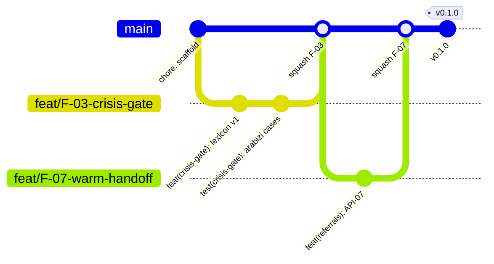

# Git Workflow
> Project: Jisr · Owner: Tech lead · Status: Draft v0.1 · Last updated: 2026-11-18
> Related: [Contributing](../../CONTRIBUTING.md) · [CI/CD](../05-ops/CICD.md) · [Coding standards](CODING_STANDARDS.md) · [Hackathon plan](../00-overview/HACKATHON_PLAN.md)

## 1. Model: GitHub flow on `main`

- `main` is always deployable; `deploy.yml` deploys it to the demo environment after CI and evals pass ([CICD](../05-ops/CICD.md)).
- Short-lived branches (hours, not days), one feature or fix each, merged by PR with **squash merge** (linear history).
- No `develop` or release branches in the MVP. For v1, add release tags and hotfix branches off the tag.

## 2. Branch naming

`<type>/<ID>-<slug>` where `ID` is a feature, API or ticket ID from the brief/backlog.

| Type | Example |
|---|---|
| `feat/` | `feat/F-07-warm-handoff`, `feat/API-24-red-ack` |
| `fix/` | `fix/crisis-gate-arabizi` |
| `rules/` | `rules/steps-v1.1-gad7-l4` (any `packages/rules` change) |
| `docs/` | `docs/pitch` |
| `chore/`, `ci/`, `test/`, `refactor/` | `ci/lighthouse-budget` |

## 3. Commit convention

[Conventional Commits 1.0](https://www.conventionalcommits.org/): `type(scope): summary (ID)`.

- Types: `feat`, `fix`, `rules`, `docs`, `test`, `refactor`, `perf`, `chore`, `ci`, `build`, `revert`.
- Scopes: `web`, `api`, `crisis-gate`, `scoring`, `step-matcher`, `rci`, `sla`, `fairness`, `llm`, `fhir`, `evals`, `infra`, `docs`.
- Examples:
  - `feat(crisis-gate): add Urdu indirect phrases (F-03)`
  - `rules(step-matcher): GAD-7 L4 needs complexity flag (steps v1.1.0)`
  - `fix(api): coordinator gets 403 on confirm-step (API-12)`
- `BREAKING CHANGE:` footer for API contract breaks (bumps the API major in v1).
- Every commit must pass ruff/eslint locally (pre-commit recommended).
- Commits that change `packages/rules` or `app/engines/crisis_gate.py` must mention the regenerated `EVAL.md` numbers in the PR description.

## 4. Pull requests

- Template from [CONTRIBUTING.md](../../CONTRIBUTING.md) (what/why with F-xx, screenshots or sample output, tests, safety checklist).
- **Size:** aim < 400 changed lines excluding generated files and fixtures.
- **Reviews:** 1 approval; **2 approvals** (one from the clinical safety lead or tech lead) for changes to `packages/rules/**`, `app/engines/crisis_gate.py`, `app/llm/**`, `ai/prompts/**`, auth/RBAC.
- `CODEOWNERS` encodes the second-review paths.
- Required checks before merge: `CI / web`, `CI / api`, `CI / rules`, `Evals / Offline suites (crisis recall must be 100%)`, CodeQL, dependency review.
- Squash merge; PR title becomes the commit message (must follow the convention).
- Delete the branch after merge.

**Hackathon exception (last 6 hours):** direct pushes to `main` only by the tech lead, for demo-critical fixes; `deploy.yml` still gates on CI and evals ([CICD §7](../05-ops/CICD.md)).

## 5. Release tagging and versioning

- Semantic Versioning 2.0 for the product: `v0.1.0` = hackathon submission (tag at the submitted commit, 2026-11-20). `CHANGELOG.md` (Keep a Changelog) updated in the release PR.
- **API version** is separate: URL major (`/v1`); `info.version` in `api/openapi.yaml` follows semver for additive changes.
- **Rules version** is separate again: `packages/rules/manifest.json` semver; each change is a minor or patch; a change in clinical meaning (threshold, trigger) is at least a minor bump and needs a clinical sign-off line in the PR.
- **Prompt versions** live in file names under `ai/prompts/` (`explain_result.v3`).
- Tags are annotated: `git tag -a v0.1.0 -m "Hackathon submission"`.

## 6. Protected files and secrets

- Never commit `.env`, keys, Gemini API keys, `JUDGE_PASSCODE`. `.gitignore` covers `.env*` except `.env.example`.
- Secret scanning: GitHub push protection on; optional `gitleaks` pre-commit.
- Never commit real patient data. `data/synthetic/` only; PRs adding files elsewhere under `data/` are blocked by CODEOWNERS review.

## 7. MVP vs v1

| Area | MVP | v1 |
|---|---|---|
| Flow | GitHub flow, squash | Same + release branches/tags, hotfixes |
| Environments | PR previews + demo | dev → staging → prod with approvals |
| Signing | Optional | Signed commits and signed container images required |
