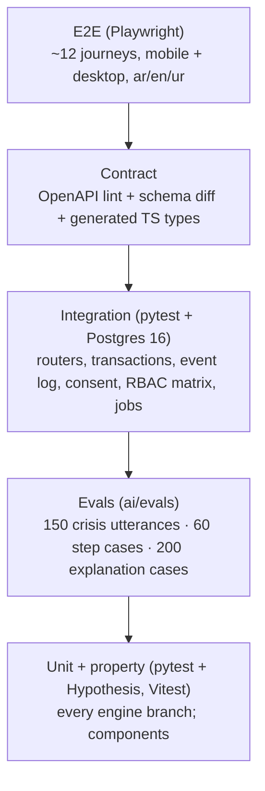

# Testing
> Project: Jisr · Owner: Tech lead (QA owner rotates per hour block) · Status: Draft v0.1 · Last updated: 2026-11-18
> Related: [Backend](BACKEND.md) · [Frontend](FRONTEND.md) · [Performance](PERFORMANCE.md) · [AI evals](../04-ai/AI_EVALS.md) · [CI/CD](../05-ops/CICD.md) · [Coding standards](CODING_STANDARDS.md)

Safety-critical logic (Crisis Gate, scoring, step matching, RCI, SLA, suppression) is tested hardest. UI tests prove the demo path and RTL rendering. All test data is synthetic.

## 1. Test pyramid

| Layer | Tools (versions 2026-11-18) | Scope | Count target (MVP) |
|---|---|---|---|
| Unit (Python) | pytest 9.2.0, Hypothesis 6.170.15, freezegun 1.5.5 | `app/engines/*`, `llm/validator.py`, `llm/facts.py`, `integrations/malaffi_ref.py`, `fhir_mapper` | ≥ 1 test per rule branch |
| Property | Hypothesis | Invariants (below) | 8 properties |
| Unit (TS) | Vitest 5.1.1, Testing Library 16.3.3, MSW 3.0.7 | Lexicon matcher (client), components, hooks | Safety components 100% |
| Integration | pytest + Postgres 16 service container (CI) / docker compose (local); testcontainers 4.15.0 optional | Each API-xx happy path + main errors; RBAC matrix; consent effects; idempotency; append-only triggers; scheduler jobs | Every API-01..API-29 |
| Contract | @redocly/cli 2.79.0, openapi-typescript 7.13.0, schema-diff test | `api/openapi.yaml` valid; FastAPI schema matches; TS types fresh | CI gate |
| Evals | `ai/evals/run_evals.py` (writes repo-root `EVAL.md`) | Crisis recall, step agreement, unsupported claims | F-18 targets |
| E2E | Playwright 1.65.1, @axe-core/playwright 4.14.0 | Demo journeys, RTL, offline crisis, quick exit, accessibility | 12 specs |
| Load | Locust 2.47.0 | [PERFORMANCE §4](PERFORMANCE.md#4-load-test-plan-locust-247) | 4 profiles |
| Security | CodeQL, dependency review (CI), `pip-audit`/`pnpm audit` locally, OWASP ZAP baseline (v1) | See [SECURITY_ARCHITECTURE](../06-security-compliance/SECURITY_ARCHITECTURE.md) | CI gate |

## 2. Engine invariants (Hypothesis)

1. `scoring`: totals always within instrument range; band is monotone in total.
2. `crisis_gate`: **monotone**: adding any text or raising any item never turns RED into not-RED.
3. `crisis_gate`: item 9 > 0 ⇒ RED for every combination of other answers.
4. `step_matcher`: step == max(step(PHQ-9 band), step(GAD-7 band)) adjusted only upward by flags; RED gate ⇒ step RED.
5. `step_matcher`: deterministic: same inputs (any order of providers) ⇒ same ranked candidates.
6. `rci`: symmetric thresholds; `|Δ| < threshold` ⇒ `no_reliable_change`.
7. `fairness.suppress`: no output cell with 0 < n < 10 is visible; no suppressed cell can be recomputed from visible cells and totals (brute-force check on random tables).
8. M-02 handler: for any classifier output, a RED episode stays RED.

## 3. Key integration tests

| Test | Proves |
|---|---|
| `test_crisis_paths.py` | Item 9 = 1 → RED `same_day_check`; ≥ 2 → `emergency`; Arabizi free text → RED; gate exception and gate timeout → RED (`gate_error`) |
| `test_free_text_storage.py` | F-22: without `store_free_text` the raw text is not in any table (scan all text/jsonb columns) and not in logs; with consent it is encrypted |
| `test_episode_open.py` | Opens at PHQ-9 ≥ 10 / GAD-7 ≥ 10 / item 9 > 0 / self-referral; not below threshold |
| `test_rbac_matrix.py` | Generated from API_SPEC §1.2: every role × every scope; coordinator can ack RED and log contacts but gets 403 on confirm-step and close |
| `test_event_log.py` | Append-only trigger; seq gapless; hash chain; projection rebuild equals live |
| `test_consent_effects.py` | Revoking `share_physical_context` removes it from API-05 for the clinician on the next read; `ai_drafted_summaries` off ⇒ no LLM call (provider spy) |
| `test_sla_sweep.py` | RED unacknowledged at 15 min ⇒ ESCALATED once (duplicate sweep ⇒ still once); referral 48 h ⇒ overdue; first appointment 14 d |
| `test_idempotency.py` | Replay returns identical body; different body ⇒ 409 |
| `test_demo_mode.py` | API-22/API-28 return 404 when `DEMO_MODE=false`; wrong `JUDGE_PASSCODE` ⇒ 401 |
| `test_analytics_allowlist.py` | API-29 rejects `score`, `answers`, `text`, `name`, any unknown key |
| `test_fhir_roundtrip.py` | Export → import yields identical scores; LOINC 44249-1 / 69737-5 panels, 44261-6 / 70274-6 totals |
| `test_llm_validator.py` | Banned claims, invented numbers, invented providers/phones ⇒ fail ⇒ template |

## 4. E2E journeys (Playwright)

Projects: `mobile-chrome` (Pixel-class, 4× CPU throttling for perf specs), `desktop-chrome`. Locales via URL.

1. Mariam (ar): screen → result (AI-drafted or template) → step L2 → book tele-consult → plan tracker.
2. Imran (ur): screen with read-aloud toggle; negative screen → self-referral → L1.
3. Judge types an indirect Arabic crisis phrase in S-04 → S-06 within 1 s, LLM panel locked.
4. Same as 3 with the network offline → S-06 from local lexicon and precache.
5. Khalid: RED in queue with SLA clock → ack (API-24) → contact attempt (API-25) → cannot confirm step (button absent; direct API call 403).
6. Dr Salma: one-screen summary shows physical context only when consented → confirm step → appears in Mariam's timeline.
7. Consent centre: revoke physical context → Dr Salma's view updates.
8. Re-check: improvement ⇒ suggestion visible to clinician; no step change until confirmed.
9. Programme: funnel, fairness table shows "<10" with complementary suppression, simulation run.
10. Quick exit: history replaced, Back does not return, session cleared.
11. Judge Mode: passcode → role switcher → demo reset (API-28).
12. Accessibility: axe scan on S-01, S-03, S-05, S-06, S-07, S-24 in `ar` and `en`; zero serious/critical violations.

## 5. Coverage targets

| Area | Line | Branch |
|---|---|---|
| `app/engines/` | 100% | 100% (CI gate) |
| `app/llm/validator.py`, `facts.py`, `crisis_raise.py` | 100% | 95% |
| `app/services/` | 85% | 75% |
| API overall | 80% | — |
| `apps/web/components/safety/`, `lib/crisis/` | 100% | 95% |
| Web overall | 60% | — |

Measured with pytest-cov 7.1.0 and Vitest coverage (v8).

## 6. Test data

- **Synthetic only**, from `data/synthetic/` (personas, ~5k simulated cohort, 40 providers, IFHAS bundles) and factories in `services/api/tests/factories.py`. Names are obviously synthetic; no real Emirates ID formats.
- Crisis benchmark utterances live in `ai/evals/` with a sealed held-out split (CI secret `EVAL_HELDOUT_KEY`, see [CICD](../05-ops/CICD.md)). Utterances are written by the team and reviewers; they are never collected from real people.
- Seeds are fixed (`--seed 42`) so dashboards and screenshots are reproducible.

## 7. CI gates

Required checks on `main` ([CICD §7](../05-ops/CICD.md)): `CI / web`, `CI / api`, `CI / rules`, `Evals / Offline suites (crisis recall must be 100%)`, CodeQL, dependency review. Additional failing conditions:
- Any engine branch uncovered.
- `api/openapi.yaml` lint error or schema drift from FastAPI.
- Stale `lib/api/schema.d.ts`.
- Rules file changed without a version bump in `manifest.json`.
- Lighthouse budget exceeded on S-06 (other routes warn only during the hackathon).

## 8. Manual demo test script (run before every rehearsal and before submission)

| # | Step | Expected | Pass |
|---|---|---|---|
| 1 | Open live link on a phone; Judge Mode; enter passcode | Persona picker in < 3 s (API warmed) | ☐ |
| 2 | API-28 reset (Judge menu) | "Demo data reset" toast; queue shows seeded items | ☐ |
| 3 | As Mariam (ar): complete PHQ-9 11 / GAD-7 13 | Result in Arabic; Calculated vs AI-drafted labels visible | ☐ |
| 4 | Step screen | L2, female Arabic-speaking family physician, Thiqa, tele-consult; factors listed | ☐ |
| 5 | Book in three taps | Plan tracker shows REFERRED and the 48 h clock | ☐ |
| 6 | New screen; type an indirect Arabic crisis phrase in "anything else?" | Crisis screen < 1 s, numbers 999 / 800-SAKINA / 800-HOPE tappable, AI panel locked | ☐ |
| 7 | Switch to Khalid | RED at top with 15-min countdown; ack; log a contact attempt | ☐ |
| 8 | Switch to Dr Salma | Summary with HbA1c/BMI/BP; confirm step | ☐ |
| 9 | Switch to Programme | Funnel, time-to-care vs baseline (labelled SIMULATED), fairness with "<10" | ☐ |
| 10 | Open `/judge/eval` | Shows numbers from the latest `EVAL.md` run only | ☐ |
| 11 | Kill Wi-Fi; open `/ar/help` | Crisis page loads offline | ☐ |
| 12 | Set `LLM_PROVIDER=none` (staging) and repeat 3 | Template text, product fully works | ☐ |
