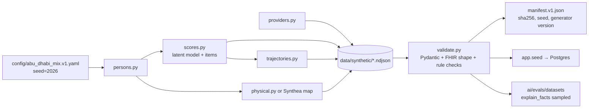

# Data Pipeline — Synthetic Cohort, Provider Directory, Content
> Project: Jisr · Owner: Data/AI engineer · Status: Draft v0.1 · Last updated: 2026-11-18
> Related: [Brief](../00-overview/PROJECT_BRIEF.md) · [MODELS](MODELS.md) · [AI_EVALS](AI_EVALS.md) · [RESPONSIBLE_AI](RESPONSIBLE_AI.md) · [DATA_MODEL](../03-engineering/DATA_MODEL.md) · [PRIVACY](../06-security-compliance/PRIVACY.md)

## 1. Principle
**MVP (hackathon): synthetic data only.** The organisers provide no data, the Gemini API has no guaranteed UAE processing, and Federal Law 2/2019 Art. 13 keeps real health data in-country. Every record in `data/synthetic/` is generated by code with a fixed seed, carries `"synthetic": true`, and is reproducible. **v1 (production):** real data only from IFHAS / Malaffi / Sahatna under DoH authorisation, hosted in-country, never sent to a non-UAE LLM endpoint.

## 2. Sources and licences
| Source | Used for | Licence | Status in MVP |
|---|---|---|---|
| Jisr generator (`scripts/synth/`) — Python 3.12, `numpy`, `faker` (MIT) | Persons, demographics, PHQ/GAD item responses and trajectories, episodes, referrals, provider directory | Team code (repo licence) | **Primary** |
| [Synthea](https://github.com/synthetichealth/synthea) | Optional physical context (encounters, HbA1c, BMI, conditions) as FHIR R4 | Apache-2.0; needs a recent JDK (check README — Java version requirement to verify) | **Optional / Should.** Geography is US-only, so we only borrow clinical observations and overwrite demographics. If Java setup costs > 30 min, use the Python fallback in §4.4 |
| Published prevalence (Abu Dhabi PHQ-9 study: 16.3% moderate-to-severe) [brief ref 3] | Calibrating baseline severity | Journal article (facts, not text, reused) | Calibration target |
| Abu Dhabi QoL survey disparities (age 15–29, women, non-Emiratis) [brief ref 4] | Direction of subgroup differences | Article | Directional only; effect sizes are **our assumptions** |
| PHQ/GAD instruments | Items, scoring (see [`instruments.v1.json`](../../packages/rules/instruments.v1.json)) | Free to use (Pfizer statement) | Used |
| SCAD (Statistics Centre Abu Dhabi) population statistics | Demographic mix | Public statistics, attribution | **Numbers in §3 are assumptions to verify** against the latest SCAD yearbook — owner: data engineer, by 2026-11-19 12:00 GST |
| CRC screening follow-up gap (30.5% of FIT-positives got colonoscopy, SEHA) | Analogue for the baseline "positive screen → specialist" conversion in the simulator | Article | Analogue, labelled as such |
| Self-help modules | F-09 waiting-well content | **Team-authored** (see §6) | Used |

Not used: MIMIC (ICU, US, ODbL — irrelevant to community mental health), any social-media text, any real lyrics, any real facility or clinician names.

## 3. Abu Dhabi demographic mix (assumptions)
Stated as assumptions because the latest SCAD breakdowns by nationality were not verified in this session. The generator reads them from `scripts/synth/config/abu_dhabi_mix.v1.yaml`, so they can be corrected in one place.

| Dimension | Categories and weights (cohort of adults 18+ screened) |
|---|---|
| Region | Abu Dhabi region 0.62 · Al Ain 0.28 · Al Dhafra 0.10 |
| Nationality group | Emirati 0.22 · South Asian (Indian 0.22, Pakistani 0.12, Bangladeshi 0.06) · Filipino 0.08 · Other Arab 0.14 · Western 0.06 · Other 0.10 |
| Sex | Male 0.62 / Female 0.38 overall (labour-migration skew); Emirati 0.50 / 0.50 |
| Age | 18–29 0.28 · 30–44 0.42 · 45–59 0.22 · 60–75 0.08 |
| Insurance | Emirati → Thiqa; expat → Enhanced 0.45 / Basic 0.55 (Basic higher for South Asian labour groups) |
| Preferred language (UI) | Emirati / Other Arab → AR; Pakistani → UR (0.8) else EN; Indian → EN (0.7) / UR (0.3); others → EN |
| Literacy flag (`very_plain`) | 0.25 for Basic-plan expats, 0.05 otherwise (assumption) |

**Known gap:** Hindi, Malayalam, Bengali, Tagalog speakers are routed to EN in the MVP. The fairness table therefore reports "language served = EN but preferred ≠ EN" as its own row ([RESPONSIBLE_AI §2](RESPONSIBLE_AI.md#2-fairness)).

## 4. Synthetic cohort generation
### 4.1 Persons
`scripts/synth/persons.py --n 5000 --seed 2026` → `data/synthetic/persons.v1.ndjson`.
Names from curated synthetic lists per nationality group (Faker locales `ar_AA`, `en_IN`, `en_PH`, `en_GB` + hand-curated Pakistani names), each suffixed in the UI with a "synthetic" badge. Emirates ID-like numbers are **never** generated (prevents accidental realism); `person_id` is a ULID.

### 4.2 Baseline severity (latent model)
For person *i*: latent depression severity `d_i` and anxiety severity `a_i` (correlation ρ = 0.6):
```
d_i ~ Normal(μ_d + β_age(i) + β_sex(i) + β_nat(i), σ=1)     # same form for a_i
β_age: 18–29 +0.25 · 30–44 0 · 45–59 −0.10 · 60–75 −0.15   (assumed, directional per ref 4)
β_sex: female +0.20
β_nat: non-Emirati +0.15
μ_d tuned so that P(PHQ-9 ≥ 10) ≈ 0.163 in the whole cohort (brief ref 3)
```
### 4.3 Item responses (so items correlate realistically)
Each item *k* is ordinal 0–3 with thresholds τ_k1 < τ_k2 < τ_k3 (graded-response style): `P(x_k ≥ c) = logistic(α_k(d_i − τ_kc))`. Item 9 gets high thresholds so P(item 9 ≥ 1 | PHQ-9 ≥ 10) ≈ 0.15 (assumption; the gate's behaviour, not prevalence, is what the demo shows). PHQ-2/GAD-2 are the first two items of the full instruments, guaranteeing consistency. Seeded missingness: 3% one item missing, 0.5% two items missing, 0.3% item 9 missing — so the NEEDS_DATA and RED (`review`, item 9 missing) paths appear in the dashboard.

### 4.4 Physical context (F-12)
Default (Python): HbA1c ~ Normal(5.6, 0.7) shifted +0.6 for age ≥ 45 and BMI ≥ 30; BMI ~ LogNormal by age/sex; blood pressure (systolic/diastolic) ~ Normal by age/sex/BMI (F-12: HbA1c, BMI, blood pressure; wearable sleep is v2, opt-in, not generated). Optional Synthea run: `java -jar synthea-with-dependencies.jar -p 5000 -s 2026 --exporter.fhir.export true`, then map Synthea `Observation` HbA1c/BMI to our persons by age/sex bucket; Synthea demographics discarded.

### 4.5 Trajectories (re-checks, F-10 / F-16)
Re-check weeks 0, 2, 4, 8, 12. Two arms on the same persons for the simulator:
```
baseline arm: P(referred → attended) = 0.30 (analogue: 30.5% CRC FIT follow-up), median 42 days to first contact
jisr arm:     P(attended) drawn from funnel parameters (accept 0.85, book 0.85, attend 0.80), median wait from directory
Δd per 4 weeks when attended at matched level: −0.35σ (L1–L2), −0.45σ (L3–L4); untreated: −0.10σ (regression to mean); noise σ=0.3
dropout: 8% per interval, higher for Basic-plan (+4%) and very_plain (+3%) to create realistic drop-off reasons
```
All effect sizes are **illustrative assumptions** shown in the simulator UI with sliders and a "these are assumptions, not evidence" label (R-10). The output is a comparison of process metrics (conversion, time-to-care), never a claim of clinical effect.

### 4.6 Scripted personas (fixed, not random)
| Persona | Fixed facts |
|---|---|
| P-01 Mariam | 27 F, Emirati, Thiqa, Abu Dhabi region, AR; GAD-7 13 (moderate), PHQ-9 11 (moderate), item 9 = 0 → L2; prefers female clinician, tele; matched synthetic provider with Thursday slot |
| P-02 Imran | 34 M, Pakistani, Basic plan, Abu Dhabi region (industrial area), UR, `very_plain`; GAD-7 8, PHQ-9 7 (mild); below the episode threshold, so he **self-refers** ("I want support") → episode opens via EO-03 → L1 (SM-06 not needed; mild = L1) |
| Crisis demo | Free-text path: judge types an indirect Arabic phrase (e.g. AR-005 or AR-006 from the lexicon) → RED |
| Khalid's queue | 6 seeded episodes incl. 1 overdue referral, 1 provider decline, 1 RED `review` (item 9 missing) acknowledged by the coordinator but awaiting clinician closure |

### 4.7 IFHAS import bundles (F-02)
`scripts/synth/fhir_bundles.py` writes FHIR R4 `Bundle` (type `collection`) per person: `Patient` (synthetic), `QuestionnaireResponse` for PHQ-9 / GAD-7 with LOINC item codes, `Observation` totals (44261-6, 70274-6), optional `Observation` HbA1c (4548-4), BMI (39156-5) and blood pressure panel (85354-9). Loaded via API-19 by the seed script; 10 bundles deliberately malformed (wrong total, missing item, unknown code) for import-validation tests.

## 5. Provider directory synthesis (F-06)
`scripts/synth/providers.py --seed 2026` → `data/synthetic/providers.v1.json` (~120 records).

| Field | Generation rule |
|---|---|
| `provider_id` | `prv_` + ULID |
| `display_name` | "<neighbourhood or generic word> <Family Clinic / Wellbeing Centre / Psychology Service> (synthetic)". Names are checked against a hand-made list of real Abu Dhabi facility names to avoid collisions; any collision is renamed |
| `region` | Abu Dhabi 0.60 · Al Ain 0.28 · Al Dhafra 0.12 (Al Dhafra has no L4 in-person; tele only — models real geography gap) |
| `levels_offered` | L1 community (20), L2 PHC family physician (50), L3 psychologist/tele-MH (35), L4 psychiatry (15) |
| `networks` | Thiqa-only 0.3, Thiqa+Enhanced 0.4, all incl. Basic 0.3 (Basic access is scarcer by design, R-12) |
| `languages` | AR+EN 0.55, EN only 0.15, AR+EN+UR/Hindi 0.20, other mixes 0.10 |
| `clinician_genders` | per provider set: F, M or both |
| `modalities` | in-person / tele / both; L3 tele 0.7 |
| `weekly_capacity`, `median_wait_days` | L2 wait ~ 5 ± 3 d; L3 ~ 12 ± 6 d; L4 ~ 21 ± 10 d (assumptions; R-12) |
| `accepting` | 0.9 |

The directory is static for the demo. v1: DoH facility registry / IHE mCSD feed.

## 6. Self-help content (F-09) — curated, not retrieved
Three team-authored modules in AR/EN/UR, reviewed by the clinical lead (pending): (1) slow breathing and grounding (anxiety), (2) behavioural activation — one small planned activity per day (low mood), (3) sleep routine. Grounded in NICE CG123 low-intensity interventions; each module is ≤ 5 screens, read-aloud friendly, no claims of effect. Stored as `data/content/selfhelp.v1.json` with per-language review status.

External materials such as WHO *Doing What Matters in Times of Stress* (available in Arabic) are licensed **CC BY-NC-SA 3.0 IGO** (non-commercial). They are offered as an external link only, not copied, to keep the commercial path clean.

## 7. Why there is no RAG
| Reason | Detail |
|---|---|
| Closed-world explanation | M-01 only rephrases facts we computed. The validator rejects any number or name not in the facts; retrieved passages would add uncheckable claims (R-02) |
| Tiny, static knowledge | 3 self-help modules + step descriptions + crisis numbers. These are shown verbatim from reviewed files; generating from them adds risk and no value |
| Attack surface | A retrieval corpus is an injection channel; removing it removes the channel |
| Latency and cost | No embedding calls, no vector DB to host, smaller prompts |
| Residency | No vector store holding text outside the UAE |
| Judges' signal | "Where does AI go (maybe nowhere)" — we can show exactly where it is not |

If v1 needs Q&A ("what is a psychologist?"), we use an **intent → curated answer lookup** (deterministic), not generation.

## 8. Pipeline, validation and lineage

- `make synth SEED=2026` (or `uv run python -m scripts.synth.all --seed 2026`) regenerates everything; CI checks the manifest hashes so the demo data cannot drift silently.
- `validate.py` checks: totals = sum of items; bands match `instruments.v1.json`; prevalence of PHQ-9 ≥ 10 within 16.3% ± 1.5 pp; no field matching Emirates ID / phone / email patterns; every provider name ends "(synthetic)".
- Lineage: each record has `generator`, `generator_version`, `seed`, `synthetic: true`; `E-17 RuleSetVersion` records which rule files scored it.
- Refresh cadence: static for the hackathon; regenerated only when the config or generator version changes.

## 9. Limitations (state these in the submission)
- Subgroup differences are injected by our assumptions, so fairness results on synthetic data test the **pipeline** (suppression, metrics), not real-world equity (R-11).
- Provider capacity and waits are invented (R-12).
- Simulator effect sizes are illustrative; no clinical-effect claim (R-10).
- Demographic weights to be verified against SCAD.
