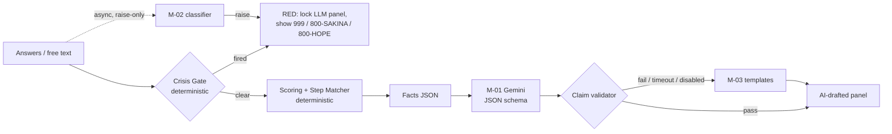

# Models (M-01 … M-03)
> Project: Jisr · Owner: AI lead · Status: Draft v0.1 · Last updated: 2026-11-18
> Related: [Brief](../00-overview/PROJECT_BRIEF.md) · [PROMPTS](PROMPTS.md) · [AI_EVALS](AI_EVALS.md) · [RESPONSIBLE_AI](RESPONSIBLE_AI.md) · [DATA_PIPELINE](DATA_PIPELINE.md) · [Architecture](../03-engineering/ARCHITECTURE.md)

## 1. Where AI sits (and where it does not)
Jisr uses AI in two narrow places. Every decision that affects care is made by a deterministic engine, and a clinician confirms it.

| Layer | What decides | AI? |
|---|---|---|
| Scoring (PHQ-2/9, GAD-2/7) | `engines/scoring.py` + [`instruments.v1.json`](../../packages/rules/instruments.v1.json) | No |
| Crisis Gate | `engines/crisis_gate.py` + [`crisis_lexicon.v1.json`](../../packages/rules/crisis_lexicon.v1.json) + rules CG-00…CG-07 (fail-closed: gate error/timeout → RED) | No. M-02 can only *add* a flag (CG-08) |
| Step Matcher, RCI, SLA, fairness suppression | `engines/*` + [`step_rules.v1.json`](../../packages/rules/step_rules.v1.json) | No |
| Explanation / message text | M-01, behind the claim validator; M-03 templates as fallback | Yes, narration only |

## 2. Verified model facts (checked 2026-11-18)
Source: Google AI Studio docs, `aistudio.google.com/docs/models` and `/docs/pricing` (the old `ai.google.dev/gemini-api/docs/*` URLs now 301-redirect there). SDK: `google-genai` **3.5.0** on PyPI, uploaded 2026-11-18 02:29 UTC.

| Fact | Value | Status |
|---|---|---|
| Current stable Flash ids | `gemini-3.8-flash`, `gemini-3.6-flash` (previous gen) | Verified |
| Current stable Flash-Lite ids | `gemini-3.5-flash-lite`, `gemini-3.1-flash-lite` | Verified |
| `gemini-3.8-flash` limits | 1,048,576 input / 65,536 output tokens; structured output and function calling supported; thinking levels low/medium/high (`minimal` returns an error); updated Sep 2026 | Verified |
| `gemini-3.6-flash` limits | 1,048,576 input / 65,536 output; structured output supported; thinking supported (levels not stated); updated Jul 2026; "remains available for production use", no deprecation date | Verified |
| `gemini-3.5-flash-lite` limits | 1,048,576 input / 65,536 output; structured output supported; updated Jul 2026 | Verified (thinking-level options not stated) |
| `gemini-flash-latest` alias | Docs use it only as an example of the `-latest` pattern; aliases are hot-swapped to new releases with 2 weeks' email notice. What it points to today is **not stated** | **Unverified** |
| Price `gemini-3.6-flash` and `gemini-3.8-flash` (paid, text, identical) | USD 0.75 / 1M input · USD 3.75 / 1M output **until 31 Dec 2026**; **doubles to USD 1.50 / 7.50 from 1 Jan 2027** | Verified |
| Price `gemini-3.5-flash-lite` (paid, text) | USD 0.30 / 1M input · USD 2.50 / 1M output | Verified |
| Price `gemini-3.1-flash-lite` (paid, text) | USD 0.25 / 1M input · USD 1.50 / 1M output | Verified |
| "Pricing changes 1 Dec 2026" | Not a price change. On **1 Dec 2026** deprecated `gemini-2.5-flash` requests are re-routed to `gemini-3.5-flash-lite` (billed at its rates) and `gemini-2.5-pro` to `gemini-3.8-flash`. The price change is **1 Jan 2027** (3.8/3.6 Flash double) | Verified |
| Free tier data use | Free-tier content **is used to improve Google products**; paid-tier content is not | Verified |

**Decisions that follow**
1. **Pin a stable id; never ship `gemini-flash-latest`.** `GEMINI_MODEL=gemini-3.6-flash` for M-01 and M-02 (brief §9). The alias could hot-swap during judging (2-week notice), which would invalidate the eval run. `gemini-3.8-flash` is newer at the same price; switching is allowed only after a full AI_EVALS run on it. `gemini-3.5-flash-lite` is an optional M-02 override (`GEMINI_MODEL_CLASSIFIER`) if latency is a problem, again eval-gated.
2. **Use a paid-tier API key**, even with synthetic data: free-tier prompts may be used to improve Google products. M-01 receives only de-identified structured facts, and only when the person's consent scope **"AI-drafted summaries"** is on (off ⇒ template-only, no LLM call). M-02 is off by default and **always off in Judge Mode**, so judges' typed text never leaves the system.
3. **Pin `google-genai==3.5.0`** but keep `3.4.0` as a tested fallback in `uv.lock` notes: 3.5.0 was released on build day.
4. Budget the 1 Jan 2027 price doubling into [COST](../05-ops/COST.md); any pilot runs after it.

FX used throughout: **1 USD = 3.6725 AED** (CBUAE peg).

## 3. Model cards

### M-01 — Plain-language explanation and message drafting
| Field | Value |
|---|---|
| Task | Turn a structured **facts JSON** (scores, bands, step, matched provider, next action, crisis numbers) into a short "what this means / what it doesn't / what happens next" explanation in AR, EN or UR; also draft neutral notification text (F-14 discreet mode) |
| Model | `gemini-3.6-flash` (brief default) via Gemini Developer API, `google-genai` 3.5.0, behind `LLMProvider` (`app/llm/provider.py`). Env: `LLM_PROVIDER=gemini`, `GEMINI_MODEL` |
| Config | `temperature=0.2`, `top_p=0.9`, `max_output_tokens=700`, `response_mime_type=application/json`, `response_schema` = `ExplanationV1` ([PROMPTS §3](PROMPTS.md#3-m-01-explanation-prompt-v1)), thinking at the lowest level the model accepts (levels for 3.6 not documented; for 3.8 `low`, `minimal` errors), safety settings default + `HARM_CATEGORY_DANGEROUS_CONTENT` at `BLOCK_LOW_AND_ABOVE` |
| Why chosen | Strong multilingual output incl. Arabic and Urdu; native JSON-schema output; cheap; fast; the brief's chosen provider. Narration needs fluency, not reasoning |
| Alternatives | Azure OpenAI in UAE North (v1 production path for residency); Jais 3 (Arabic-first, open, Inception42/MBZUAI — **check licence terms before product use**); BiMediX2 (bilingual medical, research licence — not for product); `gemini-3.5-flash-lite` (cheaper; Arabic/Urdu quality not yet measured — compare in AI_EVALS before switching) |
| Input | Facts JSON only (no names, no free text, no IDs other than an opaque `episode_ref`), language code, reading level (`plain` / `very_plain` for P-02). ~1,000 tokens system + few-shot, ~250 facts |
| Output | `ExplanationV1` JSON: `summary`, `what_it_means[]`, `what_it_does_not_mean[]`, `next_steps[]`, `claims_used[]` (fact keys cited), `language`, `reading_level`. ~250–400 tokens |
| Latency target | p50 ≤ 1.5 s, p95 ≤ 3.5 s, hard timeout `LLM_TIMEOUT_MS=4000` → M-03. **Unverified** until measured from Render (Frankfurt/Oregon) — record in `EVAL.md` |
| Cost per call | See §4: ≈ **AED 0.010** now, ≈ **AED 0.021** from 1 Jan 2027 |
| Fallback | Validator fail, schema fail, safety block, timeout, 429/5xx, `LLM_PROVIDER=none` → **M-03** (no retry on validator fail; one retry on 429/5xx with 300 ms jitter, within the timeout) |
| Cloud / on-device | Cloud (Google, global processing; **no UAE processing guarantee**). Hence **synthetic data only** in MVP (R-03) |
| Arabic / Urdu performance | Not benchmarked by Google for Gulf Arabic or Urdu health text. Our measure: 200-case validator suite + native-speaker rubric on 30 outputs per language ([AI_EVALS §5](AI_EVALS.md#5-dataset-c--200-explanation-cases-m-01--validator)). R-04 open until native review |
| Intended use | Paraphrasing already-decided, already-validated facts for a screened adult and for staff |
| Out of scope | Diagnosis, therapy, advice on medication, risk assessment, answering open questions, chat. Never sees free text from a person |
| Known limitations | May paraphrase numbers in words ("eleven"), mix scripts, drift in register, or add reassurance ("you will be fine"); all caught by the validator or banned-phrase list ([PROMPTS §6](PROMPTS.md#6-claim-validator-algorithm)). Hallucinated provider names → validator rejects |
| Logged | `ExplanationRecord` (E-18): prompt id+version, model id, facts hash, output JSON, validator verdict + reasons, latency, tokens. **No free text, no PII** |

### M-02 — Secondary crisis signal on free text (raise-only)
| Field | Value |
|---|---|
| Task | Binary-plus: does this free text contain a possible risk-to-self/others or safety signal the lexicon missed? Output `{"raise": bool, "category": enum, "confidence": "low/medium/high", "evidence_span_idx": [start,end]}` |
| Model | Same model as M-01 (`gemini-3.6-flash`), classification prompt (brief §9). Optional override `GEMINI_MODEL_CLASSIFIER=gemini-3.5-flash-lite` only after evals |
| Config | `temperature=0`, `max_output_tokens=80`, JSON schema `CrisisRaiseV1`, thinking off/lowest available |
| Invariant | Called **asynchronously after** the deterministic gate has already answered (the < 1 s gate never waits), and **only if it did not fire**. Output can set CG-08 → RED. `raise=false`, errors, timeouts, blocks, malformed JSON = **no effect** (never "clear"). A safety-filter block on the input is treated as `raise=true` (if Google blocks it as dangerous, a human should look) |
| Async | Non-blocking: the person sees the result of the deterministic gate immediately (< 1 s demo target). If M-02 raises within 2 s the UI switches to RED; if later, the episode is moved to RED and the coordinator is alerted |
| Enable flag | `LLM_CRISIS_SECOND_OPINION=false` by default and **forced off when `DEMO_MODE=true` (Judge Mode)**. Turned on (non-demo environments only) when measured p95 ≤ 2 s on the deploy host and the person's "AI-drafted summaries" consent is on. Auto-disables for 10 minutes after 3 consecutive timeouts (circuit breaker), logged |
| Why | Indirect, dialectal and code-switched expressions (Arabizi, Roman Urdu) exceed what a 44-entry lexicon covers. A raise-only LLM adds recall without being able to cost any |
| Input | The free text (synthetic in MVP) + language hint. PII scrubber removes digits ≥ 6, emails, Emirates ID pattern `784-\d{4}-\d{7}-\d` before the call |
| Latency / cost | Target p95 ≤ 2 s (**unverified**). ≈ AED 0.0018 per call (§4) |
| Fallback | None needed: absence of M-02 = deterministic gate only (which is the safety baseline) |
| Limitations | Will over-raise on idioms and lyrics (acceptable: precision target ≥ 80% is set on the combined gate); may under-detect Urdu-script text. Never the primary detector. Not a risk assessment |

### M-03 — No-LLM templates (fallback, and the default for RED)
| Field | Value |
|---|---|
| Task | Same output contract as M-01 (`ExplanationV1`), filled from ICU MessageFormat templates in `apps/web/messages/{en,ar,ur}.json` and `ai/prompts/templates/explanation.v1.json` |
| When | Any M-01 failure; `LLM_PROVIDER=none`; **always** for RED episodes and crisis screens (LLM panel locked); always for the clinician summary's calculated values |
| Latency / cost | < 10 ms, AED 0 |
| Quality | Clinically reviewed text (once the clinical lead signs off), less natural. Validator also runs on templates in CI so the template set itself is proven claim-safe |
| Limitations | Fixed phrasing; Arabic/Urdu template text needs native review (R-04) |

## 4. Cost per call (AED)
Assumptions: M-01 input 1,250 tokens (system 900 + few-shot 100 + facts 250), output 350 visible + ~150 thinking tokens (billed as output) = 500. M-02 input 450 tokens, output 40 (thinking at the lowest level; if thinking tokens appear they are billed as output).

| Model | Rate (USD / 1M in · out) | Input cost | Output cost | Per call USD | **Per call AED** |
|---|---|---|---|---|---|
| M-01 `gemini-3.6-flash` (to 31 Dec 2026) | 0.75 · 3.75 | 0.000938 | 0.001875 | 0.00281 | **0.0103** |
| M-01 `gemini-3.6-flash` (from 1 Jan 2027) | 1.50 · 7.50 | 0.001875 | 0.00375 | 0.00563 | **0.0207** |
| M-01 alt `gemini-3.5-flash-lite` | 0.30 · 2.50 | 0.000375 | 0.00125 | 0.00163 | **0.0060** |
| M-02 `gemini-3.6-flash` (to 31 Dec 2026) | 0.75 · 3.75 | 0.000338 | 0.00015 | 0.000488 | **0.0018** |
| M-02 alt `gemini-3.5-flash-lite` | 0.30 · 2.50 | 0.000135 | 0.0001 | 0.000235 | **0.0009** |
| M-03 templates | — | — | — | 0 | **0** |

Per episode (≈ 4 explanations + 3 message drafts + 2 free-text checks): ≈ AED 0.08 now, ≈ AED 0.15 in 2027. At 10,000 positive screens / year: ≈ AED 1,500 / year in 2027 prices. Token cost is not the constraint; residency is. The UI cost meter (Judge Mode) shows tokens and AED per call from `ExplanationRecord`.

Hackathon budget: ~2,000 calls (dev + eval runs × 3 + demo) ≈ AED 25. Prices verified 2026-11-18; re-check before any pilot quote.

## 5. Context limits and prompt size
All three Gemini ids accept ~1M input tokens; we use < 2k. We deliberately keep prompts small (no RAG, no history) — cost, latency, and a smaller attack surface. Max output capped at 700 (M-01) / 80 (M-02).

## 6. MVP (hackathon) vs v1 (production)
| Aspect | MVP (hackathon) | v1 (production) |
|---|---|---|
| Endpoint | Gemini Developer API, paid tier, global | In-country: Azure OpenAI UAE North or self-hosted Jais 3 on Core42 / Azure UAE North (Federal Law 2/2019 Art. 13) |
| Data | Synthetic only; LLM calls only with "AI-drafted summaries" consent | Real PHI only after DoH authorisation, DPIA, clinical safety case |
| Model pinning | Stable ids in env | Dated ids + quarterly re-eval; any model change = full AI_EVALS re-run and change record |
| M-02 | Off by default; always off in Judge Mode | On, in-country, with monitored recall on a live-labelled sample |
| Provider abstraction | `gemini` / `none` implemented; `azure_openai` / `local` stubs | All four implemented and eval-gated |

## 7. Licence awareness (judges ask)
| Component | Licence | Product use OK? |
|---|---|---|
| Gemini API | Google Gemini API Additional Terms of Service; paid tier | Yes (synthetic data in MVP) |
| `google-genai` SDK | Apache-2.0 | Yes |
| PHQ-2/9, GAD-2/7 | Free; "no permission required to reproduce, translate, display or distribute" (Pfizer) | Yes, with attribution |
| C-SSRS screener | Columbia Lighthouse Project terms; free for many uses, **electronic/commercial use terms to verify** (R-05) | Verify before submission — owner: product lead, by 2026-11-19 |
| Jais 3 (v1 option) | Check model card licence | To verify before v1 |
| BiMediX2 | Research licence (check repo) | Not for product without permission |
| Synthea | Apache-2.0 | Yes |
