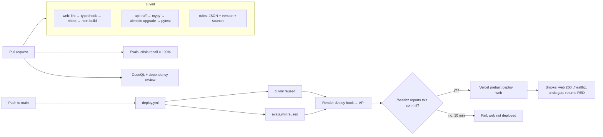

# CI/CD
> Project: Jisr · Owner: Tech lead (DevOps hat) · Status: Draft v0.1 · Last updated: 2026-11-18
> Related: [Project brief](../00-overview/PROJECT_BRIEF.md) · [Architecture](../03-engineering/ARCHITECTURE.md) · [Deployment](DEPLOYMENT.md) · [AI evals](../04-ai/AI_EVALS.md) · [Testing](../03-engineering/TESTING.md) · [Security architecture](../06-security-compliance/SECURITY_ARCHITECTURE.md)

The workflow files in `.github/workflows/` are the **source of truth**. This doc explains them. If the two disagree, the YAML wins; fix this doc.

## 1. Pipeline



Stage order follows the brief (§10): lint → test → eval → build → deploy, with a security scan in parallel.

## 2. Workflows

| File | Trigger | Jobs | Blocks merge? |
|---|---|---|---|
| `ci.yml` | every PR, push to `main`, `workflow_call`, manual | `web` (pnpm lint / typecheck / test / build in `apps/web`), `api` (uv sync, ruff check + format check, mypy, `alembic upgrade head` on Postgres 16 service container, pytest), `rules` (every `packages/rules/*.json` parses and has `version` + `sources`) | Yes |
| `evals.yml` | PRs touching `ai/**`, `packages/rules/**`, `services/api/app/engines/**`, `services/api/app/llm/**` (and when labelled `run-llm-evals`); push to `main`; nightly 06:00 GST; `workflow_call`; manual (`live` input) | `offline`: `ai/evals/run_evals.py` (all offline suites, `LLM_PROVIDER=none`, cassettes for LLM suites) renders repo-root `EVAL.md`; **fails if crisis recall < 100%** (runner exit code 1 **and** an independent JSON check). `live`: M-02 raise-only crisis run + live M-01 explanations (0 displayed unsupported claims), nightly / labelled PR / manual only | Yes (`offline`) |
| `deploy.yml` | push to `main`, manual | reuses `ci.yml` + `evals.yml` → `deploy-api` (Render hook, waits for `/healthz` to report the commit) → `deploy-web` (Vercel CLI `pull` / `build --prod` / `deploy --prebuilt --prod`) → `smoke` | n/a |
| `codeql.yml` | PR, push, weekly | CodeQL `security-extended` for `javascript-typescript`, `python`, `actions` | Yes (high alerts) |
| `dependency-review.yml` | PR | Fails on new deps with high/critical CVEs or GPL/AGPL licences | Yes |

### 2.1 Eval contract (shared with [AI_EVALS](../04-ai/AI_EVALS.md) and [ai/evals/README](../../ai/evals/README.md))
`evals.yml` uses the runner exactly as documented in `ai/evals/README.md`:

```text
cd services/api && uv sync --frozen --all-extras          # evals reuse the API environment
cd ai/evals && uv run --project ../../services/api python run_evals.py --report ../../EVAL.md   # offline, all suites
uv run --project ../../services/api python run_evals.py --suite crisis --with-m02 --live          # live job
uv run --project ../../services/api python run_evals.py --suite explain --live --report ../../EVAL.md
exit 0 = gates passed · 1 = a gate failed · 2 = config error (missing dataset, cassette miss, missing key)
writes ai/evals/results/<run_id>.json and the repo-root EVAL.md
```
**Independent check:** the workflow opens the newest `results/<run_id>.json`, finds every object under a `crisis` key (or with `"suite": "crisis"`) that has `recall`, and fails if any recall < 1.0 or `false_negatives` is non-empty. If no crisis recall is found at all, it **fails** (fail-closed), so the runner's JSON must keep a `crisis` object with `recall`, `n` and `false_negatives`. Why the LLM is excluded from the gating run: M-02 can only *raise* risk, so recall must come from the deterministic gate alone (brief §9, R-01). `FF_CSSRS_ITEMS=false` in CI matches the demo default (R-05); a separate run with the flag on is added once C-SSRS terms are confirmed.

`EVAL.md` from the offline run is uploaded as an artifact on every run. The **submission** `EVAL.md` is produced by a manual dispatch with `live=true` on 2026-11-20 and committed by the AI lead.

Secrets used: `GEMINI_API_KEY`, `EVAL_HELDOUT_KEY` (sealed held-out crisis split); variables `GEMINI_MODEL`, `GEMINI_MODEL_CLASSIFIER`.

### 2.2 Post-deploy smoke contract (shared with [API_SPEC](../03-engineering/API_SPEC.md))
- `GET /healthz` → `200 {"status":"ok","commit":"<7+ char sha>","ruleset":"…"}`. Render sets `RENDER_GIT_COMMIT`; the API echoes it.
- `POST /v1/crisis/check` (API-04) with `{"text":"I want to end my life","lang":"en","source":"smoke_test"}` → body contains `"level":"RED"`. Smoke-test calls are tagged `source=smoke_test` and **must not** create an episode, store text (F-22) or page the on-call queue. If the gate errors or times out the API must still answer RED (fail-closed rule, brief §5), so a smoke failure here means the API itself is down or the contract changed.

## 3. Environments

| Env | Web | API | DB | Data | Who deploys |
|---|---|---|---|---|---|
| local | `pnpm dev` :3000 | uvicorn :8000 | docker compose Postgres 16 (or SQLite) | seeded synthetic | developer |
| preview | Vercel preview per PR (Git integration, automatic) | shared staging API on Render (optional, free instance) | Neon branch or Render free DB | synthetic | Vercel bot |
| production (MVP demo) | Vercel production | Render web service (Docker) | Neon / Render Postgres | synthetic only, `DEMO_MODE=true` | `deploy.yml` only |
| v1 production | Azure UAE North (App Service / Container Apps) | same | Azure Database for PostgreSQL, UAE North | real PHI under DoH approval, `DEMO_MODE=false` | Azure DevOps or GitHub Actions with OIDC to Azure; manual approval gate |

Render **auto-deploy must be off** for the production API so only a green `deploy.yml` can ship it. Vercel Git auto-deploy for `main` must also be off (`git.deploymentEnabled.main=false` in `vercel.json`) because `deploy.yml` deploys production; PR previews stay on.

## 4. Secrets and variables

| Name | Kind | Where | Used by |
|---|---|---|---|
| `VERCEL_TOKEN`, `VERCEL_ORG_ID`, `VERCEL_PROJECT_ID` | secret | GitHub env `production` | deploy-web |
| `RENDER_DEPLOY_HOOK_URL` | secret (the URL embeds a key) | GitHub env `production` | deploy-api |
| `GEMINI_API_KEY` | secret | repo secret (evals), Render env (runtime) | llm-validator, API |
| `GEMINI_MODEL`, `GEMINI_MODEL_CLASSIFIER` | variable | repo variables + Render env | pin dated ids (see [COST](COST.md) §4) |
| `EVAL_HELDOUT_KEY` | secret | repo secret | decrypts the sealed held-out crisis split in `evals.yml` |
| `API_BASE_URL`, `WEB_URL` | variable | GitHub env `production` | deploy, smoke |
| `JWT_SECRET`, `DATABASE_URL`, `CORS_ORIGINS` | runtime secret | Render dashboard only (never GitHub) | API |
| `JUDGE_PASSCODE` | runtime secret | Render dashboard only | Judge Mode gate, see [DEPLOYMENT](DEPLOYMENT.md) §5 |

Rules: no secrets in the repo or in `NEXT_PUBLIC_*` vars; GitHub `production` environment restricted to `main` with one required reviewer when the team has more than two people; secret scanning + push protection on; rotate every key after the hackathon (see [RUNBOOK](RUNBOOK.md) §8). v1: GitHub OIDC → Azure federated credentials, secrets in Azure Key Vault (UAE North), no long-lived cloud keys in GitHub.

## 5. Preview deploys
Vercel builds a preview URL per PR automatically (Git integration). Previews point at the staging API and use `NEXT_PUBLIC_DEMO_MODE=true`. Previews are protected with Vercel Deployment Protection (Vercel Authentication) so seeded data is not crawled.

## 6. Rollback

| Layer | How | Time |
|---|---|---|
| Web | Vercel dashboard → Deployments → previous → "Instant Rollback" (or `vercel rollback <url> --token …`) | < 1 min |
| API | Render dashboard → Events → previous deploy → "Rollback" | 1–3 min |
| DB schema | Alembic migrations are additive-only during the hackathon (expand / contract). Rollback = redeploy old code; no `downgrade` against prod | — |
| Rules | Rule files are versioned (`*.v1.json`); revert the commit, which redeploys through the pipeline (evals re-run) | ~10 min |

## 7. Branch protection (set on day 1)
`main` requires: `CI / web`, `CI / api`, `CI / rules`, `Evals / Offline suites (crisis recall must be 100%)`, `CodeQL`, `dependency-review`; linear history; no force-push. In the last 6 hours of the hackathon, a direct push is allowed only by the tech lead, and `deploy.yml` still gates on CI + evals.

## 8. Pinning and build-day checks
- Actions pinned to major tags (`actions/checkout@v5`, `actions/setup-node@v5`, `actions/setup-python@v6`, `pnpm/action-setup@v4`, `astral-sh/setup-uv@v6`, `github/codeql-action@v4`, `actions/dependency-review-action@v4`, `actions/upload-artifact@v4`). v1: pin to commit SHAs with Dependabot updates.
- `deploy.yml` installs `vercel@latest`. Replace with the exact major you verified on build day (`npm view vercel version`). **[U] not verified on 2026-11-18.**
- Node 24 LTS and Python 3.12 match the brief (§10).
- `uv.lock` and `apps/web/pnpm-lock.yaml` must be committed or `--frozen` installs fail.

## 9. MVP vs v1
| | MVP (hackathon) | v1 (production) |
|---|---|---|
| Gate | CI + crisis eval | + SAST/DAST (OWASP ZAP baseline against staging), container scan (Trivy), SBOM (CycloneDX), signed images |
| Approval | automatic on `main` | manual approval by clinical safety officer for any rule-file change (DCB0129-style safety case) |
| Target | Vercel + Render | Azure UAE North only; no build artefact or log leaves the UAE |
