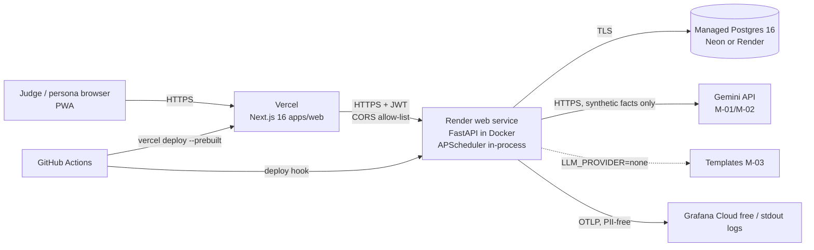
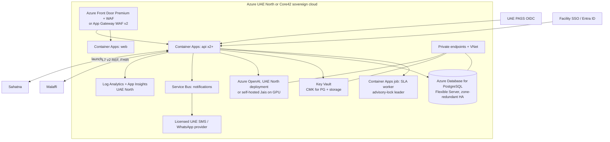

# Infrastructure
> Project: Jisr · Owner: Tech lead · Status: Draft v0.1 · Last updated: 2026-11-18
> Related: [Project brief](../00-overview/PROJECT_BRIEF.md) · [Architecture](../03-engineering/ARCHITECTURE.md) · [Deployment](DEPLOYMENT.md) · [Cost](COST.md) · [Compliance](../06-security-compliance/COMPLIANCE.md) · [Privacy](../06-security-compliance/PRIVACY.md)

Tags: **[V]** verified in a primary source this session · **[S]** secondary source · **[U]** unverified, check before relying on it.

## 1. The hosting decision in one line
**MVP:** Vercel + Render + managed Postgres, outside the UAE, **synthetic data only**. **v1:** everything in-country (Azure UAE North or Core42), because Federal Law 2/2019 Art. 13 bars storing or processing UAE health data outside the UAE except under listed exceptions [S][1], and DoH Circular 147/2022 restricts sharing and (reportedly) cloud use without DoH authorisation [S][2].

## 2. MVP (hackathon)



| Component | Choice | Region | Notes |
|---|---|---|---|
| Web | Vercel project, root dir `apps/web` | Functions region: `fra1` (Frankfurt) default; `dxb1` (Dubai) if listed for the plan **[U]** | Static + RSC; no PHI stored at the edge |
| API | Render web service, Docker, 1 instance (Starter or above, so it does not sleep) | Frankfurt (closest Render region to the UAE; Render has no Middle East region **[U]**) | Single instance keeps APScheduler from double-firing SLA jobs |
| DB | Neon Postgres 16 (free/Launch) **or** Render Postgres | Same region as API (Frankfurt / `aws-eu-central-1`) | Pick one; Neon branching is handy for previews |
| LLM | Gemini Developer API (`google-genai` 3.5.0), **paid tier** | Google-chosen; no location guarantee | Paid tier so prompts are not used for product improvement [V][3]; see [PRIVACY](../06-security-compliance/PRIVACY.md) §6 |
| Secrets | Render env vars, Vercel env vars, GitHub environments | — | See [CICD](CICD.md) §4 |
| Observability | stdout JSON logs (Render log stream) + optional OTLP to Grafana Cloud free tier | — | See [OBSERVABILITY](OBSERVABILITY.md) |
| Backups | Neon point-in-time restore (plan-dependent) / Render daily snapshots; plus `scripts/seed` can rebuild the whole demo DB in < 1 min | — | Demo data is synthetic and reproducible, so the seed is the real backup |

**Why not UAE hosting for the demo?** Speed, free tiers and the team's familiarity. It is legitimate only because no real personal health data is processed (brief §13). The judge's free-text input is the one leak path; see [PRIVACY](../06-security-compliance/PRIVACY.md) §6.

### Container
`services/api/Dockerfile`: `python:3.12-slim`, non-root user, `uv sync --frozen --no-dev`, `CMD uvicorn app.main:app --host 0.0.0.0 --port $PORT --proxy-headers`. Health check path `/healthz`. Pre-deploy command `uv run alembic upgrade head` (Render pre-deploy commands need a paid instance type **[U]**; otherwise run migrations at startup behind an advisory lock).

### Scaling limits of the MVP
- One API instance: fine for the demo (< 10 rps). Scaling out needs the SLA scheduler moved to a separate worker with a Postgres advisory lock (v1).
- Free Postgres tiers cap storage/compute and may suspend when idle; the warm-up step in [RUNBOOK](RUNBOOK.md) §7 handles cold starts.

## 3. v1 (production, in-country)



| Concern | v1 decision |
|---|---|
| Residency | All compute, storage, logs, backups and LLM inference in the UAE. Check Front Door: it is a global service; if DoH requires, use App Gateway WAF in-region instead **[U]** |
| Region pair | Azure UAE North (Dubai) with UAE Central (Abu Dhabi) for DR. UAE Central has restricted access **[U]**. Core42 sovereign cloud is the alternative if DoH prefers a national provider |
| LLM | Azure OpenAI model deployed in UAE North with a regional (not Global) deployment type, or Jais served on in-country GPUs. Model availability per region changes; check before procurement **[U]** |
| Network | Hub-spoke VNet, private endpoints for PG/Key Vault/OpenAI, no public DB endpoint, egress via Azure Firewall with an allow-list (Malaffi, UAE PASS, SMS provider) |
| Identity | UAE PASS (citizens/residents), facility SSO via Entra ID (staff), managed identities between services |
| Encryption | TLS 1.2+ everywhere; PG and storage with customer-managed keys in Key Vault; field-level encryption for free text and contact details |
| Backups | PG automated backups 35 days, geo-redundant to UAE Central; RPO 5 min, RTO 1 h (see [RUNBOOK](RUNBOOK.md) §9) |
| Compliance | ADHICS controls mapped, DoH audit; ISO 27001 roadmap (see [COMPLIANCE](../06-security-compliance/COMPLIANCE.md)) |

### IaC outline (Terraform, `infra/`)
```text
infra/
  mvp/                    # optional: Render blueprint (render.yaml) + vercel.json
  azure/
    main.tf               # azurerm provider, region = "uaenorth"
    modules/network/      # vnet, subnets, private DNS, firewall
    modules/postgres/     # flexible server, HA, CMK, diagnostic settings → Log Analytics
    modules/apps/         # container apps env, web, api, sla-worker job
    modules/keyvault/
    modules/openai/       # cognitive account kind=OpenAI, regional deployment
    modules/monitoring/   # log analytics, app insights, alert rules from OBSERVABILITY.md
    policy.tf             # Azure Policy: allowed locations = [uaenorth, uaecentral]
    envs/{staging,prod}.tfvars
```
The `allowed locations` Azure Policy is the residency guardrail: nothing can be created outside the UAE by mistake.

### Credits
Microsoft is a challenge co-creator (brief §1): ask organisers about Azure credits / Microsoft for Startups Founders Hub for the pilot. Google AI Studio free tier is **not** suitable even for the demo if any non-synthetic text could arrive (free-tier data may be used to improve products [V][3]).

## Sources
1. UAE Federal Law 2/2019, Art. 13 — https://elaws.moj.gov.ae/UAE-MOJ_LC-En/00_Health/UAE-LC-En_2019-02-06_00002_Kait.html?val=EL1 ; Al Tamimi on transfers — https://tamimi.com/news/health-data-transfers-outside-the-uae
2. DoH Circular 147/2022 (secondary) — https://www.globalcompliancenews.com/2022/10/07/https-insightplus-bakermckenzie-com-bm-data-technology-uae-abu-dhabi-department-of-health-requires-licensed-entities-to-comply-with-strict-data-localization-requirements_09222022/
3. Gemini API pricing (free vs paid data use), fetched 2026-11-18 — https://ai.google.dev/gemini-api/docs/pricing (redirects to https://aistudio.google.com/docs/pricing)
4. Gemini API data logging policy — https://ai.google.dev/gemini-api/docs/logs-policy
