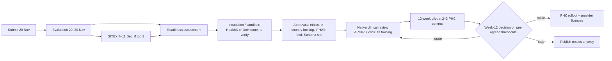

# Go-to-Market
> Project: Jisr (جسر, "bridge") · Owner: Product lead · Status: Draft v0.1 · Last updated: 2026-11-18
> Related: [Project brief](../00-overview/PROJECT_BRIEF.md) · [Business model](BUSINESS_MODEL.md) · [Financials](FINANCIALS.md) · [Impact](IMPACT.md) · [Pitch](../00-overview/PITCH.md) · [Roadmap](../01-product/ROADMAP.md)

**Labels.** `VERIFIED` = checked against a public source (link given). `UNVERIFIED` = found only in secondary sources or not checked; confirm before relying on it. `HUNCH` = our inference.

## 1. Beachhead
**The smallest viable audience:** adults screened positive for anxiety or depression at **IFHAS** at **2–3 primary-care centres** nominated by ADPHC.

Why this cohort:
- IFHAS is free for Thiqa holders aged 18–75 at 150+ facilities and added anxiety and mental-health screening in 2025 [1] (`VERIFIED`).
- The owner (ADPHC screening) already thinks in closed loops. The head of screening called results without referral "worthless" in the population-health session (transcript; speaker by role).
- Primary care is where the DoH Standard of Care puts PHQ/GAD screening [5], and 1,930 family physicians are trained in common mental health conditions [6].
- The cohort is bounded, has a single owner, and has an obvious baseline (what happens to positive screens today).

Known gap: IFHAS is Thiqa-only, so the beachhead under-represents expatriates. We therefore plan an **expat extension** (family-physician-screened adults on Basic/Enhanced plans at one site) as the first expansion, so the fairness story isn't Emirati-only.

## 2. First 10 / 100 / 10,000
| Milestone | Who | How we get them | Exit criterion |
|---|---|---|---|
| **First 10** | 10 *staff* design partners at the pilot sites: 4–6 family physicians, 2 coordinators, 1 on-call clinician, 1 programme lead | Introductions through the Future Health readiness assessment and ADPHC; 1-hour role training; weekly feedback | All 10 can run their role unaided; the clinician confirm-vs-override log shows the rules make sense to them |
| **First 100** | 100 enrolled episodes (people with a consented positive screen) | IFHAS result → in-clinic invitation by the physician/nurse + Sahatna deep link | Safety: zero missed RED escalations; hand-off rate measured; first fairness cut (where k ≥ 10) |
| **First 10,000** | Episodes across Abu Dhabi PHC and more entry points (family-physician screens, expat plans, 800-SAKINA follow-ups) | Sahatna module rollout; provider-network licences; new rule files (perinatal) | Pilot evidence published; in-country production; regulator position settled |

We give no dates for the 10,000 milestone. It depends on pilot results and approvals.

## 3. Channels (Gary Vee for attention, Hoffman for networks)
| Channel | Use | Notes |
|---|---|---|
| **Future Health pathway** | Readiness assessment → incubation → pilot (the challenge's stated path for selected solutions) [S1][S29] | Primary channel. `VERIFIED` on the challenge page; the terms of incubation are unpublished |
| **GITEX 2026 (7–11 Dec, Dubai)** | Finalist presentation; pilot conversation with ADPHC and sites | Only if top 3 |
| **Sahatna** | Citizen distribution: launch from the app the person already uses. All facilities must be on Sahatna by 30 Nov 2026 [13] | MVP stub only; v1 module needs DoH approval |
| **Clinician word of mouth** | Family physicians at pilot sites → other PHC centres | The referral network effect: each new provider on the directory makes matching better for everyone |
| **DoH innovation programmes** | **HealthX** (startAD × DoH): regulatory sandbox, de-identified data access, pilot-proposal support for startups with an Abu Dhabi use case | `UNVERIFIED` for 2026 cycles: https://www.doh.gov.ae/en/news/startad-and-doh-launch-healthx-to-advance-abu-dhabi-as-global-biotech-and-life-sciences-hub |
| **Hub71** | Access Programme / Hub71+ Life Sciences (digital health). Reported incentives up to AED 750k cash + in-kind via a SAFE; ADIO and DoH partnered with Hub71 on healthtech | `UNVERIFIED`: secondary sources; Cohort 20 deadline (2 Aug 2026) passed, watch the next one. https://www.entrepreneur.com/en-ae/growth-strategies/adio-and-abu-dhabi-department-of-health-partner-with-hub71/490235 |
| **ADIO Innovation Programme** | Financial and non-financial incentives for innovation-led companies in health services (e.g. payroll rebates, trial licences) | `UNVERIFIED`: sources date from 2020–22; check https://investinabudhabi.gov.ae/Innovation-programme |
| **Content (attention)** | Publish the crisis benchmark method and the failure log; short Arabic/English explainer videos for clinicians | Earn trust with the people who will judge the product clinically |

## 4. Partnerships
| Partner type | Who (examples) | What we need | What they get |
|---|---|---|---|
| Government | DoH (regulator, Sahatna, Malaffi); ADPHC (IFHAS, programmes) | Sites, data-feed approval, sandbox, ethics route | Statement KPIs measured; a GITEX-ready pilot story |
| Provider networks | SEHA / PureHealth; M42; private groups | Clinicians, directory and capacity data, referral acceptance | Right-level referrals, Sahatna/Malaffi-compatible workflow |
| Crisis lines | 800-SAKINA operator; 800-HOPE | A warm-transfer protocol | Context-rich, consented hand-offs |
| Payers | Daman (Thiqa administration; verify) | Network data; later, eligibility lookups | Least intensive safe care data |
| Hosting / AI | Microsoft (Azure UAE North); Core42; Inception42 / MBZUAI for Arabic models | In-country hosting and an in-country LLM option | A sovereign, governed health workload |
| Academic | A university partner (e.g. MBZUAI or a UAE medical school) | Evaluation design, Arabic/Urdu instrument review | A pragmatic real-world dataset under ethics approval |
| Community / NGOs | Expat community groups, workers' welfare programmes | Language review and outreach to under-served groups | A pathway their members can trust |

## 5. Government pilot path (replaces "state department / GeM")

Procurement after the pilot follows Abu Dhabi government procurement rules. We haven't researched the specific vehicle; `UNVERIFIED`. Owner: Product lead, to check during the readiness assessment.

## 6. Launch plan
| When | What | Owner |
|---|---|---|
| 20 Nov 2026 | Submit: live link, credentials, docs, video | Team |
| 20–30 Nov | Keep the live link up and monitored; answer organiser questions within 24 h | PM |
| 7–11 Dec (if top 3) | GITEX pitch; ask for the readiness assessment and a site introduction | Pitch lead |
| Dec 2026–Q1 2027 (target) | Readiness assessment; clinical advisor on board; native AR/UR review; in-country deployment | Team |
| After approvals (target) | 12-week pilot | Team + ADPHC |
| Pilot + 4 weeks | Publish results with the pre-registered method | Team + ADPHC |

## 7. Messaging per audience
| Audience | Message | Proof point |
|---|---|---|
| ADPHC programme lead | "Every positive screen becomes an owned, timed, measured episode. You see hand-off, time-to-care, improvement, crisis response and fairness every week." | Programme dashboard |
| Head of screening | "No result without a referral, no referral without an owner, no closure without evidence." | Episode ledger + closure rules |
| Family physician | "One screen, a pre-filled referral, and you confirm. You stay in charge." | Dr Salma's summary |
| Person (Arabic-first) | "Understand your result. Choose care in your language and network. Your employer sees nothing." | Three-tap flow; consent sheet |
| Person (Urdu, low literacy) | Short, spoken-style copy; icons; "free / covered by your plan" shown first | Urdu UI; read-aloud (if built) |
| Regulator | "Rules decide, a clinician confirms, AI only explains. In-country in v1. Published benchmark." | `EVAL.md`; RESPONSIBLE_AI |
| Payer | "The least intensive safe care, measured." | Step distribution (pilot) |
| Microsoft / Inception / MBZUAI | "A sovereign-ready, gated, benchmarked health workload." | Architecture; eval; licence table |

## Sources
Numbered sources follow [PROJECT_BRIEF.md § Sources](../00-overview/PROJECT_BRIEF.md#sources). [S1][S29] = challenge page and press release (see `biblehackathon.md`). Hub71 incentive figures: https://meatechwatch.com/2025/11/03/abu-dhabi-scales-up-startup-innovation-through-enhanced-hub71-incentive-program/ (secondary, `UNVERIFIED`).
