# Impact
> Project: Jisr (جسر, "bridge") · Owner: Product lead · Status: Draft v0.1 · Last updated: 2026-11-18
> Related: [Project brief](../00-overview/PROJECT_BRIEF.md) · [Vision](../00-overview/VISION.md) · [Metrics](../01-product/METRICS.md) · [AI evals](../04-ai/AI_EVALS.md) · [Responsible AI](../04-ai/RESPONSIBLE_AI.md) · [GTM](GTM.md) · [Business model](BUSINESS_MODEL.md)

**Honesty rule.** Hackathon numbers are **simulated on synthetic data**. They show that the measurement machinery works. They are not evidence of effect. Impact is claimed only after a pilot measures it.

## 1. Problem in one paragraph
Abu Dhabi now screens adults for anxiety and depression through IFHAS [1], and the DoH Standard of Care sets PHQ-2/GAD-2 → PHQ-9/GAD-7 in primary care [5]. In a stratified Abu Dhabi adult sample, 16.3% screened moderate-to-severe on PHQ-9 [3]. Stress is highest at ages 15–29 and worse among women and non-Emiratis [4]. Yet the C10 statement names a "continuing conversion gap between a positive screen and timely specialist follow-up". It lists the barriers (stigma, uncertainty about where to go, fragmented pathways, uneven capacity) and the harms (weak crisis handling, unvalidated advice, disclosure of sensitive data) [2]. There is no public figure for how many positive mental-health screens reach care in Abu Dhabi. That absence is part of the problem.

## 2. Theory of change

```mermaid
flowchart LR
  subgraph Inputs
    I1[IFHAS / PHQ-GAD screens]
    I2[DoH Standard of Care + NICE stepped care]
    I3[Trained family physicians + tele-MH capacity]
    I4[Crisis lines 999 / 800-SAKINA / 800-HOPE]
  end
  subgraph Activities["Jisr activities"]
    A1[Deterministic crisis gate, first]
    A2[Explain result: what it means and doesn't]
    A3[Match least intensive safe step: language, gender, network, modality, capacity]
    A4[Warm hand-off with owner + SLA]
    A5[Re-check + RCI → clinician-confirmed step change]
    A6[Programme dashboard + fairness]
  end
  subgraph Outputs
    O1[Every positive screen has an owned episode]
    O2[RED episodes reach a human within 15 min]
    O3[Referrals accepted and booked]
    O4[Re-checks completed]
  end
  subgraph Outcomes
    S1[More people reach the right care, sooner]
    S2[More reliable improvement]
    S3[Smaller gaps by nationality, language, gender, age]
    S4[Crisis responses completed]
  end
  subgraph Impact
    L1[Better mental health and wellbeing in Abu Dhabi: SDG 3.4]
  end
  Inputs --> Activities --> Outputs --> Outcomes --> Impact
```

### Assumptions in the chain (each one is testable)
| # | Assumption | Test in pilot |
|---|---|---|
| T1 | Confusion about where to go, cost and network uncertainty, and privacy fears are major causes of drop-off | Drop-off reasons captured per episode; trust survey |
| T2 | A named owner + SLA makes referrals happen faster | Time to first appointment vs site baseline |
| T3 | Providers have enough capacity to accept within SLA | Acceptance rate and wait by level |
| T4 | Least-intensive-safe matching doesn't under-treat | Step-up rate driven by RCI; adverse events |
| T5 | The deterministic gate catches crisis language real people use | Every RED and every missed case reviewed; lexicon updated |
| T6 | Language and network-aware matching narrows subgroup gaps | Subgroup north star (k ≥ 10) |

## 3. Impact metrics
Definitions and formulas are in [METRICS.md](../01-product/METRICS.md); the list below maps them to the C10 statement's named measures [2].

| C10 measure | Jisr metric | Source in system | Level |
|---|---|---|---|
| Successful hand-off | **Completed hand-off within timeframe** (north star) | Episode states `REFERRED → ACCEPTED → BOOKED → ATTENDED` | Outcome |
| Follow-up within timeframe | Re-check completion by due date | E-15/E-04 re-check events | Output |
| Waiting time | Median days `STEP_CONFIRMED → BOOKED` and `→ ATTENDED`, by level | Episode events | Outcome |
| Symptom change | % with reliable improvement (RCI) at re-check; % reliable deterioration | InstrumentScore + RCI engine | Outcome |
| Crisis-response completion | % RED episodes acknowledged within 15 min; % with a documented crisis outcome | CrisisEvent + SLA | Output / safety |
| Adverse events | Self-harm events, complaints, privacy incidents during open episodes | Incident log | Safety |
| Fairness | All of the above by nationality, language, gender and age group; cells with k < 10 suppressed | Fairness engine (F-15) | Equity |
| (Ours) Clinician burden | Minutes per hand-off; confirm-vs-override rate | Console telemetry (IDs only) | Efficiency |
| (Ours) AI safety | Unsupported claims in validated outputs; template fallback rate | ExplanationRecord (E-18) | Safety |

## 4. SDG mapping
| SDG target | How Jisr contributes | Indicator we can report |
|---|---|---|
| **3.4**: by 2030, reduce by one third premature mortality from non-communicable diseases through prevention and treatment, and **promote mental health and well-being** | Moves people with positive screens into the right care sooner; measures improvement | Hand-off within timeframe; reliable improvement (programme-level contributions only) |
| **3.4.2**: suicide mortality rate (indicator) | Deterministic crisis gate + human escalation within minutes | RED escalation completion; we **don't** claim any effect on suicide mortality |
| 3.8: universal health coverage, access to quality essential services | Network-aware routing within existing coverage (Thiqa, expatriate plans) | Share matched within network; wait by plan type |
| 10.2 / 10.3: inclusion and equal opportunity | Arabic / English / Urdu, low-literacy design, fairness reporting | Subgroup gaps (k ≥ 10) |

## 5. Measurement plan
### Hackathon (now)
- All metrics computed on a synthetic cohort (seeded, declared) and labelled **"simulated on synthetic data"** in the UI and in `EVAL.md`.
- Baseline-vs-Jisr simulation: the assumptions (drop-off probabilities per state, with and without Jisr) are listed in `data/synthetic/README`. The output demonstrates the mechanism only.
- Safety evaluation: crisis-gate recall and false-positive rate on the adversarial benchmark; validator results ([AI_EVALS](../04-ai/AI_EVALS.md)).

### Pilot (12 weeks, 2–3 PHC centres)
| Element | Plan |
|---|---|
| Design | Pragmatic before/after against each site's own historical baseline; stepped-wedge across sites if ADPHC agrees |
| Pre-registration | Analysis plan agreed with ADPHC before go-live: outcomes, windows, subgroups, thresholds for scale/iterate/stop |
| Baseline | Positive IFHAS screens at the same sites in a prior period, with whatever follow-up data is recorded (to be confirmed with ADPHC; may be partial) |
| Data | Episode ledger (in-country), with consent; aggregate, suppressed exports only |
| Cadence | Weekly KPI report to the programme lead; safety review of every RED episode within 24 h |
| Safety stop rules | Any missed RED escalation or privacy incident → pause and review |
| Fairness | Subgroup analysis by nationality, language, gender and age; small cells suppressed; gaps reported even if unflattering |
| Reporting | DECIDE-AI items for early-stage clinical evaluation; publish the results whatever they show |
| Ethics | DoH research ethics approval before any real data |

### What we won't claim
- No diagnosis and no treatment effect.
- No reduction in suicide or crisis rates.
- No cost savings without measured data.
- No improvement of any size from the simulation.

## 6. Stories (illustrative personas, not real people)
**Mariam (P-01).** Before: GAD-7 13, PHQ-9 11 at IFHAS, a printed note, six weeks of not knowing who to call or whether her employer would find out. With Jisr: she reads what her result means and doesn't mean. She picks an Arabic-speaking female clinician in her Thiqa network for a tele-session on Thursday, and she can see that nothing is shared with her employer. A coordinator owns her referral. Two weeks after her first session her re-check shows reliable improvement, and Dr Salma confirms she can stay at her current step.

**Imran (P-02).** Before: stressed and sleeping badly, unable to read a long form, worried about cost and his job. With Jisr: short Urdu screens, "covered by your plan" shown first, a phone call from the coordinator instead of a form. If his free text ever contains crisis language in Urdu, the gate fires the same way it would in Arabic. In the programme view, Urdu speakers are a subgroup the programme lead can see, provided there are at least 10 of them.

**Khalid (P-04).** A RED episode lands in his queue with a 15-minute clock. He sees the trigger (*Observed*), not an AI summary. He calls, documents the outcome, and the episode moves to the crisis pathway with a named owner.

## Sources
Numbered sources follow [PROJECT_BRIEF.md § Sources](../00-overview/PROJECT_BRIEF.md#sources). SDG target 3.4 and indicator 3.4.2: UN SDG indicator framework, https://unstats.un.org/sdgs/metadata/?Text=&Goal=3&Target=3.4
