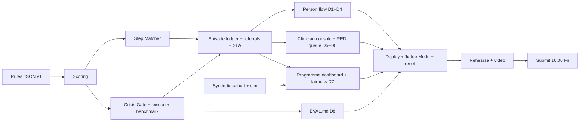

# Hackathon Plan
> Project: Jisr (جسر, "bridge") · Owner: Product lead (acts as PM) · Status: Draft v0.1 · Last updated: 2026-11-18
> Related: [Project brief](PROJECT_BRIEF.md) · [Pitch](PITCH.md) · [PRD](../01-product/PRD.md) · [Architecture](../03-engineering/ARCHITECTURE.md) · [Backlog](../08-project/BACKLOG.md) · [Team](../08-project/TEAM.md) · [AI evals](../04-ai/AI_EVALS.md) · [Deployment](../05-ops/DEPLOYMENT.md)

## 0. Clock and deadlines
| Item | Value |
|---|---|
| H0 (plan start) | **Wed 18 Nov 2026, 12:00 GST** (UTC+4). Shift every row if you start later; keep the freeze and submit times fixed |
| Hard deadline | **20 Nov 2026**. The exact hour and time zone are **unverified**: Hack2skill may use IST (GST −1:30). Check the submission page at H0 and write the time here: `____` |
| **Internal submit target** | **Fri 20 Nov, 10:00 GST**, at least 12 h before the earliest plausible cut-off (20 Nov 23:59 IST = 22:29 GST) |
| Feature freeze | Thu 19 Nov, 14:00 GST (H26) |
| Code freeze | Thu 19 Nov, 23:00 GST (H35). After this, only P0 fixes go in, each with a re-run of the smoke test |
| Resubmission | Allowed before the deadline: in the DoH Q&A session the organisers said a submitted prototype can be changed and resubmitted before 20 Nov. Use it only for P0 fixes |
| Working hours | ≈36 build hours, with two sleep blocks (5–6 h each). Nobody codes 46 hours straight; tired teams ship crisis-gate bugs |

## 1. Workstreams and roles
| Stream | Owns | Key IDs |
|---|---|---|
| **A: Engines & API** (Python) | `packages/rules`, scoring, Crisis Gate, Step Matcher, RCI, SLA/APScheduler, episode ledger, FastAPI endpoints, seed | F-03, F-05, F-07, F-08, F-10 · API-01…13, 19–22 |
| **B: Web** (TypeScript) | Next.js PWA: person app (AR/EN/UR, RTL), clinician console, coordinator queue, programme dashboard, Judge Mode, consent, discreet mode | F-01, F-04 UI, F-09, F-11, F-13, F-14, F-15 UI, F-17 |
| **C: AI, data & evals** (Python) | Gemini provider, prompts, claim validator, templates, M-02; synthetic cohort + provider directory; crisis benchmark; step cases; simulation; `EVAL.md`; fairness engine | M-01…03, F-06, F-15 engine, F-16, F-18 |
| **D: PM, deploy & story** | Scope calls, CI, Vercel/Render/Neon deploy, README, governance/assumptions docs, pitch, video, submission | F-19 stub, CI, docs, video |

### Role mapping by team size
| Team size | Person 1 | Person 2 | Person 3 | Person 4 |
|---|---|---|---|---|
| **2** | A + C (all Python: engines, AI, evals, data) | B + D (web, deploy, docs, pitch, video) | — | — |
| **3** | A (engines & API) | B (web) | C + D (AI, evals, data, docs, video); the pitch lead is whoever presents best | — |
| **4** | A | B | C | D (also second pair of hands on B after H20) |

Pitch presenter: the person with the clearest voice, decided at H0. Demo driver: B, who knows the UI.

Decision rule: the PM (D, or B+D in a 2-team) makes scope calls in under 2 minutes. When in doubt, cut (§5).

## 2. Hour-by-hour plan (GST)
Legend: ✅ checkpoint. **Bold** = critical path.

### Wed 18 Nov
| Time | H | A: Engines & API | B: Web | C: AI, data & evals | D: PM, deploy & story |
|---|---|---|---|---|---|
| 12:00–13:00 | 0–1 | Read the brief. Repo scaffold per `CLAUDE.md`; `docker compose` Postgres; FastAPI skeleton + health route | Next.js 16 scaffold, Tailwind, next-intl with `en/ar/ur`, RTL check, shadcn | Get a Gemini API key; `LLMProvider` interface stub with `none` working first | Kickoff: lock scope = brief §5 MVP. Resolve PRD OQ-03 (Mariam's step = L2 tele). Verify the deadline time zone. Create GitHub issues from the [BACKLOG](../08-project/BACKLOG.md) |
| 13:00–15:00 | 1–3 | **Rules JSON v1 (instruments, bands, step rules with citations). Scoring engine + tests** | Layout shell, role switcher, Judge Mode landing `/judge` (static) | **Crisis lexicon v1 (AR / Gulf / Arabizi / EN / UR) + first 60 benchmark cases** (write cases *before* tuning) | CI: lint → test → eval → build. Vercel + Render + Neon projects; `.env.example` |
| 15:00–17:00 | 3–5 | **Crisis Gate engine** (item 9, C-SSRS screener items, lexicon, normalisation of Arabic/Arabizi) + unit tests | Screening flow screens (PHQ-2/GAD-2 → PHQ-9/GAD-7), result screen with the 3 content-type badges | Synthetic provider directory (network, language, gender, modality, capacity, wait) + persona seed (Mariam, Imran, Dr Salma, Khalid, programme lead) | **First deploy of the skeletons (web + API) to their public URLs.** README first line (who/task/input) |
| 17:00–19:00 | 5–7 | **Episode ledger: state machine + append-only events; API-01…05** | Crisis screen (red card, tel: links, "AI locked" state), persistent "I need help now" button | Claim validator (numbers/dates/instruments/providers/phones must be in facts; banned claims) + templates AR/EN/UR | Pitch v0 from [PITCH](PITCH.md); slide skeleton |
| 19:00–21:00 | 7–9 | **Step Matcher (L0–L4, RED override, factors) + API-06, API-15** | "See my options" + factor chips + provider card + consent sheet | Gemini M-01 behind the validator, 3 s timeout → template; prompt files in `ai/prompts` | Seed script + **Reset demo data** endpoint spec with A |
| 21:00–21:30 | — | Dinner | | | |
| 21:30–22:00 | 9.5–10 | ✅ **Checkpoint 1: on the deployed URL, Mariam goes D1 → D3 (result → match → booking request) and D4 (the crisis gate fires).** If not: cut per §5 now | | | |
| 22:00–02:00 | 10–14 | **Referrals (API-07…09) + SLA scheduler + escalation; RED queue; confirm-step (API-12); recheck + RCI (API-10)** | **Clinician console: queue, red episodes, one-screen summary, Confirm step.** Coordinator queue with SLA countdown | Synthetic cohort (≈2,000 people, declared seed) + fairness engine (k < 10 suppression) + API-16/17 | Docs: governance page, assumptions & limitations, licence/provenance table (with C) |
| 02:00–07:00 | — | **Sleep.** 4-person team: A and B sleep 02:00–07:00; C and D may sleep 00:00–05:00 and take the 05:00–07:00 slot (eval runs, docs). 2–3-person team: everybody sleeps 02:00–07:00 | | | |

### Thu 19 Nov
| Time | H | A | B | C | D |
|---|---|---|---|---|---|
| 07:00–08:00 | 19–20 | Fix overnight CI failures | Pull, run locally | Eval harness `run_evals.py` writes `EVAL.md`; CI fails if recall < 100% | Stand-up at 07:45 |
| 08:00–08:30 | 20 | ✅ **Checkpoint 2: all five demo moments (brief §14) run on staging, even if ugly.** Anything not working by now gets the cut list | | | |
| 08:30–11:00 | 20–23 | FHIR import (API-19, seeded IFHAS bundle) + export (API-20); consents API-14; audit API-23 | **Programme dashboard (funnel, time-to-care, follow-up, RCI, crisis response, fairness table, "Simulated on synthetic data" banner)** | **Simulation engine (F-16): baseline vs Jisr, precomputed to `data/synthetic/sim_results.json`** | Judge Mode guided tour copy; Settings → AI narration Off toggle (with A) |
| 11:00–13:00 | 23–25 | Physical context (F-12) on the summary; demo-login JWT (API-22) | Consent centre (F-13), discreet mode (F-14), self-help modules ×3 (F-09) | M-02 raise-only (switch off if > 2 s); benchmark to full N incl. held-out split; step-matcher cases | Sahatna stub (F-19) + SMS mock inbox (F-21) if A/B are on track; else cut |
| 13:00–14:00 | 25–26 | Lunch. **14:00 FEATURE FREEZE** | | | |
| 14:00–17:00 | 26–29 | Bug bash; idempotency; error states | Playwright e2e of the 5 demo moments; Arabic RTL and mobile pass | **Final eval run → `EVAL.md`** (benchmark table, failure log, validator stats) | All docs final: README, MAP links, governance, limitations, pilot slide. Fill `[[…]]` in the pitch from `EVAL.md` and sim results **only** |
| 17:00–18:00 | 29–30 | ✅ **Checkpoint 3: template-only run.** `LLM_PROVIDER=none`, full demo passes. Local fallback stack (`docker compose`, SQLite) passes on the demo laptop | | | |
| 18:00–20:00 | 30–32 | Rehearsal 1 + fixes | Rehearsal 1 + fixes | Rehearsal 1 + fixes | **Rehearsal 1 (timed)**; record the backup video (§9) |
| 20:00–21:00 | — | Dinner | | | |
| 21:00–23:00 | 33–35 | P1 fixes only | P1 fixes only | Re-run evals after any rule change | Edit the video; draft the submission form text; credentials sheet |
| **23:00** | 35 | **CODE FREEZE.** Tag `v0.1.0`; update `CHANGELOG.md` | | | |
| 23:00–00:30 | 35–36.5 | ✅ **Checkpoint 4: clean-browser test** (incognito, phone on 4G): live link, credentials, every demo moment, the video plays, repo is public or access is shared | | | |
| 00:30–06:30 | — | Sleep | | | |

### Fri 20 Nov
| Time | A–D |
|---|---|
| 06:30–08:00 | Warm-up, smoke test on the live link, Rehearsal 2 (timed, with Q&A drill from [PITCH §5](PITCH.md#5-judge-q--a-bank)) |
| 08:00–09:30 | Fill in the submission form; upload the video; paste links and credentials; attach docs |
| **≤ 10:00** | **SUBMIT.** Screenshot the confirmation. Post the confirmation in the team chat |
| 10:00–deadline | Buffer. P0 only (a broken link, a crashed API, a wrong credential). Each P0 fix: fix → smoke test → resubmit. Rehearsal 3 for any live presentation |

## 3. Critical path

**Slack:** Gemini narration (M-01), M-02, FHIR import/export, consent centre, discreet mode, physical context, Sahatna stub and SMS mock are all *off* the critical path. They can slip or be cut without breaking the demo, because templates and seeded data cover them.

## 4. Real vs mocked
| Component | MVP status | Notes for judges (copy into README "Assumptions & limitations") |
|---|---|---|
| PHQ-2/9, GAD-2/7 scoring | **Real** | Standard scoring; rule file cites sources [8][9] |
| Crisis Gate (item 9, C-SSRS screener items, lexicon) | **Real** | Deterministic; benchmark in `EVAL.md`; lexicon written by the team, native review pending (R-04); C-SSRS terms to verify (R-05) |
| Step Matcher L0–L4 + RED | **Real** | Rules from PHQ/GAD bands + NICE CG123 + DoH standard |
| Episode ledger, SLA timers, escalation | **Real** | APScheduler; SLA durations are design assumptions |
| RCI step-up/down suggestions | **Real** | Reliability values from the literature, cited in the rule file |
| LLM explanation (M-01) | **Real** (Gemini API) | Synthetic data only; validator + template fallback; v1 moves in-country |
| LLM raise-only crisis signal (M-02) | Real if < 2 s, else off | Can add RED, never remove it |
| Provider directory | **Mocked** (synthetic) | Network/language/gender/modality/capacity tags are invented |
| IFHAS result | **Mocked** (seeded FHIR bundle) | Real feed needs DoH approval |
| Bookings and provider acceptance | **Simulated** | Judge Mode "Provider accepts" button stands in for the receiving clinic |
| Notifications | In-app real; SMS **mock** inbox; WhatsApp not built | — |
| Sahatna launch | **Stub** (deep link) | No Sahatna API used |
| Malaffi HL7 v2 REF | **Design only** | No Malaffi integration; no Malaffi FHIR API claimed |
| Programme metrics and fairness | **Real computation on synthetic data** | Every chart says "simulated on synthetic data" |
| Baseline vs Jisr conversion | **Simulated** | Mechanism demo, not an effect estimate |
| Auth | Judge Mode demo login (signed JWT) | UAE PASS / facility SSO in v1 |
| Hosting | Vercel + Render + Neon | v1: Azure UAE North or Core42 |

## 5. Cut list (cut in this order; stop when back on schedule)
| Order | Cut | Fallback that keeps the demo whole |
|---|---|---|
| 1 | F-20 read-aloud | Mention as v1 |
| 2 | F-19 Sahatna stub | Rails slide S7 only |
| 3 | F-21 SMS mock inbox | In-app notifications only |
| 4 | M-02 LLM raise-only signal | Deterministic gate only (it already carries the demo) |
| 5 | F-01 Urdu **UI** strings | Keep the Urdu crisis lexicon and Urdu benchmark cases; UI in AR/EN |
| 6 | F-02/API-19/20 FHIR import/export | Seed Mariam's result directly; show a sample FHIR JSON file in the repo |
| 7 | F-09 self-help modules (3 → 1) | One "sleep routine" module + scheduled re-check |
| 8 | F-12 physical context | Static card from seed data on Dr Salma's summary |
| 9 | F-14 discreet mode | Quick-exit button only |
| 10 | F-13 consent centre granularity | Two toggles: "share with my clinician" and "share physical findings" |
| 11 | F-16 live simulation | Precomputed `sim_results.json` only (already the demo path) |
| 12 | M-01 Gemini narration | Templates only (`LLM_PROVIDER=none`); pitch it as "runs with no AI" |
| **Never cut** | F-03 Crisis Gate · F-05 Step Matcher · F-07/F-08 hand-off + ledger + SLA · F-11 clinician console + RED queue · F-15 dashboard with fairness suppression · F-17 Judge Mode · F-18 `EVAL.md` · live link + credentials · backup video | These *are* the submission |

Last-resort fallback (from `misc/ideas.md`): if by Checkpoint 2 the person app is broken, ship **Sakina Loop**: console + ledger + dashboard + crisis gate API demo, and drive Mariam's journey from the coordinator side.

## 6. Submission checklist
### 6.1 Deliverables (brief §13)
- [ ] Live link (web) + API URL, both warmed and tested from a clean browser on 4G
- [ ] Judge Mode credentials (per role) in the submission form **and** on README line 3
- [ ] Repo access (public, or shared as the form requires); `v0.1.0` tag
- [ ] Technical docs: README, MAP, ARCHITECTURE, API_SPEC + `packages/contracts/openapi.yaml`, AI_EVALS + `EVAL.md`, RESPONSIBLE_AI, PRIVACY, COMPLIANCE, MEDICAL_DEVICE
- [ ] **Assumptions, dependencies, limitations** section in the README (copy §4 of this plan + risks R-01…R-12)
- [ ] Data declaration: synthetic only, every source and licence listed (organisers provide no data)
- [ ] "Built during the challenge" statement (no prior product)
- [ ] Demo video ≤ 3 min, uploaded, link works logged-out
- [ ] Pilot slide / deck PDF
- [ ] Confirmation screenshot saved

### 6.2 Mapped to every judging criterion
| Criterion | What proves it | Where | Owner | ✔ |
|---|---|---|---|---|
| Health impact & clinical relevance | Statement KPIs computed live (hand-off, time-to-care, follow-up, RCI, crisis response, fairness); DoH standard + NICE CG123 cited in the rules; Mariam's journey | Dashboard D7; `packages/rules`; [IMPACT](../07-business/IMPACT.md) | C, D | [ ] |
| Technical depth & architecture | Deterministic engines + state machine + append-only events; FHIR R4 shapes; LLM behind an interface + validator; CI with eval gate | [ARCHITECTURE](../03-engineering/ARCHITECTURE.md); repo; CI badge | A | [ ] |
| Working solution & demo quality | Live link + Judge Mode + guided tour; five demo moments pass in Playwright; template-only mode works; backup video | Live URL; `tests/e2e`; video | B | [ ] |
| Responsible AI, safety & data governance | Crisis Gate first + `EVAL.md` (recall, FPR, failure log); raise-only LLM; validator; Observed/Calculated/AI-drafted labels; consent; no employer role; k < 10 suppression; licence/provenance table; residency note | `EVAL.md`; [RESPONSIBLE_AI](../04-ai/RESPONSIBLE_AI.md); [PRIVACY](../06-security-compliance/PRIVACY.md) | C | [ ] |
| Scalability & deployment readiness | Containerised; in-country v1 path (Azure UAE North / Core42); Sahatna/Malaffi adapter designs; rule files per jurisdiction | [DEPLOYMENT](../05-ops/DEPLOYMENT.md); [INTEGRATIONS](../03-engineering/INTEGRATIONS.md) | A, D | [ ] |
| Commercial viability & path to pilot | Buyer, pricing hypothesis in AED, pilot ask (cohort, sites, 12 weeks, KPIs, what DoH provides) | [BUSINESS_MODEL](../07-business/BUSINESS_MODEL.md); [GTM](../07-business/GTM.md); PITCH S9 | D | [ ] |

### 6.3 Mapped to the C10 "Your solution should" bullets
> Verbatim C10 bullets are saved in `../../misc/research/00-source/statement-C10.md` (captured from the live page on 18 Nov). Rows 1–6 below match bullets 1–6 one-to-one: **(1) Validated early identification · (2) Stepped, local support navigation · (3) Human-led high-risk escalation · (4) Privacy, consent, and autonomy · (5) Coordinated physical and mental care · (6) Outcome and safety monitoring.**

| C10 bullet | Jisr evidence | Demo beat | ✔ |
|---|---|---|---|
| 1. Validated self-assessment (with clear screening ≠ diagnosis) | PHQ-2/9, GAD-2/7 per the DoH standard; "what this means / what it doesn't" card | D1 | [ ] |
| 2. Stepped, local navigation (barriers: stigma, where to go, fragmented pathways, capacity) | Step Matcher L0–L4 with factor chips: network, language, clinician gender, modality, capacity, wait | D2–D3 | [ ] |
| 3. Human-led crisis escalation | Deterministic gate → 999 / 800-SAKINA / 800-HOPE → RED episode → on-call human, 15-min SLA; LLM locked out | D4–D5 | [ ] |
| 4. Privacy (no covert monitoring, safe disclosure) | Opt-in only; granular revocable consent; no employer/insurer role; discreet mode; audit log | D3 consent sheet; consent centre | [ ] |
| 5. Coordinated physical + mental care | Dr Salma's one-screen summary with IFHAS physical context (consented) | D6 | [ ] |
| 6. Demonstrable outcomes (hand-off, follow-up within timeframe, waiting time, symptom change, crisis-response completion, adverse events, fairness) | Programme dashboard + simulation + fairness table with suppression + `EVAL.md` | D7–D8 | [ ] |
| Named digital harms: weak crisis handling, unvalidated advice, sensitive-data disclosure | Gate benchmark; claim validator + templates; consent + residency plan | D4, D8 | [ ] |

### 6.4 Universal winning layer (from `misc/ideas.md`)
- [ ] README line 1: "We help … complete … using …" + the one-sentence test
- [ ] `EVAL.md`: N cases, expected vs actual, error source, easy/adversarial/missing/contradictory, failure log
- [ ] Observed / Calculated / AI-drafted badges visible in the UI
- [ ] Rails slide + Sahatna stub + Malaffi HL7 v2 design; no false integration claims
- [ ] Governance page: DoH RAI Standard, Federal Law 2/2019 Art. 13, synthetic only, licence table, DECIDE-AI/TRIPOD+AI mapping, intended use + SaMD assumption
- [ ] Fairness with k < 10 suppression on every population view
- [ ] Judge Mode + credentials + backup video
- [ ] Path-to-pilot slide
- [ ] Session speakers referred to by role only (grep the repo for speaker names before submitting)

## 7. Definition of "demo-ready" (exit criteria for Checkpoint 4)
1. All five brief §14 moments pass on the live URL from a clean browser in ≤ 3 min.
2. Same with `LLM_PROVIDER=none`.
3. Same on the local fallback stack with Wi-Fi off.
4. `EVAL.md` regenerated from the tagged commit; CI green.
5. Every simulated number on screen carries "simulated on synthetic data".
6. No `[[…]]` placeholder is left in the deck or the README.

## 8. Rehearsal schedule
| # | When (GST) | Format | Pass criteria |
|---|---|---|---|
| R0 | Thu 12:00 (lunch, 10 min) | Read-through of the script against the half-built app | Script matches the real UI labels; adjust either |
| R1 | Thu 18:00 | Full 3-min pitch, timed, live demo, then 5 min of random Q&A from [PITCH §5](PITCH.md#5-judge-q--a-bank) | ≤ 3:00; all demo beats; no number outside `EVAL.md`/sim |
| R1b | Thu 19:00 | **Failure drill:** pull Wi-Fi mid-demo; set AI narration Off; kill the API | Recovery in ≤ 20 s each; presenter never stops talking |
| R2 | Fri 06:30 | Full pitch + 10 min Q&A, each teammate taking two judge roles | Crisp first-sentence answers; nobody improvises numbers |
| R3 | Fri after submit, and before any live presentation (GITEX finalists: 7–11 Dec) | Full run on the presentation device and network | Same as R1 |

## 9. Video recording plan (≤ 3:00)
- **Tools:** OBS (or the OS screen recorder) at 1920×1080, 30 fps; external mic; record the live URL, not localhost. Voice-over can be recorded separately and laid over.
- **Rule:** the video must be the **same build** as the live link and show nothing the live link can't do. It's the backup, not the pitch ("never demo a video", Microsoft Innovation Hub session), but the submission requires one.

| Time | Shot | Voice-over gist |
|---|---|---|
| 0:00–0:15 | Title card → Mariam card | Mariam's pain (short version) |
| 0:15–0:25 | Funnel slide | The silent drop-off; the statement's conversion gap |
| 0:25–0:35 | Pipeline slide | Rules decide, a clinician confirms, AI only explains; gate first |
| 0:35–1:05 | D1–D3 live recording | Same Mariam: explanation, match, three taps |
| 1:05–1:35 | D4–D5 | Indirect Arabic phrase → gate < 1 s → AI locked → RED in Khalid's queue, 15-min clock |
| 1:35–1:55 | D6 | Dr Salma's one screen; three content-type badges; confirm |
| 1:55–2:20 | D7 + `EVAL.md` | Dashboard ("simulated on synthetic data"), fairness with suppression, benchmark table |
| 2:20–2:35 | Toggle AI narration Off, re-run D1 | "Jisr works with no AI at all" |
| 2:35–2:50 | One more thing | Perinatal + memory-screen loops on the same engine |
| 2:50–3:00 | Pilot ask + link + credentials | The ask |

- **Record:** Thu 18:30–19:30, after R1. **Edit:** Thu 21:00–22:30. **Check:** ≤ 3:00, captions on (EN; AR if time), no real names or data, audio level, link works logged-out.

## 10. The 12-hour buffer
- Submit at **Fri 10:00 GST**. Treat the form as the riskiest step: uploads fail, forms time out, links need permissions.
- At Thu 22:00, do a **dry run of the form** up to the final button (no submit), so every field and file is known.
- Keep a `SUBMISSION.md` in the repo root (not a doc for judges) with the final text of every form field, the links and the credentials, so a resubmission takes minutes.
- After submitting: one person keeps an eye on the live link every 2 h until the deadline (Render sleep, Neon limits, Gemini quota). Any outage → fix → smoke test → resubmit if the submission changed.

## 11. Communication
- One team chat channel for blockers, with a `#blocker` tag answered within 10 min.
- Stand-ups at the checkpoints only (5 min each).
- Every merge to `main` deploys; never push to `main` after code freeze without the PM saying "go".
