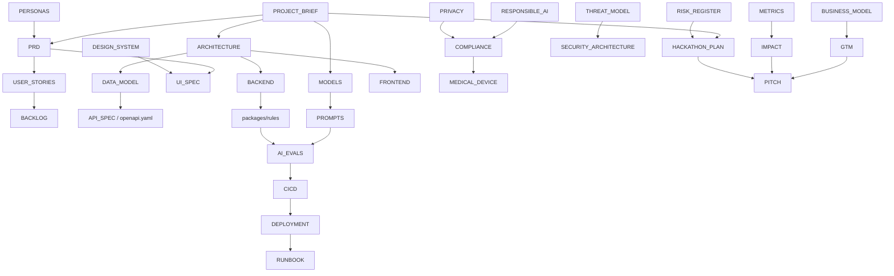

# MAP — Find anything in Jisr
> Project: Jisr · Owner: Product lead · Status: Draft v0.1 · Last updated: 2026-11-18
> Start here, then read [PROJECT_BRIEF](00-overview/PROJECT_BRIEF.md) (the single source of truth).

## Directory tree
```
Jisr/ (repo root)
├── README.md                 Front door: one-liner, quick start, docs index
├── CLAUDE.md                 Rules + commands for AI coding agents
├── AGENTS.md                 Pointer to CLAUDE.md for other agents
├── CHANGELOG.md              Keep a Changelog
├── Makefile                  Thin aliases for common dev, test, lint, and eval commands
├── .editorconfig             Formatting defaults (UTF-8, LF, indentation)
├── .gitattributes            Line-ending and binary rules
├── .env.example              Every env var, grouped, with comments + feature flags
├── EVAL.md                   (generated by ai/evals/run_evals.py — latest benchmark numbers)
├── .github/
│   ├── CODEOWNERS
│   ├── CODE_OF_CONDUCT.md    Contributor Covenant (short)
│   ├── CONTRIBUTING.md       Branches, commits, PR template, definition of done
│   ├── PULL_REQUEST_TEMPLATE.md
│   ├── SECURITY.md           Vulnerability reporting; crisis-gate defects = Sev 1
│   ├── ISSUE_TEMPLATE/       Bug report and feature request forms
│   └── workflows/
│       ├── ci.yml            Web lint/type/test/build · API ruff/mypy/pytest · rule-file checks
│       ├── evals.yml         Crisis benchmark (fails if recall < 100%) · engine + LLM suites
│       ├── deploy.yml        CI + evals → Render (API) → Vercel (web) → smoke test
│       ├── codeql.yml        Static analysis (JS/TS, Python, Actions)
│       └── dependency-review.yml Blocks high/critical CVEs and GPL/AGPL deps
├── apps/web/                 Next.js 16 PWA: person app, staff console, programme dashboard, Judge Mode
├── services/api/             FastAPI: engines, routes, LLM provider + validator, jobs
├── packages/
│   ├── contracts/openapi.yaml OpenAPI 3.1 for API-01…API-29
│   └── rules/                Versioned clinical rules (JSON) — the only place thresholds live
│       ├── instruments.v1.json   PHQ-2/9, GAD-2/7 items, scoring, bands, LOINC
│       ├── crisis_lexicon.v1.json AR/EN/Arabizi/UR crisis phrases + false-positive guards
│       ├── step_rules.v1.json    Crisis-gate rules, episode opening, L0–L4/RED, modifiers, RCI, matching
│       └── sla.v1.json           SLA defaults (env-overridable)
├── ai/
│   ├── prompts/              Versioned prompt files
│   └── evals/README.md       How to run and extend the evals
├── data/synthetic/           Synthetic cohort, FHIR bundles, provider directory
├── deploy/                   Production compose, dev compose (compose.dev.yml), nginx, deploy.sh
└── docs/
    ├── README.md             Docs index
    ├── MAP.md                This file
    ├── 00-overview/          PROJECT_BRIEF · VISION · PITCH · HACKATHON_PLAN
    ├── 01-product/           PRD · PERSONAS · USER_JOURNEYS · USER_STORIES · FEATURES · ROADMAP · METRICS · COMPETITIVE_ANALYSIS
    ├── 02-design/            DESIGN_SYSTEM · UI_SPEC · ACCESSIBILITY · LOCALIZATION
    ├── 03-engineering/       ARCHITECTURE · TECH_STACK · DATA_MODEL · API_SPEC · INTEGRATIONS · FRONTEND · BACKEND ·
    │                         CODING_STANDARDS · GIT_WORKFLOW · TESTING · PERFORMANCE · ENVIRONMENT_SETUP · MOBILE · adr/ADR-0000…0006
    ├── 04-ai/                MODELS · PROMPTS · AI_EVALS · DATA_PIPELINE · RESPONSIBLE_AI
    ├── 05-ops/               CICD · INFRASTRUCTURE · DEPLOYMENT · OBSERVABILITY · RUNBOOK · COST
    ├── 06-security-compliance/ SECURITY_ARCHITECTURE · THREAT_MODEL · PRIVACY · COMPLIANCE · RISK_REGISTER · MEDICAL_DEVICE
    ├── 07-business/          BUSINESS_MODEL · GTM · FINANCIALS · IMPACT
    ├── 08-project/           BACKLOG · TEAM · GLOSSARY
    ├── assets/               Demo GIF, screenshots (placeholder)
    └── research/             Hackathon background, not part of the build: research, war-room debates, hackathon bible, idea shortlist
```

## Where do I find…?
| Question | Doc |
|---|---|
| What are we building, and with what IDs? | [PROJECT_BRIEF](00-overview/PROJECT_BRIEF.md) |
| What do we do in the next 36 hours, hour by hour? | [HACKATHON_PLAN](00-overview/HACKATHON_PLAN.md) |
| What do I say on stage, and how do I click through the demo? | [PITCH](00-overview/PITCH.md) |
| Which tickets are mine? | [BACKLOG](08-project/BACKLOG.md) · [TEAM](08-project/TEAM.md) |
| Exact requirements + acceptance criteria per feature | [PRD](01-product/PRD.md) · [USER_STORIES](01-product/USER_STORIES.md) |
| Who are the users (Mariam, Imran, Dr Salma, Khalid)? | [PERSONAS](01-product/PERSONAS.md) · [USER_JOURNEYS](01-product/USER_JOURNEYS.md) |
| What does each screen look like, and what does it say? | [UI_SPEC](02-design/UI_SPEC.md) · [DESIGN_SYSTEM](02-design/DESIGN_SYSTEM.md) |
| Arabic / Urdu / RTL handling | [LOCALIZATION](02-design/LOCALIZATION.md) |
| How the system fits together | [ARCHITECTURE](03-engineering/ARCHITECTURE.md) |
| Tables and fields | [DATA_MODEL](03-engineering/DATA_MODEL.md) |
| Endpoints and JSON | [API_SPEC](03-engineering/API_SPEC.md) · [openapi.yaml](../packages/contracts/openapi.yaml) |
| Crisis Gate, step matcher, RCI, SLA engines | [BACKEND](03-engineering/BACKEND.md) · [step_rules.v1.json](../packages/rules/step_rules.v1.json) |
| How to set up my machine | [ENVIRONMENT_SETUP](03-engineering/ENVIRONMENT_SETUP.md) |
| Prompts and the claim validator | [PROMPTS](04-ai/PROMPTS.md) |
| How we prove safety (benchmarks, thresholds) | [AI_EVALS](04-ai/AI_EVALS.md) · [`EVAL.md`](../EVAL.md) |
| Where synthetic data comes from, and licences | [DATA_PIPELINE](04-ai/DATA_PIPELINE.md) |
| Fairness, human oversight, DoH RAI alignment | [RESPONSIBLE_AI](04-ai/RESPONSIBLE_AI.md) |
| How to deploy the live demo | [DEPLOYMENT](05-ops/DEPLOYMENT.md) · [CICD](05-ops/CICD.md) |
| What to do if the demo breaks | [RUNBOOK](05-ops/RUNBOOK.md) |
| What it costs (AED) | [COST](05-ops/COST.md) |
| Laws, consent text, threat model, SaMD position | [COMPLIANCE](06-security-compliance/COMPLIANCE.md) · [PRIVACY](06-security-compliance/PRIVACY.md) · [THREAT_MODEL](06-security-compliance/THREAT_MODEL.md) · [MEDICAL_DEVICE](06-security-compliance/MEDICAL_DEVICE.md) |
| Risks and mitigations | [RISK_REGISTER](06-security-compliance/RISK_REGISTER.md) |
| Who pays, pilot path, impact | [BUSINESS_MODEL](07-business/BUSINESS_MODEL.md) · [GTM](07-business/GTM.md) · [IMPACT](07-business/IMPACT.md) |
| Why we chose X over Y | [adr/](03-engineering/adr/) |
| What does IFHAS / Thiqa / RCI mean? | [GLOSSARY](08-project/GLOSSARY.md) |
| The original challenge text | [research/research/00-source/statement-C10.md](research/research/00-source/statement-C10.md) |

## Doc dependency graph


## Reading orders
| Reader | Order |
|---|---|
| **New developer** | README → PROJECT_BRIEF → ARCHITECTURE → BACKEND or FRONTEND → DATA_MODEL → API_SPEC → ENVIRONMENT_SETUP → BACKLOG (your tickets) → TESTING |
| **Judge / evaluator** | README → PITCH (30-second explainer) → `EVAL.md` → RESPONSIBLE_AI → ARCHITECTURE → PRIVACY → MEDICAL_DEVICE → GTM (pilot ask) |
| **Designer** | PROJECT_BRIEF §3, §14 → PERSONAS → USER_JOURNEYS → DESIGN_SYSTEM → UI_SPEC → ACCESSIBILITY → LOCALIZATION |
| **AI coding agent** | CLAUDE.md → PROJECT_BRIEF → ARCHITECTURE → BACKEND / FRONTEND → `packages/rules/*.json` → API_SPEC + openapi.yaml → PROMPTS → AI_EVALS → BACKLOG |
| **Pitch lead** | PITCH → HACKATHON_PLAN §6 (submission checklist) → COMPETITIVE_ANALYSIS → IMPACT → GTM → FINANCIALS |
